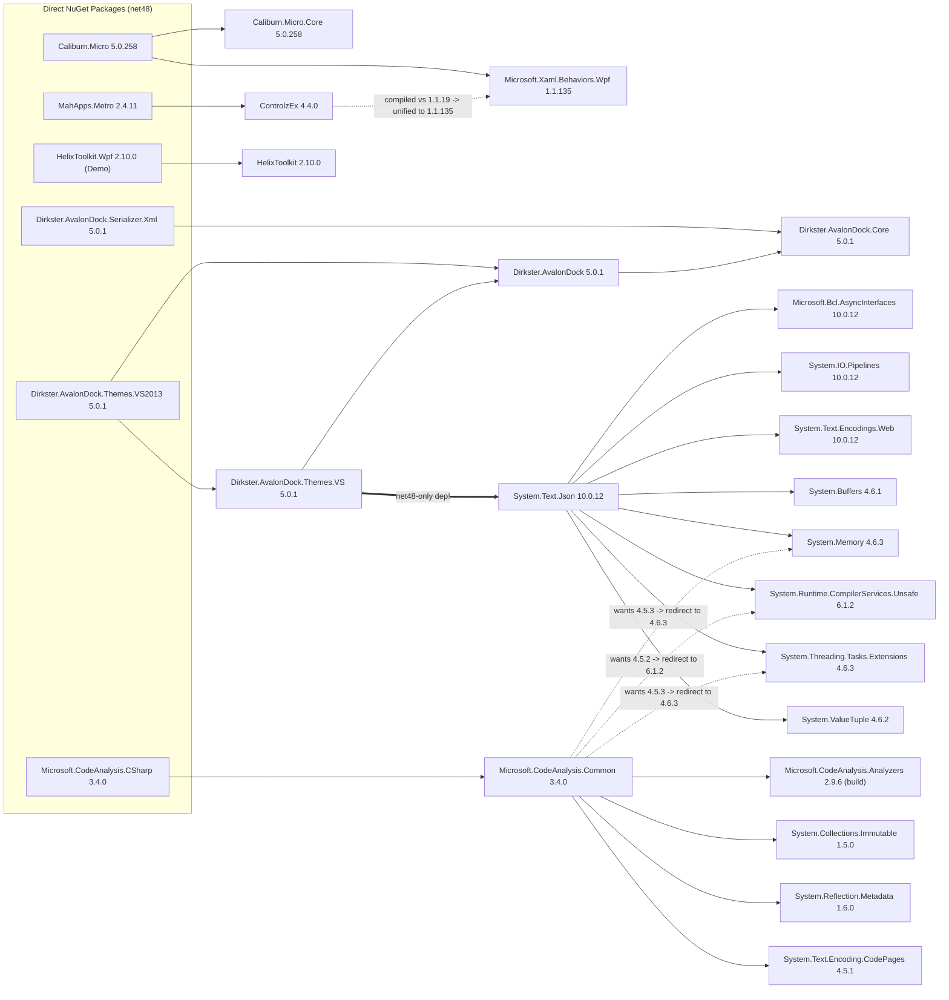

# Dependency Risk Management Analysis (DRMA) — `SomaFrameQD`

> **Generated Timestamp:** `2026-11-22T18:47:30-05:00` (`2026-11-22`)  
> **Target Conversion Profile:** `.NET Framework 4.8` (`net48`) exclusively, compatible with **Windows 7 SP1 64-bit (`x64`) and higher**  
> **Companion Documents:** [`TODO.md`](./TODO.md) | [`AGENTS.md`](./AGENTS.md) | [`REPO_MAP.md`](./REPO_MAP.md) | [`eng/package-contract.json`](./eng/package-contract.json) | [`doc_before-net48/09_Build_Versioning_Packaging_and_CI_Before_NET48.md`](./doc_before-net48/09_Build_Versioning_Packaging_and_CI_Before_NET48.md)

---

## 1. Executive Verdict: Should You Be Concerned About the Dependencies?

**Short Answer:** **You should NOT be alarmed—none of `SomaFrameQD`'s core UI or MVVM packages require replacement—but you SHOULD actively manage four concrete `.NET Framework 4.8` / Windows 7 SP1 dependency traps during Stage 1 and Stage 2.**

Every major third-party framework used by `SomaFrameQD` (`Caliburn.Micro` `5.0.258`, `Dirkster.AvalonDock` `5.0.1`, `MahApps.Metro` `2.4.11`, `AvalonEdit` `6.3.1.120`, `DotNetProjects.Extended.Wpf.Toolkit` `5.0.129`, `HelixToolkit.Wpf` `2.10.0`, and `Microsoft.CodeAnalysis.CSharp` `3.4.0`) **already ships a dedicated `.NET Framework` (`net40`–`net48`) or `.NET Standard 2.0` binary** and already passes the 146-test characterization suite on `net48`. There are **zero `.NET Core`-only runtime blockers** forcing an architectural rewrite.

However, a forensic inspection of upstream `.nuspec` manifests and `.nupkg` archives reveals **four real engineering risks** that stay hidden while `.NET 10` is present or while testing only on Windows 10/11:

1. **🔴 HIGH RISK (Manage in Stage 1 & Stage 2 `Plan 2.1`): Hidden `System.Text.Json 10.0.12` Transitive Chain & Strong-Name Version Collisions on `net48`**
   - `Dirkster.AvalonDock.Themes.VS` `5.0.1` declares a `.NETFramework4.8`-specific dependency on **`System.Text.Json` `10.0.12`**, which pulls **8 additional out-of-band (OOB) BCL NuGet assemblies** (`System.Memory` `4.6.3`, `System.Runtime.CompilerServices.Unsafe` `6.1.2`, `System.Threading.Tasks.Extensions` `4.6.3`, `System.Buffers` `4.6.1`, `System.IO.Pipelines` `10.0.12`, `System.Text.Encodings.Web` `10.0.12`, `Microsoft.Bcl.AsyncInterfaces` `10.0.12`, `System.ValueTuple` `4.6.2`) into `net48` builds.
   - Meanwhile, `SomaFrameQD.Modules.CodeCompiler` (`Microsoft.CodeAnalysis.CSharp` `3.4.0`) was compiled against older strong-named versions (`System.Memory` `4.5.3`, `Unsafe` `4.5.2`, `Tasks.Extensions` `4.5.3`), and `ControlzEx` `4.4.0` compiled against `Microsoft.Xaml.Behaviors.Wpf` `1.1.19` (vs. `Caliburn.Micro`'s `1.1.135`).
   - Unlike `.NET 10`, **`.NET Framework 4.8`'s Fusion loader throws `FileLoadException` at runtime** unless `.exe.config` `<bindingRedirect>` entries are generated—and dynamic MEF `DirectoryCatalog` plugin loading can bypass MSBuild's compile-time redirect generator if a host `Exe` does not directly reference the plugin!
2. **🟠 MEDIUM-HIGH RISK (Manage in Stage 1 `1.2`–`1.3`): Build SDK vs. `MSTest.Sdk 4.1.0` Runner Coupling**
   - `global.json` currently pins `.NET SDK 10.0.400` and `"runner": "Microsoft.Testing.Platform"`, which enables `dotnet test --project ...`. Downgrading the *build SDK* below `.NET SDK 10` breaks `dotnet test --project` CLI flags even though `<TargetFramework>net48</TargetFramework>` compiled by `.NET SDK 10` produces pure CLR 4.0/4.8 IL binaries with **zero** `.NET 10` runtime dependency on target Windows 7 machines.
3. **🟡 MEDIUM RISK (Manage in Stage 2 `Plan 2.1`): `.NET Core` Out-of-Band Compatibility Packages (`System.Drawing.Common 6.0.0` & `System.ComponentModel.Composition 6.0.0`)**
   - On `net48`, `System.Drawing.Common` `6.0.0` copies a separate OOB `lib/net461/System.Drawing.Common.dll` into `bin/` instead of using the Windows Update–serviced, pre-NGen'd `.NET Framework 4.8` GAC `System.Drawing.dll`. `System.ComponentModel.Composition` `6.0.0` resolves to `lib/net461/_._` (GAC), but still pollutes `SomaFrameQDWpf.nuspec` with an unnecessary NuGet dependency.
4. **🟡 MEDIUM RISK (Manage in Stage 2 `Plans 2.2`, `2.4`, `2.5`): Windows 7 SP1 `x64` OS, DPI, Non-DWM & AppDomain Limits**
   - Windows 7 SP1 lacks Win8.1/Win10 Per-Monitor DPI APIs (`shcore.dll`, `GetDpiForWindow`), supports non-DWM Classic/Basic themes (`MahApps.Metro` / `ControlzEx` `WindowChrome` fallback), loads `System.Windows.Forms.dll` transitively when `AvalonEdit` initializes, cannot unload Roslyn `Assembly.Load(byte[])` assemblies in `.NET Framework 4.8`, and requires OS updates **KB4019990**, **KB4474419**, and **KB4490628** to install/run `.NET Framework 4.8`.

---

## 2. Complete Enumeration of All `SomaFrameQD` Dependencies

### 2.1 Layer A — Direct External NuGet Dependencies (Packable Library Family, `0.9.0`)

These are the exact external packages declared across `src/SomaFrameQD` (`SomaFrameQDWpf`) and the 7 `src/SomaFrameQD.Modules.*` libraries ([`eng/package-contract.json`](./eng/package-contract.json)):

| Direct NuGet Package | Pinned Version | Consuming Project(s) | Resolved `net48` Asset in `.nupkg` | Pre-Conversion `net10.0-windows` Asset | Architectural Role |
| :--- | :--- | :--- | :--- | :--- | :--- |
| `Caliburn.Micro` | `5.0.258` | `SomaFrameQD` | `lib/net462/Caliburn.Micro.Platform.dll` *(+ `Core`)* | `lib/net9.0-windows7.0/...` *(via fallback)* | MVVM `BootstrapperBase`, async `Screen`/`Conductor`, `IoC`, `IWindowManager`, `IResult` coroutines. |
| `Dirkster.AvalonDock.Serializer.Xml` | `5.0.1` | `SomaFrameQD` | `lib/netstandard2.0/AvalonDock.Serializer.Xml.dll` | `lib/netstandard2.0/...` | `XmlLayoutSerializer` for `ApplicationState.bin` docking persistence. |
| `Dirkster.AvalonDock.Themes.VS2013` | `5.0.1` | `SomaFrameQD` | `lib/net48/AvalonDock.Themes.VS2013.dll` | `lib/net10.0-windows7.0/...` | VS2013 Light, Blue, and Dark docking theme dictionaries (pulls in `AvalonDock` + `Themes.VS`). |
| `DotNetProjects.Extended.Wpf.Toolkit` | `5.0.129` | `SomaFrameQD` *(used transitively by `PropertyGrid` & `Inspector`)* | `lib/net40/DotNetProjects.Wpf.Extended.Toolkit.dll` | `lib/net8.0-windows7.0/...` | `PropertyGrid`, `ColorCanvas`, `ColorPicker`, `CollectionControl`, numeric editors (`PublicKeyToken=3e4669d2f30244f4`). |
| `MahApps.Metro` | `2.4.11` | `SomaFrameQD` *(+ `MahApps.Net10DragHost`)* | `lib/net47/MahApps.Metro.dll` | `lib/netcoreapp3.1/...` | Borderless `MetroWindow` shell chrome (`MainWindowView`) and window command buttons. |
| `System.ComponentModel.Composition` | `6.0.0` | `SomaFrameQD` | `lib/net461/_._` *(defers to `net48` GAC `4.0.0.0`)* | `lib/net6.0/System.ComponentModel.Composition.dll` | MEF v1 `[Export]`, `[Import]`, `CompositionContainer`, `DirectoryCatalog` *(needed as NuGet only while multi-targeting `.NET Core/.NET 10`)*. |
| `AvalonEdit` | `6.3.1.120` | `SomaFrameQD.Modules.CodeEditor` | `lib/net462/ICSharpCode.AvalonEdit.dll` | `lib/net8.0-windows7.0/...` | Syntax-highlighted text editor, `.xshd` highlighting engine, `SearchPanel`. |
| `Microsoft.CodeAnalysis.CSharp` | `3.4.0` | `SomaFrameQD.Modules.CodeCompiler` | `lib/netstandard2.0/Microsoft.CodeAnalysis.CSharp.dll` | `lib/netstandard2.0/...` | In-memory Roslyn C# syntax parsing and IL compilation (`CSharpCompilation`). |
| `System.Drawing.Common` | `6.0.0` | `SomaFrameQD.Modules.Inspector` *(conditional `< net10.0`)* | `lib/net461/System.Drawing.Common.dll` *(OOB DLL)* | *(built into `net10.0-windows` WindowsDesktop pack)* | `Bitmap` and `Graphics.CopyFromScreen` in `ScreenShotUtility` (`ScreenColorPicker`). |

*(Note: `ErrorList`, `GraphEditor`, `Output`, and `PropertyGrid` declare **zero** direct external NuGet packages beyond `SomaFrameQDWpf`.)*

---

### 2.2 Layer B — Demo, Build-Time, Versioning & Test Toolchain Dependencies

| Dependency / SDK | Version | Scope / Project | Shipped to End-User `net48` Runtime? | Purpose & Behavior on `net48` |
| :--- | :--- | :--- | :---: | :--- |
| `HelixToolkit.Wpf` | `2.10.0` | `SomaFrameQD.Demo` (`net48` condition) | Demo only (`lib/net45`) | Managed WPF 3D viewport (`HelixViewport3D` over WPF MILCore D3D9; pulls `HelixToolkit` `2.10.0`). |
| `HelixToolkit.Core.Wpf` | `2.10.0` | `SomaFrameQD.Demo` (`!= net48` condition) | **Removed in Stage 1** | `.NET Core 3.0+` counterpart of `HelixToolkit.Wpf`; deleted when `net10.0-windows` is dropped. |
| `JeremyAnsel.HLSL.Targets` | `1.0.9` | `SomaFrameQD.Demo` | **No (Build-only)** | MSBuild task (`tools/net472` & `netstandard2.0` + `JeremyAnsel.DirectX.D3DCompiler.dll`) compiling `*.fx` into `ps_2_0` `.ps` bytecode at build time. |
| `Nerdbank.GitVersioning` | `3.5.109` | `src/Directory.Build.props` *(+ `Update` in `Demo.csproj`)* | **No (`PrivateAssets="all"`)** | Computes assembly/NuGet versions from Git commit height + `version.json` (`0.9.0` libs, `0.1.0` Demo). |
| `MSTest.Sdk` | `4.1.0` | `global.json` / `SomaFrameQD.Tests` | **No (Test-only)** | Compiles `SomaFrameQD.Tests` as a self-contained `Microsoft.Testing.Platform` runner executable on `net48`. |
| `.NET SDK` | `10.0.400` | `global.json` / `.github/workflows/ci.yml` | **No (Compiler/CLI)** | Builds, tests, and packs the solution. Targets `net48` reference assemblies (`Microsoft.NETFramework.ReferenceAssemblies`) cleanly. |

---

### 2.3 Layer C — Full Transitive NuGet Dependency Graph on `.NET Framework 4.8`

Inspecting the `.nuspec` dependency groups for `.NETFramework4.8` / `.NETFramework4.7` / `.NETFramework4.6.2` / `.NETStandard2.0` reveals **22 transitive NuGet packages** pulled in underneath the direct dependencies above:

#### Transitive Version Skew Hotspots on `.NET Framework 4.8`

| Transitive Package | Lower Requested Version (Requester) | Higher Unified Version (Requester) | `.NET Framework 4.8` Runtime Consequence |
| :--- | :--- | :--- | :--- |
| `System.Runtime.CompilerServices.Unsafe` | `4.5.2` (`Microsoft.CodeAnalysis.Common` `3.4.0`) | **`6.1.2`** (`System.Text.Json` `10.0.12`) | **Throws `FileLoadException`** when `CodeCompiler` runs without `<bindingRedirect oldVersion="0.0.0.0-6.0.0.0" newVersion="6.0.0.0" />` (or `6.0.1.0`/`6.1.2` assembly version). |
| `System.Memory` | `4.5.3` (`Microsoft.CodeAnalysis.Common` `3.4.0`) | **`4.6.3`** (`System.Text.Json` `10.0.12`) | **Throws `FileLoadException`** without binding redirects if assembly minor/build version differs. |
| `System.Threading.Tasks.Extensions` | `4.5.3` (`Microsoft.CodeAnalysis.Common` `3.4.0`) | **`4.6.3`** (`System.Text.Json` `10.0.12`) | **Throws `FileLoadException`** without binding redirects. |
| `Microsoft.Xaml.Behaviors.Wpf` | `1.1.19` (`ControlzEx` `4.4.0` via `MahApps.Metro`) | **`1.1.135`** (`Caliburn.Micro` `5.0.258`) | Unified by NuGet to `1.1.135`; safe when binding redirects are active on the host `.exe.config`. |

---

### 2.4 Layer D — `.NET Framework 4.8` BCL / GAC & Native OS Dependencies

| Dependency | Origin / Location | Where Referenced | Windows 7 SP1 `x64` Status |
| :--- | :--- | :--- | :--- |
| `PresentationCore`, `PresentationFramework`, `WindowsBase`, `System.Xaml` | `.NET 4.8` GAC + `wpfgfx_v0400.dll` | All WPF projects (`<UseWPF>true</UseWPF>`) | Native in `.NET Framework 4.8` on Win7 SP1 `x64` (requires KB4019990 for `d3dcompiler_47.dll`). |
| `PresentationFramework.Aero` | `.NET 4.8` GAC (`4.0.0.0`) | `SomaFrameQD.csproj` (`net48` condition) | Built into `.NET 4.8` on Win7 SP1; provides Aero control chrome templates. |
| `System.Windows.Forms` | `.NET 4.8` GAC (`4.0.0.0`) | Transitive `.nuspec` `<frameworkAssembly>` of `AvalonEdit` `6.3.1.120` | Always present in `.NET 4.8` GAC on Win7 SP1; loaded when `CodeEditor` assembly loads. |
| `System.ComponentModel.Composition` | `.NET 4.8` GAC (`4.0.0.0`) | Target of Stage 2 `Plan 2.1` (replacing `6.0.0` NuGet) | Built into `.NET 4.8` GAC and pre-NGen'd on disk. |
| `System.Drawing` + `gdiplus.dll` | `.NET 4.8` GAC (`4.0.0.0`) + Win32 OS | Target of Stage 2 `Plan 2.1` (replacing `System.Drawing.Common` `6.0.0`) | Native in Win7 SP1 (`Graphics.CopyFromScreen` works across multi-monitor virtual desktops). |
| `user32.dll`, `gdi32.dll`, `dwmapi.dll` | Windows OS (`System32`) | `SomaFrameQD` `NativeMethods.cs`, `HwndWrapper.cs`, `Inspector` `NativeMethods.cs`, `ControlzEx` | Present on Win7 SP1 `x64` (**must** use `GetWindowLongPtr`/`SetWindowLongPtr` and 64-bit-safe `WPARAM`/`LPARAM` unpacking in `Plan 2.3`). |

---

## 3. Segregated Risk Analysis: Stage 1 (Retargeting) vs. Stage 2 (Optimization)

### Why Segregating Stage 1 and Stage 2 Is Essential for Dependency Safety
In [`TODO.md`](./TODO.md), **Stage 1** changes *only* the project/build multi-targeting envelope (`net48;net10.0-windows` → `net48`), while **Stage 2** modifies the dependency graph (`Plan 2.1` OOB→GAC swaps, binding redirects) and runtime behavior (`Plans 2.2`–`2.6`). Mixing TFM removal with NuGet package swaps in a single pass makes it impossible to tell whether a build, `.nuspec`, or runtime test failure came from MSBuild TFM evaluation or from assembly/GAC version changes.

---

### 3.1 Stage 1 Risks — Simple Retargeting (`TODO.md` `1.1`–`1.4`)

#### Risk S1-1: `.NET SDK 10.0.400` Removal vs. `MSTest.Sdk 4.1.0` (`Microsoft.Testing.Platform`) CLI Syntax — **🟠 MEDIUM-HIGH**
- **What Happens:** `TODO.md` `1.2` & `1.3` note removing or updating the `.NET SDK 10.0.400` pin in `global.json` and CI. However, `global.json` also configures `"test": { "runner": "Microsoft.Testing.Platform" }` and CI runs `dotnet test --project src\SomaFrameQD.Tests\SomaFrameQD.Tests.csproj`. That `--project` CLI integration in `dotnet test` is a **`.NET SDK 10` feature**; downgrading the build SDK to `.NET SDK 8.0` or `9.0` causes `dotnet test --project` to fail with unrecognized option errors!
- **Crucial Fact:** Compiling `<TargetFramework>net48</TargetFramework>` with `.NET SDK 10.0.400` links strictly against `.NET Framework 4.8` reference assemblies and emits pure CLR v4.0.30319 binaries—**it adds zero `.NET 10` dependency to compiled `.dll`/`.exe` outputs or Windows 7 SP1 target machines**.
- **Mitigation:** Either (a) **recommended:** retain `.NET SDK 10.0.x` in `global.json` strictly as the *build/CI compiler SDK* while single-targeting `<TargetFramework>net48</TargetFramework>` everywhere, **or** (b) if switching to Visual Studio MSBuild / `.NET SDK 8.0 LTS`, update test execution simultaneously to invoke `SomaFrameQD.Tests.exe` directly (or `dotnet run --project`) and set `<LangVersion>` explicitly in `src/Directory.Build.props`.

#### Risk S1-2: Lockstep Failure in `eng/validate-artifacts.ps1` & `eng/package-contract.json` — **🟡 MEDIUM**
- **What Happens:** Dropping `net10.0-windows` removes `lib/net10.0-windows7.0/*` from all 8 `.nupkg`/`.snupkg` archives and removes `net10.0-windows7.0` from `.nuspec` dependency groups (`Inspector`'s `externalDependenciesByFramework` also collapses into unconditional `externalDependencies`). `validate-artifacts.ps1` will hard-fail if `package-contract.json` and `Caliburn5PackageHost.csproj` are not updated in the same commit.
- **Mitigation:** Update `eng/package-contract.json` (retaining only the `net48` / `.NETFramework4.8` framework block, `resolvedDependencies`, and `resolvedAssets`), retarget `Caliburn5PackageHost.csproj` to `<TargetFramework>net48</TargetFramework>`, and delete `eng/compatibility/MahApps.Net10DragHost` (removing its entry from `src/SomaFrameQD.sln`).

#### Risk S1-3: C# Language Version Drop (`14.0` → `7.3`) & `CodeEditor` `.resx` WinForms `5.0.0.0` Header — **🟡 MEDIUM**
- **What Happens:** When `<TargetFrameworks>` changes from `net48;net10.0-windows` to `<TargetFramework>net48</TargetFramework>`, MSBuild lowers the default C# language version on `net48` to **C# `7.3`** (breaking target-typed `new()`, file-scoped namespaces, or C# 8+ syntax introduced in 2026 tests/infrastructure). Additionally, `src/SomaFrameQD.Modules.CodeEditor/Properties/Resources.resx` contains a `.NET 5` `System.Windows.Forms, Version=5.0.0.0` `<resheader>` entry.
- **Mitigation:** Pin `<LangVersion>latest</LangVersion>` (or `12.0`) in `src/Directory.Build.props` (pure compile-time syntax; emits standard IL for CLR 4.8) and normalize `CodeEditor/Properties/Resources.resx` to `Version=4.0.0.0` in Stage 1 (`1.1`).

---

### 3.2 Stage 2 Risks — Optimization for `net48` + Windows 7 SP1 `x64` (`TODO.md` `Plans 2.1`–`2.6`)

#### Risk S2-1 (`Plan 2.1`): `System.Text.Json 10.0.12` vs. Roslyn `3.4.0` Strong-Name Collisions + Dynamic MEF Plugin Blind Spot — **🔴 HIGH**
- **What Happens:**
  1. Direct host executables (`SomaFrameQD.Demo.exe`, `SomaFrameQD.Tests.exe`, `Caliburn5PackageHost.exe`) need `<AutoGenerateBindingRedirects>true</AutoGenerateBindingRedirects>` and `<GenerateBindingRedirectsOutputType>true</GenerateBindingRedirectsOutputType>` so CLR 4.8 redirects Roslyn `3.4.0`'s references (`System.Runtime.CompilerServices.Unsafe` `4.5.2`, `System.Memory` `4.5.3`, `System.Threading.Tasks.Extensions` `4.5.3`) and `ControlzEx`'s `Microsoft.Xaml.Behaviors.Wpf` `1.1.19` to the higher versions shipped by `System.Text.Json` `10.0.12` and `Caliburn.Micro` `5.0.258`.
  2. **The Dynamic MEF Trap:** If a downstream `SomaFrameQD` host application references only `SomaFrameQDWpf` at compile time and drops `SomaFrameQD.Modules.CodeCompiler.dll` (+ Roslyn DLLs) into its plugin folder at runtime for `AppBootstrapper`'s `DirectoryCatalog` to discover dynamically, MSBuild never saw Roslyn during host compilation—so the host's `.exe.config` may lack a redirect or only ship one version of `Unsafe`/`System.Memory`!
- **Mitigation (`Plan 2.1` & `Plan 2.2`):**
  - Enable automatic binding redirects across all executable/test projects in `Plan 2.1` and add a characterization test in `SomaFrameQD.Tests` that activates **both** `AvalonDock` VS2013 themes (`System.Text.Json` `10.0.12`) and `CodeCompiler.Compile(...)` (`Roslyn` `3.4.0`) in the same `net48` `x64` process.
  - In `Plan 2.2`, evaluate adding a lightweight `AppDomain.CurrentDomain.AssemblyResolve` unification fallback inside `AppBootstrapper` for already-loaded/base-directory strong-named assemblies (`System.Runtime.CompilerServices.Unsafe`, `System.Memory`, `System.Buffers`, `System.Threading.Tasks.Extensions`) so dynamically discovered MEF plugins never fail with `FileLoadException`.

#### Risk S2-2 (`Plan 2.1`): Replacing `System.ComponentModel.Composition 6.0.0` & `System.Drawing.Common 6.0.0` with `net48` GAC References — **🟢 LOW-MEDIUM**
- **What Happens:** Removing both OOB NuGet packages changes `.nuspec` dependency metadata for `SomaFrameQDWpf` and `SomaFrameQD.Modules.Inspector`.
- **Why Risk Is Low & Payoff Is High:**
  - `SomaFrameQD` uses only standard MEF v1 types (`CompositionContainer`, `AggregateCatalog`, `DirectoryCatalog`, `CatalogExportProvider`, `ReflectionModelServices`) that originated in `.NET Framework 4.0`'s `System.ComponentModel.Composition.dll`.
  - `Inspector` uses only `System.Drawing.Bitmap`, `Graphics.FromImage`, `Graphics.CopyFromScreen`, `PixelFormat`, and `ImageLockMode`—all native to `.NET Framework 4.8`'s GAC `System.Drawing.dll`.
  - Eliminating `System.Drawing.Common` `6.0.0` removes an extra OOB DLL from `bin/`, avoids `.NET 6` cross-platform `System.Drawing.Common` deprecation baggage, and uses Windows' pre-NGen'd, OS-patched GAC assemblies.
- **Mitigation:** Perform the swap exclusively in `Plan 2.1`, update `eng/package-contract.json` in lockstep, and run `SomaFrameQD.Tests` + `validate-artifacts.ps1`.

#### Risk S2-3 (`Plans 2.2` & `2.4`): `MahApps.Metro 2.4.11` (`ControlzEx 4.4.0`) + `AvalonEdit` (`System.Windows.Forms`) on Windows 7 SP1 DPI & Non-DWM Chrome — **🟡 MEDIUM**
- **What Happens:**
  - Windows 7 SP1 supports **System DPI awareness only**; calling Windows 8.1 (`shcore.dll`) or Windows 10 (`GetDpiForWindow`, `PerMonitorV2`) APIs without OS guards crashes, and declaring Per-Monitor DPI in `app.manifest` alongside `AvalonEdit`'s transitive `System.Windows.Forms` GAC reference can trigger WPF/WinForms mixed-mode DPI scaling bugs on Windows 8.1/10 while being ignored on Windows 7.
  - On Windows 7 SP1 with **Aero Glass disabled** (Windows 7 Basic, Classic theme, or unaccelerated RDP/VM sessions), `DwmIsCompositionEnabled()` is `false`, forcing `MahApps.Metro` (`ControlzEx.WindowChromeBehavior`) and `AvalonDock` floating windows onto Win32 non-DWM rendering paths.
- **Mitigation (`Plans 2.2` & `2.4`):**
  - Declare clean System-DPI awareness (`<dpiAware>true</dpiAware>`) and explicit Windows 7 SP1 (`{35138b9a-5d96-4fbd-8e2d-a2440225f93a}`) through Windows 10/11 `<supportedOS>` GUIDs in `app.manifest`.
  - Upgrade `app.config` runtime SKU from `v4.6.1` to `sku=".NETFramework,Version=v4.8"`.
  - Test `MainWindowView` (`MetroWindow`) resize grips, maximize bounds, and `AvalonDock` floating windows with DWM both **enabled** (Aero) and **disabled** (Classic/Basic).

#### Risk S2-4 (`Plans 2.4` & `2.6`): `System.Text.Json 10.0.12` Family on Windows 7 SP1 `x64` — **🟡 MEDIUM**
- **What Happens:** Although Microsoft officially dropped Windows 7 from `.NET 7+` CoreCLR support matrices, `Dirkster.AvalonDock.Themes.VS` `5.0.1` pulls the **`net462`** build of `System.Text.Json` `10.0.12` (+ `System.IO.Pipelines` `10.0.12` + `System.Text.Encodings.Web` `10.0.12`). Those `lib/net462` binaries contain pure managed IL with **zero** native `runtimes/win-*` DLLs, executing atop CLR 4.8 (`net48`).
- **Mitigation:** Do **not** upgrade `System.Text.Json` to preview/major versions beyond what `AvalonDock 5.0.1` requires, and include theme switching (`LightTheme`, `BlueTheme`, `DarkTheme`) in the Windows 7 SP1 `x64` smoke test in `Plans 2.4` & `2.6` to confirm zero Win8+ OS P/Invoke calls occur.

#### Risk S2-5 (`Plan 2.5`): `Microsoft.CodeAnalysis.CSharp 3.4.0` Non-Collectible `AppDomain` Memory Growth on `net48` — **🟡 MEDIUM**
- **What Happens:**
  - **Do NOT upgrade Roslyn `3.4.0` to `4.x+`:** Roslyn `3.4.0` targets `netstandard2.0` cleanly and works reliably on `.NET Framework 4.8` + Windows 7 SP1, whereas newer `4.x` releases pull heavy `.NET 8/9` OOB collection/metadata chains and drop older host guarantees.
  - However, on **`.NET Framework 4.8`** (unlike `.NET Core 3+` collectible `AssemblyLoadContext`), `CodeCompiler.Compile()` calls `Assembly.Load(ms.ToArray())` into the default `AppDomain`, which **can never be unloaded until application exit**. In `SomaFrameQD.Demo`'s `HelixViewModel`, `CompileScripts()` fires synchronously on every `TextChanged` keystroke (and calls `GC.Collect()` on the UI thread!).
- **Mitigation (`Plan 2.5`):** Keep `Microsoft.CodeAnalysis.CSharp` pinned at `3.4.0`, debounce live script compilation in `HelixViewModel`, remove synchronous UI-thread `GC.Collect()` stalls in `CodeCompiler` where appropriate, and document the `net48` `AppDomain` assembly-retention behavior for plugin authors.

#### Risk S2-6 (`Plans 2.2`, `2.4`, `2.5`): HLSL Pixel Shaders (`ps_2_0`), `HelixToolkit.Wpf 2.10.0`, and Windows 7 SP1 OS Patch Floor — **🟢 LOW-MEDIUM**
- **What Happens:**
  - `JeremyAnsel.HLSL.Targets` `1.0.9` runs **only at build time** (compiling `.fx` → `.ps`); zero `JeremyAnsel.*` or `d3dcompiler` NuGet DLLs ship to end users.
  - Core `GrayscaleEffect.ps` and Demo `AddEffect.ps` / `MultiplyEffect.ps` use Shader Model **`ps_2_0`**, which WPF 4.8 executes in hardware **and** in CPU software fallback (critical for Windows 7 VMs, RDP, or GPU-less machines where `ps_3_0` effects silently stop rendering or fail!).
  - Installing `.NET Framework 4.8` itself on a base Windows 7 SP1 `x64` image fails unless three Microsoft updates are installed first.
- **Mitigation:**
  - Keep all WPF `ShaderEffect` shaders on **`ps_2_0`** (never bump to `ps_3_0` unless hardware-only rendering is acceptable).
  - Document the mandatory Windows 7 SP1 `x64` OS baseline for installers/operators: **SP1** + **KB4019990** (`d3dcompiler_47.dll` required by WPF 4.8) + **KB4474419** & **KB4490628** (SHA-2 signing support).

---

## 4. Master Dependency Risk Register & Governance Policy

### 4.1 Consolidated Risk Matrix

| Risk ID | Dependency / Subsystem | Stage / Plan | Likelihood | Impact | Overall Risk | Action Required |
| :--- | :--- | :--- | :---: | :---: | :---: | :--- |
| **S2-1** | `Dirkster.AvalonDock.Themes.VS` (`System.Text.Json` `10.0.12`) × `Microsoft.CodeAnalysis` (`3.4.0`) strong-name skew | Stage 1 & `Plan 2.1`–`2.2` | High | High | **🔴 HIGH** | Enable `AutoGenerateBindingRedirects` + `GenerateBindingRedirectsOutputType`; add `AssemblyResolve` unification guard for dynamic MEF `DirectoryCatalog` plugins; test theme + `CodeCompiler` together. |
| **S1-1** | `.NET SDK 10.0.400` (`global.json`) × `MSTest.Sdk` `4.1.0` (`Microsoft.Testing.Platform`) | Stage 1 (`1.2`–`1.3`) | Medium | High | **🟠 MED-HIGH** | Keep `.NET SDK 10.0.x` as build-only compiler toolchain **or** update `global.json` + test CLI invocation together if changing SDK. |
| **S1-2** | `eng/package-contract.json` & `Caliburn5PackageHost` TFM/asset contract | Stage 1 (`1.3`) & `Plan 2.1` | High *(if forgotten)* | Medium | **🟡 MEDIUM** | Update `package-contract.json` and `Caliburn5PackageHost.csproj` in lockstep at both Stage 1 (`net10.0` removal) and `Plan 2.1` (OOB→GAC swap). |
| **S1-3** | Default C# `7.3` downgrade on `net48` + `CodeEditor` `.resx` WinForms `5.0.0.0` header | Stage 1 (`1.1`) | Medium | Medium | **🟡 MEDIUM** | Set explicit `<LangVersion>` in `src/Directory.Build.props`; fix `CodeEditor/Properties/Resources.resx` header to `4.0.0.0`. |
| **S2-2** | `System.Drawing.Common` `6.0.0` & `System.ComponentModel.Composition` `6.0.0` OOB NuGets | Stage 2 (`Plan 2.1`) | Low | Medium | **🟢 LOW-MED** | Keep untouched in Stage 1; replace with `<Reference Include="System.Drawing" />` and `<Reference Include="System.ComponentModel.Composition" />` in `Plan 2.1`. |
| **S2-3** | `MahApps.Metro` `2.4.11` (`ControlzEx` `4.4.0`) + `AvalonEdit` (`System.Windows.Forms`) on Win7 DPI / non-DWM | Stage 2 (`Plans 2.2`, `2.4`) | Medium | Medium | **🟡 MEDIUM** | Configure `sku=".NETFramework,Version=v4.8"` + Win7 System-DPI `app.manifest`; test Aero Glass AND Windows 7 Basic/Classic/RDP. |
| **S2-4** | `System.Text.Json` `10.0.12` (`net462` OOB chain) on live Windows 7 SP1 `x64` | Stage 2 (`Plans 2.4`, `2.6`) | Low | Medium | **🟡 MEDIUM** | Freeze at `10.0.12`; verify AvalonDock VS2013 theme loading on a real Windows 7 SP1 `x64` VM. |
| **S2-5** | `Microsoft.CodeAnalysis.CSharp` `3.4.0` `AppDomain` non-collectible `Assembly.Load` | Stage 2 (`Plan 2.5`) | Medium | Medium | **🟡 MEDIUM** | Freeze Roslyn at `3.4.0` (do **not** upgrade to `4.x+`); debounce `HelixViewModel` live compilation and remove UI-thread `GC.Collect()`. |
| **S2-6** | `JeremyAnsel.HLSL.Targets` `1.0.9`, `ps_2_0` shaders & Win7 SP1 OS KB floor | Stage 2 (`Plans 2.2`, `2.5`) | Low | Medium | **🟢 LOW-MED** | Keep shaders on `ps_2_0` for CPU fallback; document Win7 SP1 updates `KB4019990`, `KB4474419`, `KB4490628`. |

---

### 4.2 Strict Dependency Action Table ("Freeze vs. Remove vs. Swap to GAC")

> [!IMPORTANT]
> **Golden Rule During Conversion:** Do **NOT** opportunistically bump versions of working UI/compiler packages during Stage 1 or Stage 2. Every version bump risks breaking XAML `PART_*` control templates (`Extended.Wpf.Toolkit`, `MahApps.Metro`, `AvalonDock`), dropping `.NET Framework` / Windows 7 compatibility (`Roslyn 4.x+`, `AvalonEdit`, `System.Text.Json`), or invalidating [`eng/package-contract.json`](./eng/package-contract.json).

| Package / Reference | Stage 1 Action (Simple Retargeting) | Stage 2 Action (Optimization) | Rationale |
| :--- | :--- | :--- | :--- |
| `Caliburn.Micro` `5.0.258` | **Freeze (`5.0.258`)** | **Freeze (`5.0.258`)** | Proven `net462` + STA async lifecycle across 146 tests. |
| `Dirkster.AvalonDock.*` `5.0.1` | **Freeze (`5.0.1`)** | **Freeze (`5.0.1`)** | Native `lib/net48` target; layout persistence hashes verified against `5.0.1`. |
| `DotNetProjects.Extended.Wpf.Toolkit` `5.0.129` | **Freeze (`5.0.129`)** | **Freeze (`5.0.129`)** | Native `lib/net40`; custom VS2013 `ColorCanvas.xaml` & template tests depend on `5.0.129`. |
| `MahApps.Metro` `2.4.11` | **Freeze (`2.4.11`)** *(delete `MahApps.Net10DragHost`)* | **Freeze (`2.4.11`)** | Native `lib/net47`; supports Win7 borderless `MetroWindow` via `ControlzEx` `4.4.0`. |
| `AvalonEdit` `6.3.1.120` | **Freeze (`6.3.1.120`)** | **Freeze (`6.3.1.120`)** | Native `lib/net462`; zero external NuGet dependencies. |
| `Microsoft.CodeAnalysis.CSharp` `3.4.0` | **Freeze (`3.4.0`)** | **Freeze (`3.4.0`)** | Last lightweight `netstandard2.0` era without `.NET 8/9` OOB bloat; Win7-friendly. |
| `HelixToolkit.Core.Wpf` `2.10.0` | **Remove (`1.2`)** | *(already removed)* | `.NET Core`-only Demo package. |
| `HelixToolkit.Wpf` `2.10.0` | **Keep Unconditionally (`1.2`)** | **Freeze (`2.10.0`)** | Native `lib/net45` WPF D3D9 3D viewport; zero native SharpDX DLLs. |
| `JeremyAnsel.HLSL.Targets` `1.0.9` | **Freeze (`1.0.9`)** | **Freeze (`1.0.9`)** | Build-time only; outputs Win7-safe `ps_2_0` `.ps` bytecode. |
| `System.ComponentModel.Composition` `6.0.0` | **Keep Temporarily** | **Swap to GAC `<Reference>` (`Plan 2.1`)** | Eliminates redundant NuGet dependency on `SomaFrameQDWpf.nuspec`. |
| `System.Drawing.Common` `6.0.0` | **Keep Unconditionally (`1.2`)** | **Swap to GAC `System.Drawing` (`Plan 2.1`)** | Replaces OOB `lib/net461` DLL with OS-patched, pre-NGen'd `net48` GAC assembly. |
| `PresentationFramework.Aero` *(GAC)* | **Keep Unconditionally (`1.2`)** | **Keep (`net48` GAC)** | Native WPF Aero theme assembly in `.NET Framework 4.8`. |
| `Nerdbank.GitVersioning` `3.5.109` | **Freeze (`3.5.109`)** | **Freeze (`3.5.109`)** | Build-time only (`PrivateAssets="all"`). |
| `MSTest.Sdk` `4.1.0` | **Freeze (`4.1.0`)** | **Freeze (`4.1.0`)** | Runs all 146 STA characterization tests natively on `net48`. |
