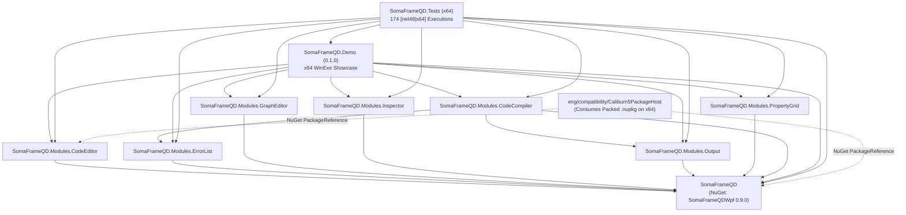

# `SomaFrameQD` — Repository & Symbol Navigation Map (`REPO_MAP.md`)

> **Purpose:** High-density structural, dependency, MEF contract, command/shortcut, and test-coverage map so AI coding agents and developers locate exact files in a single read without exploratory directory scans.  
> **Current Repository State:** `.NET Framework 4.8` (`net48`) single-target + **Windows 7 SP1 `x64` → Windows 11 `x64`** Stage 1 & Stage 2 conversion complete (`2026-11-23`; inaugural release **`0.9.0`** for `SomaFrameQD` & all 7 `SomaFrameQD.Modules.*` packages and **`0.1.0` alpha** for `SomaFrameQD.Demo` — see [`changelogs/20261123_CHANGELOG.md`](./changelogs/20261123_CHANGELOG.md), [`releasenotes/20261123_RELEASE_NOTES_v0.9.0.md`](./releasenotes/20261123_RELEASE_NOTES_v0.9.0.md), and [AFTER_NET48_LOC_Statistics_2026-11-23_00-20-00.md](./LOC-statistics_plus_net48-retargeting/AFTER_NET48_LOC_Statistics_2026-11-23_00-20-00.md) vs. pre-conversion baseline [BEFORE_NET48_LOC_Statistics_2026-11-22_17-23-51.md](./LOC-statistics_plus_net48-retargeting/BEFORE_NET48_LOC_Statistics_2026-11-22_17-23-51.md)).  
> **Companion Entry Point:** Read [`AGENTS.md`](./AGENTS.md) for operating rules, architectural invariants, and build/validation commands, [`doc_after-net48/00_INDEX.md`](./doc_after-net48/00_INDEX.md) for the **authoritative post-`net48` `x64` subsystem reference suite (`01`–`09`)**, [`changelogs/20261123_CHANGELOG.md`](./changelogs/20261123_CHANGELOG.md) for the granular chronological engineering changelog, [`doc/net48-win7-to-win11-x64-deployment-guide.md`](./doc/net48-win7-to-win11-x64-deployment-guide.md) for `x64` deployment/runtime diagnostics, and [`doc_before-net48/00_INDEX.md`](./doc_before-net48/00_INDEX.md) for the immutable pre-conversion (`2026-11-22`) baseline snapshot.

---

## 1. Repository Layout & LOC Summary

- **Post-Conversion Deliverable Totals** ([AFTER_NET48_LOC_Statistics_2026-11-23_00-20-00.md](./LOC-statistics_plus_net48-retargeting/AFTER_NET48_LOC_Statistics_2026-11-23_00-20-00.md)): **`489` Core Source & UI files** = **`31,518` Core SLOC** (`38,394` lines); **`576` Deliverable Text files** = **`38,771` SLOC** (`49,032` lines); **`41` Binary Assets** (`38` `.png`, `2` `.bin` AvalonDock layout fixtures, `1` `ps_2_0` pixel shader `GrayscaleEffect.ps`).
- **Pre-Conversion Baseline Totals** ([BEFORE_NET48_LOC_Statistics_2026-11-22_17-23-51.md](./LOC-statistics_plus_net48-retargeting/BEFORE_NET48_LOC_Statistics_2026-11-22_17-23-51.md)): **`486` Core Source & UI files** = **`29,538` Core SLOC** (`35,860` lines); **`575` Deliverable Text files** = **`36,671` SLOC** (`46,373` lines).
- **Centralized Release Housekeeping Directories (`YYYYMMDD_` Date-Stamped Convention):**
  - **[`changelogs/`](./changelogs/):** Centralized date-stamped (`YYYYMMDD_*`), granular, developer/maintainer-facing technical changelogs (starting with [`changelogs/20261123_CHANGELOG.md`](./changelogs/20261123_CHANGELOG.md)), recording API/ABI changes, breaking changes, MSBuild/CLR internals, and individual bug fixes.
  - **[`releasenotes/`](./releasenotes/):** Centralized date-stamped (`YYYYMMDD_RELEASE_NOTES_v*.md`) curated per-release notes (starting with [`releasenotes/20261123_RELEASE_NOTES_v0.9.0.md`](./releasenotes/20261123_RELEASE_NOTES_v0.9.0.md)), communicating release significance, highlights, and migration steps for end users, developers, and administrators.

```text
C:\SOFTDEV\SomaFrameQD\
├── AGENTS.md                                      # Primary AI coding agent operating manual & invariants
├── REPO_MAP.md                                    # This structural, MEF contract, command & test navigation map
├── TODO.md                                        # Two-stage roadmap: Stage 1 (Simple Retargeting) -> Stage 2 (Optimization 2.1-2.6)
├── VNIR.md                                        # Git provenance & split NBGV version inventory (0.9.0 framework vs. 0.1.0 Demo)
├── DRMA.md                                        # Dependency Risk & Mitigation Assessment for net48 + Win7-Win11 x64
├── CHANGELOG.md                                   # Historical pre-fork changelog (0.2.0-0.6.0, 2013-2015; superseded by changelogs/)
├── README.md                                      # Overview (WARNING: legacy code samples still contain historical snippets)
├── global.json                                    # Pins .NET SDK 8.0.400 LTS and MSTest.Sdk 4.1.0
├── version.json                                   # Nerdbank.GitVersioning 0.9.0 for all 8 NuGet libraries (excludes Demo)
├── .github/workflows/ci.yml                       # Hardened Windows-2025 CI build + validate-artifacts.ps1 + OIDC NuGet publish
│
├── changelogs/                                    # Centralized date-stamped technical changelogs (YYYYMMDD_CHANGELOG.md)
│   └── 20261123_CHANGELOG.md                      # Granular technical changelog (SomaFrameQD 0.9.0 & Demo 0.1.0 alpha)
│
├── releasenotes/                                  # Centralized date-stamped release notes (YYYYMMDD_RELEASE_NOTES_v*.md)
│   └── 20261123_RELEASE_NOTES_v0.9.0.md           # Inaugural SomaFrameQD 0.9.0 (Demo 0.1.0 alpha) release announcement & guide
│
├── doc/
│   ├── caliburn-5-migration.md                    # Caliburn.Micro 5.0.258 async lifecycle, AvalonDock 5 & net48 consolidation guide
│   └── net48-win7-to-win11-x64-deployment-guide.md # Cross-OS (Win7 SP1 -> Win11 x64) deployment, JIT/MEF & QA guide
│
├── doc_after-net48/                               # AUTHORITATIVE post-net48 x64 technical documentation (00_INDEX + 01..09)
│   ├── 00_INDEX.md
│   ├── 01_Architecture_and_Bootstrapper_Overview.md
│   ├── 02_Core_Framework_Primitives_and_Coroutines.md
│   ├── 03_Commands_Menus_ToolBars_and_KeyGestures.md
│   ├── 04_Shell_Docking_Persistence_and_BuiltIn_Modules.md
│   ├── 05_Themes_Rendering_and_Win32_Interop.md
│   ├── 06_Standalone_Modules_Reference.md
│   ├── 07_Demo_Application_and_Extension_Patterns.md
│   ├── 08_Test_Suite_and_Characterization_Harness.md
│   └── 09_Build_Versioning_Packaging_and_CI_After_NET48.md
│
├── doc_before-net48/                              # IMMUTABLE pre-net48-conversion technical documentation (00_INDEX + 01..09)
│   ├── 00_INDEX.md
│   ├── 01_Architecture_and_Bootstrapper_Overview.md
│   ├── 02_Core_Framework_Primitives_and_Coroutines.md
│   ├── 03_Commands_Menus_ToolBars_and_KeyGestures.md
│   ├── 04_Shell_Docking_Persistence_and_BuiltIn_Modules.md
│   ├── 05_Themes_Rendering_and_Win32_Interop.md
│   ├── 06_Standalone_Modules_Reference.md
│   ├── 07_Demo_Application_and_Extension_Patterns.md
│   ├── 08_Test_Suite_and_Characterization_Harness.md
│   └── 09_Build_Versioning_Packaging_and_CI_Before_NET48.md
│
├── LOC-statistics_plus_net48-retargeting/         # Pre- & Post-conversion LOC statistics + Retargeting-vs-Optimization analysis
│   ├── BEFORE_NET48_LOC_Statistics_2026-11-22_17-23-51.md
│   ├── AFTER_NET48_LOC_Statistics_2026-11-23_00-20-00.md
│   └── Simple_Retargeting_vs_Optimization_NET48_Win7_x64_2026-11-22_17-36-26.md
│
├── Implementation-Plans_doc_after-net48/          # Four-plan suite that produced doc_after-net48/ & synced AGENTS/REPO_MAP
│   ├── Plan_01_Architecture_Bootstrapper_Primitives_and_Commands_Docs.md
│   ├── Plan_02_Shell_Docking_Themes_Rendering_and_Win32_x64_Docs.md
│   ├── Plan_03_Standalone_Modules_and_Demo_Application_Docs.md
│   └── Plan_04_Tests_Build_CI_Master_Index_and_Agent_Routing_Sync.md
│
├── Implementation-Plans_doc_before-net48/         # Execution plans that produced doc_before-net48/, REPO_MAP.md, and AGENTS.md
│   ├── Plan_01_Core_Framework_Shell_and_BuiltIn_Modules_Docs.md
│   └── Plan_02_Standalone_Modules_Demo_Tests_Build_and_Root_AGENTS_REPO_MAP.md
│
├── Implementation-Plans_net48-retargeting-ONLY/   # Stage 1 (Simple Retargeting to net48) sequential implementation plans
│   ├── Plan_01_Toolchain_BuildProps_and_Library_Family_Retargeting.md
│   ├── Plan_02_Demo_Tests_Solution_and_Obsolete_MultiTarget_Cleanup.md
│   ├── Plan_03_Package_Contract_CompatibilityHost_and_CI_Pipeline.md
│   └── Plan_04_Documentation_Alignment_and_Stage1_Completion_Gate.md
│
├── Implementation-Plans_net48-optimizations/      # Stage 2 (net48 + Win7 SP1 -> Win11 x64 Optimization) executed plans (01..08)
│   ├── Plan_01_Open_Questions_Native_GAC_References_x64_and_Binding_Redirects.md
│   ├── Plan_02_CLR48_Runtime_SKU_AppManifest_Startup_JIT_and_MEF_Probing.md
│   ├── Plan_03_Win32_x64_Pointer_ABI_and_HwndHost_Interop_Hardening.md
│   ├── Plan_04_WPF_RenderLoop_Lifecycle_and_VS2013_Theme_Resource_Freezing.md
│   ├── Plan_05_WindowChrome_Docking_DPI_and_Win7_to_Win11_OS_Adaptation.md
│   ├── Plan_06_Standalone_Modules_Part1_CodeCompiler_CodeEditor_ErrorList_Output.md
│   ├── Plan_07_Standalone_Modules_Part2_Inspector_GraphEditor_PropertyGrid_and_Demo.md
│   └── Plan_08_End_to_End_x64_Win7_to_Win11_Verification_and_After_LOC_Report.md
│
├── eng/                                           # Packaging contract, release verification script & compatibility host
│   ├── package-contract.json                      # Declarative net48/.NETFramework4.8, .nuspec, shader & NuGet asset lockfile contract
│   ├── validate-artifacts.ps1                     # Post-pack verification gate invoked by CI & local release checks
│   └── compatibility/
│       └── Caliburn5PackageHost/                  # Standalone (NOT in .sln) packed-NuGet consumer smoke test (net48|x64)
│
└── src/
    ├── SomaFrameQD.sln                            # 10-project Visual Studio / dotnet solution (net48, AnyCPU + x64)
    ├── Directory.Build.props                      # Shared metadata, LangVersion 12.0, GAC MEF, x64 Exe, snupkg & NBGV 3.5.109
    ├── NuGet.config                               # <clear /> + single official nuget.org v3 source
    ├── SomaFrameQD/                               # Core shell & framework -> NuGet ID: SomaFrameQDWpf (0.9.0; 13,019 Core SLOC)
    │   ├── AppBootstrapper.cs                     # MEF + Caliburn.Micro 5 bootstrapper (priorityProvider + mainProvider, Multi-Core JIT)
    │   ├── Framework/                             # Base classes, Behaviors, Commands, Controls, Markup, Menus, Results, Services, ShaderEffects, Themes, ToolBars, Win32
    │   ├── Modules/                               # 8 built-in modules: MainWindow, Shell, MainMenu, ToolBars, StatusBar, Toolbox, UndoRedo, Settings
    │   ├── Properties/                            # AssemblyInfo.cs (XmlnsDefinition, InternalsVisibleTo), Settings, 7-locale Resources.*.resx
    │   └── Themes/                                # Generic.xaml + VS2013 Light/Blue/Dark palettes (562 frozen brushes) & 15 control XAML files
    ├── SomaFrameQD.Modules.CodeCompiler/          # Roslyn C# in-memory compiler -> Output + ErrorList (0.9.0; 120 Core SLOC)
    ├── SomaFrameQD.Modules.CodeEditor/            # AvalonEdit syntax-highlighted editor + 16 languages + .xshd (0.9.0; 935 Core SLOC)
    ├── SomaFrameQD.Modules.ErrorList/             # VS-style Error/Warning/Message tool window (0.9.0; 690 Core SLOC)
    ├── SomaFrameQD.Modules.GraphEditor/           # Node/Connector/Bezier/ZoomAndPan WPF controls (0.9.0; 1,593 Core SLOC)
    ├── SomaFrameQD.Modules.Inspector/             # Undo-aware fluent/convention property & group inspector (0.9.0; 2,611 Core SLOC)
    ├── SomaFrameQD.Modules.Output/                # Buffered thread-safe log & TextWriter tool window (0.9.0; 323 Core SLOC)
    ├── SomaFrameQD.Modules.PropertyGrid/          # Extended WPF Toolkit PropertyGrid tool + ICommandRerouter (0.9.0; 181 Core SLOC)
    ├── SomaFrameQD.Demo/                          # Showcase WPF app & samples (version 0.1.0 alpha; 6 sample modules; 3,461 Core SLOC)
    └── SomaFrameQD.Tests/                         # MSTest 4.1.0 64-bit STA suite (27 .cs files, 174 [net48|x64] executions; 8,422 Core SLOC)
```

---

## 2. Project & NuGet Dependency Graph



### Complete Project & Dependency Matrix (Post-Stage-2 `net48` `x64` Optimized State)

| Project | Platform Target | Target Framework | NuGet Package ID | Internal Dependencies | Direct External NuGet / `.NET 4.8` GAC References |
| :--- | :---: | :--- | :--- | :--- | :--- |
| [`src/SomaFrameQD`](./src/SomaFrameQD/SomaFrameQD.csproj) | `AnyCPU` | `net48` | **`SomaFrameQDWpf`** | *(none)* | `Caliburn.Micro` `5.0.258`, `Dirkster.AvalonDock.Serializer.Xml` `5.0.1`, `Dirkster.AvalonDock.Themes.VS2013` `5.0.1`, `DotNetProjects.Extended.Wpf.Toolkit` `5.0.129`, `MahApps.Metro` `2.4.11`, `System.ComponentModel.Composition` *(GAC)*, `PresentationFramework.Aero` *(GAC)* |
| [`src/SomaFrameQD.Modules.CodeCompiler`](./src/SomaFrameQD.Modules.CodeCompiler/SomaFrameQD.Modules.CodeCompiler.csproj) | `AnyCPU` | `net48` | `SomaFrameQD.Modules.CodeCompiler` | `SomaFrameQDWpf`, `ErrorList`, `Output` | `Microsoft.CodeAnalysis.CSharp` `3.4.0`, `System.ComponentModel.Composition` *(GAC)* |
| [`src/SomaFrameQD.Modules.CodeEditor`](./src/SomaFrameQD.Modules.CodeEditor/SomaFrameQD.Modules.CodeEditor.csproj) | `AnyCPU` | `net48` | `SomaFrameQD.Modules.CodeEditor` | `SomaFrameQDWpf` | `AvalonEdit` `6.3.1.120`, `System.ComponentModel.Composition` *(GAC)* |
| [`src/SomaFrameQD.Modules.ErrorList`](./src/SomaFrameQD.Modules.ErrorList/SomaFrameQD.Modules.ErrorList.csproj) | `AnyCPU` | `net48` | `SomaFrameQD.Modules.ErrorList` | `SomaFrameQDWpf` | `System.ComponentModel.Composition` *(GAC)* |
| [`src/SomaFrameQD.Modules.GraphEditor`](./src/SomaFrameQD.Modules.GraphEditor/SomaFrameQD.Modules.GraphEditor.csproj) | `AnyCPU` | `net48` | `SomaFrameQD.Modules.GraphEditor` | `SomaFrameQDWpf` | `System.ComponentModel.Composition` *(GAC)* |
| [`src/SomaFrameQD.Modules.Inspector`](./src/SomaFrameQD.Modules.Inspector/SomaFrameQD.Modules.Inspector.csproj) | `AnyCPU` | `net48` | `SomaFrameQD.Modules.Inspector` | `SomaFrameQDWpf` | `System.Drawing` *(GAC)*, `System.ComponentModel.Composition` *(GAC)* |
| [`src/SomaFrameQD.Modules.Output`](./src/SomaFrameQD.Modules.Output/SomaFrameQD.Modules.Output.csproj) | `AnyCPU` | `net48` | `SomaFrameQD.Modules.Output` | `SomaFrameQDWpf` | `System.ComponentModel.Composition` *(GAC)* |
| [`src/SomaFrameQD.Modules.PropertyGrid`](./src/SomaFrameQD.Modules.PropertyGrid/SomaFrameQD.Modules.PropertyGrid.csproj) | `AnyCPU` | `net48` | `SomaFrameQD.Modules.PropertyGrid` | `SomaFrameQDWpf` | *(transitive Extended WPF Toolkit)*, `System.ComponentModel.Composition` *(GAC)* |
| [`src/SomaFrameQD.Demo`](./src/SomaFrameQD.Demo/SomaFrameQD.Demo.csproj) | **`x64`** | `net48` | *(WinExe, `0.1.0`)* | `SomaFrameQD` + all 7 `Modules.*` | `JeremyAnsel.HLSL.Targets` `1.0.9`, `HelixToolkit.Wpf` `2.10.0`, `app.manifest` (`Win7 SP1`–`Win11` + System-DPI) |
| [`src/SomaFrameQD.Tests`](./src/SomaFrameQD.Tests/SomaFrameQD.Tests.csproj) | **`x64`** | `net48` | *(Test Exe)* | `SomaFrameQD`, `Demo`, + all 7 `Modules.*` | `MSTest.Sdk` `4.1.0` (`Microsoft.Testing.Platform`, `174` `[net48\|x64]` executions) |
| [`eng/compatibility/Caliburn5PackageHost`](./eng/compatibility/Caliburn5PackageHost/Caliburn5PackageHost.csproj) | **`x64`** | `net48` | *(Outside `.sln`)* | Packed `SomaFrameQDWpf` + `CodeEditor` | *(restored & executed dynamically in `validate-artifacts.ps1`)* |

---

## 3. Master MEF Contract & Extensibility Directory

All runtime composition runs through `AppBootstrapper.Container` (`priorityProvider` [entry assembly] → `mainProvider` [`DirectoryCatalog`]).

### 3.1 Core Infrastructure, Shell & Chrome Contracts

| MEF Contract | Cardinality / Lifetime | Contract File | Default / Built-In Implementation(s) |
| :--- | :--- | :--- | :--- |
| `AppBootstrapper`, `CompositionContainer`, `AggregateCatalog`, `IWindowManager`, `IEventAggregator` | Singleton (`CompositionBatch`) | [`src/SomaFrameQD/AppBootstrapper.cs`](./src/SomaFrameQD/AppBootstrapper.cs) | Bound directly in `AppBootstrapper.BindServices` & `Configure`. |
| `IServiceProvider` | Singleton | *(BCL `System`)* | [`src/SomaFrameQD/Framework/Services/ServiceProvider.cs`](./src/SomaFrameQD/Framework/Services/ServiceProvider.cs) (forwards to `IoC.GetInstance`). |
| `IMainWindow` | Singleton (overridable) | [`src/SomaFrameQD/Framework/Services/IMainWindow.cs`](./src/SomaFrameQD/Framework/Services/IMainWindow.cs) | [`src/SomaFrameQD/Modules/MainWindow/ViewModels/MainWindowViewModel.cs`](./src/SomaFrameQD/Modules/MainWindow/ViewModels/MainWindowViewModel.cs) |
| `IShell` | Singleton (overridable) | [`src/SomaFrameQD/Framework/Services/IShell.cs`](./src/SomaFrameQD/Framework/Services/IShell.cs) | Core: [`src/SomaFrameQD/Modules/Shell/ViewModels/ShellViewModel.cs`](./src/SomaFrameQD/Modules/Shell/ViewModels/ShellViewModel.cs)<br/>Demo override (`priorityProvider`): [`src/SomaFrameQD.Demo/Modules/Shell/ViewModels/ShellViewModel.cs`](./src/SomaFrameQD.Demo/Modules/Shell/ViewModels/ShellViewModel.cs) |
| `IModule` | `[ImportMany]` | [`src/SomaFrameQD/Framework/IModule.cs`](./src/SomaFrameQD/Framework/IModule.cs) | Core [`ToolBars/Module.cs`](./src/SomaFrameQD/Modules/ToolBars/Module.cs), [`GraphEditor/Module.cs`](./src/SomaFrameQD.Modules.GraphEditor/Module.cs), plus Demo `Startup`, `Home`, `SampleBrowser`, `FilterDesigner` modules. Base class: [`ModuleBase.cs`](./src/SomaFrameQD/Framework/ModuleBase.cs). |
| `ILayoutItemStatePersister` | Singleton | [`src/SomaFrameQD/Modules/Shell/Services/ILayoutItemStatePersister.cs`](./src/SomaFrameQD/Modules/Shell/Services/ILayoutItemStatePersister.cs) | [`src/SomaFrameQD/Modules/Shell/Services/LayoutItemStatePersister.cs`](./src/SomaFrameQD/Modules/Shell/Services/LayoutItemStatePersister.cs) |
| `IAsyncLayoutItemStateRestorer` | Per-item interface | [`src/SomaFrameQD/Framework/IAsyncLayoutItemStateRestorer.cs`](./src/SomaFrameQD/Framework/IAsyncLayoutItemStateRestorer.cs) | Implemented by [`CodeEditorViewModel.cs`](./src/SomaFrameQD.Modules.CodeEditor/ViewModels/CodeEditorViewModel.cs) for post-stream async file loading. |
| `IEditorOpeningService` | Singleton | [`src/SomaFrameQD/Framework/Services/IEditorOpeningService.cs`](./src/SomaFrameQD/Framework/Services/IEditorOpeningService.cs) | [`src/SomaFrameQD/Modules/Shell/Services/EditorOpeningService.cs`](./src/SomaFrameQD/Modules/Shell/Services/EditorOpeningService.cs) |
| `IEditorProvider` | `[ImportMany]` | [`src/SomaFrameQD/Framework/Services/IEditorProvider.cs`](./src/SomaFrameQD/Framework/Services/IEditorProvider.cs) | [`CodeEditor/EditorProvider.cs`](./src/SomaFrameQD.Modules.CodeEditor/EditorProvider.cs), Demo [`TextEditor/EditorProvider.cs`](./src/SomaFrameQD.Demo/Modules/TextEditor/EditorProvider.cs) |
| `IThemeManager` & `ITheme` | Singleton / `[ImportMany]` | [`IThemeManager.cs`](./src/SomaFrameQD/Framework/Themes/IThemeManager.cs), [`ITheme.cs`](./src/SomaFrameQD/Framework/Themes/ITheme.cs) | [`ThemeManager.cs`](./src/SomaFrameQD/Framework/Themes/ThemeManager.cs); [`LightTheme.cs`](./src/SomaFrameQD/Framework/Themes/LightTheme.cs), [`BlueTheme.cs`](./src/SomaFrameQD/Framework/Themes/BlueTheme.cs), [`DarkTheme.cs`](./src/SomaFrameQD/Framework/Themes/DarkTheme.cs) |
| `IResourceManager` | Singleton | [`src/SomaFrameQD/Framework/Services/IResourceManager.cs`](./src/SomaFrameQD/Framework/Services/IResourceManager.cs) | [`src/SomaFrameQD/Framework/Services/ResourceManager.cs`](./src/SomaFrameQD/Framework/Services/ResourceManager.cs) |
| `IInputManager` | Singleton | [`src/SomaFrameQD/Framework/Services/IInputManager.cs`](./src/SomaFrameQD/Framework/Services/IInputManager.cs) | [`src/SomaFrameQD/Framework/Services/InputManager.cs`](./src/SomaFrameQD/Framework/Services/InputManager.cs) |

### 3.2 Commands, Menus, ToolBars, Settings & Built-In Tool Contracts

| MEF Contract | Cardinality / Lifetime | Contract File | Concrete Implementation(s) |
| :--- | :--- | :--- | :--- |
| `ICommandService` | Singleton | [`src/SomaFrameQD/Framework/Commands/ICommandService.cs`](./src/SomaFrameQD/Framework/Commands/ICommandService.cs) | [`src/SomaFrameQD/Framework/Commands/CommandService.cs`](./src/SomaFrameQD/Framework/Commands/CommandService.cs) |
| `ICommandRouter` | Singleton | [`src/SomaFrameQD/Framework/Commands/ICommandRouter.cs`](./src/SomaFrameQD/Framework/Commands/ICommandRouter.cs) | [`src/SomaFrameQD/Framework/Commands/CommandRouter.cs`](./src/SomaFrameQD/Framework/Commands/CommandRouter.cs) |
| `ICommandKeyGestureService` | Singleton | [`src/SomaFrameQD/Framework/Commands/ICommandKeyGestureService.cs`](./src/SomaFrameQD/Framework/Commands/ICommandKeyGestureService.cs) | [`src/SomaFrameQD/Framework/Commands/CommandKeyGestureService.cs`](./src/SomaFrameQD/Framework/Commands/CommandKeyGestureService.cs) |
| `CommandDefinitionBase` (`[CommandDefinition]`) | `[ImportMany]` | [`src/SomaFrameQD/Framework/Commands/CommandDefinitionBase.cs`](./src/SomaFrameQD/Framework/Commands/CommandDefinitionBase.cs) | 29 concrete subclasses (see Section 4 Master Command Table below). |
| `ICommandHandler` (`[CommandHandler]`) & `ICommandRerouter` | `[ImportMany]` / Contextual | [`ICommandHandler.cs`](./src/SomaFrameQD/Framework/Commands/ICommandHandler.cs), [`ICommandRerouter.cs`](./src/SomaFrameQD/Framework/Commands/ICommandRerouter.cs) | Global MEF handlers + active `Document` / `CodeEditorViewModel` / `PropertyGridViewModel` (`ICommandRerouter`). |
| `IMenu` & `IMenuBuilder` | Singleton | [`IMenu.cs`](./src/SomaFrameQD/Modules/MainMenu/IMenu.cs), [`IMenuBuilder.cs`](./src/SomaFrameQD/Modules/MainMenu/IMenuBuilder.cs) | [`MainMenuViewModel.cs`](./src/SomaFrameQD/Modules/MainMenu/ViewModels/MainMenuViewModel.cs), [`MenuBuilder.cs`](./src/SomaFrameQD/Modules/MainMenu/MenuBuilder.cs) |
| `IToolBars` & `IToolBarBuilder` | Singleton | [`IToolBars.cs`](./src/SomaFrameQD/Modules/ToolBars/IToolBars.cs), [`IToolBarBuilder.cs`](./src/SomaFrameQD/Modules/ToolBars/IToolBarBuilder.cs) | [`ToolBarsViewModel.cs`](./src/SomaFrameQD/Modules/ToolBars/ViewModels/ToolBarsViewModel.cs), [`ToolBarBuilder.cs`](./src/SomaFrameQD/Modules/ToolBars/ToolBarBuilder.cs) |
| `IStatusBar` | Singleton | [`src/SomaFrameQD/Modules/StatusBar/IStatusBar.cs`](./src/SomaFrameQD/Modules/StatusBar/IStatusBar.cs) | [`src/SomaFrameQD/Modules/StatusBar/ViewModels/StatusBarViewModel.cs`](./src/SomaFrameQD/Modules/StatusBar/ViewModels/StatusBarViewModel.cs) |
| `IToolbox` & `IToolboxService` | Singleton | [`IToolbox.cs`](./src/SomaFrameQD/Modules/Toolbox/IToolbox.cs), [`IToolboxService.cs`](./src/SomaFrameQD/Modules/Toolbox/Services/IToolboxService.cs) | [`ToolboxViewModel.cs`](./src/SomaFrameQD/Modules/Toolbox/ViewModels/ToolboxViewModel.cs), [`ToolboxService.cs`](./src/SomaFrameQD/Modules/Toolbox/Services/ToolboxService.cs) (scans `[ToolboxItem]`). |
| `IHistoryTool` & `IUndoRedoManager` | Singleton tool / Per-`Document` | [`IHistoryTool.cs`](./src/SomaFrameQD/Modules/UndoRedo/IHistoryTool.cs), [`IUndoRedoManager.cs`](./src/SomaFrameQD/Modules/UndoRedo/IUndoRedoManager.cs) | [`HistoryViewModel.cs`](./src/SomaFrameQD/Modules/UndoRedo/ViewModels/HistoryViewModel.cs), [`UndoRedoManager.cs`](./src/SomaFrameQD/Modules/UndoRedo/Services/UndoRedoManager.cs) |
| `ISettingsEditor`, `ISettingsEditorAsync` & `SettingsViewModel` | `[ImportMany]` (`NonShared`) | [`ISettingsEditor.cs`](./src/SomaFrameQD/Modules/Settings/ISettingsEditor.cs) | [`SettingsViewModel.cs`](./src/SomaFrameQD/Modules/Settings/ViewModels/SettingsViewModel.cs); pages: [`MainMenuSettingsViewModel.cs`](./src/SomaFrameQD/Modules/MainMenu/ViewModels/MainMenuSettingsViewModel.cs), [`CodeEditorSettingsViewModel.cs`](./src/SomaFrameQD.Modules.CodeEditor/ViewModels/CodeEditorSettingsViewModel.cs), [`DemoApplicationSettingsViewModel.cs`](./src/SomaFrameQD.Demo/Modules/Shell/ViewModels/DemoApplicationSettingsViewModel.cs) |

### 3.3 Standalone Module & Demo Plugin Contracts

| MEF Contract | Cardinality / Lifetime | Contract File | Concrete Implementation(s) |
| :--- | :--- | :--- | :--- |
| `ICodeCompiler` | Singleton | [`src/SomaFrameQD.Modules.CodeCompiler/ICodeCompiler.cs`](./src/SomaFrameQD.Modules.CodeCompiler/ICodeCompiler.cs) | [`src/SomaFrameQD.Modules.CodeCompiler/CodeCompiler.cs`](./src/SomaFrameQD.Modules.CodeCompiler/CodeCompiler.cs) |
| `LanguageDefinitionManager` & `ILanguageDefinition` | Singleton / `[ImportMany]` | [`ILanguageDefinition.cs`](./src/SomaFrameQD.Modules.CodeEditor/ILanguageDefinition.cs) | [`LanguageDefinitionManager.cs`](./src/SomaFrameQD.Modules.CodeEditor/LanguageDefinitionManager.cs) + 16 built-ins (`DefaultLanguageDefinition`) + `./SyntaxHighlighting/*.xshd`. |
| `CodeEditorViewModel` | **`CreationPolicy.NonShared`** | *(concrete export)* | [`src/SomaFrameQD.Modules.CodeEditor/ViewModels/CodeEditorViewModel.cs`](./src/SomaFrameQD.Modules.CodeEditor/ViewModels/CodeEditorViewModel.cs) |
| `IErrorList` | Singleton (`ITool`, Bottom) | [`src/SomaFrameQD.Modules.ErrorList/IErrorList.cs`](./src/SomaFrameQD.Modules.ErrorList/IErrorList.cs) | [`src/SomaFrameQD.Modules.ErrorList/ViewModels/ErrorListViewModel.cs`](./src/SomaFrameQD.Modules.ErrorList/ViewModels/ErrorListViewModel.cs) |
| `IInspectorTool` | Singleton (`ITool`, Right) | [`src/SomaFrameQD.Modules.Inspector/IInspectorTool.cs`](./src/SomaFrameQD.Modules.Inspector/IInspectorTool.cs) | [`src/SomaFrameQD.Modules.Inspector/ViewModels/InspectorViewModel.cs`](./src/SomaFrameQD.Modules.Inspector/ViewModels/InspectorViewModel.cs) |
| `IOutput` | Singleton (`ITool`, Bottom) | [`src/SomaFrameQD.Modules.Output/IOutput.cs`](./src/SomaFrameQD.Modules.Output/IOutput.cs) | [`src/SomaFrameQD.Modules.Output/ViewModels/OutputViewModel.cs`](./src/SomaFrameQD.Modules.Output/ViewModels/OutputViewModel.cs) |
| `IPropertyGrid` | Singleton (`ITool`, Right) | [`src/SomaFrameQD.Modules.PropertyGrid/IPropertyGrid.cs`](./src/SomaFrameQD.Modules.PropertyGrid/IPropertyGrid.cs) | [`src/SomaFrameQD.Modules.PropertyGrid/ViewModels/PropertyGridViewModel.cs`](./src/SomaFrameQD.Modules.PropertyGrid/ViewModels/PropertyGridViewModel.cs) |
| `ISample` *(Demo)* | `[ImportMany]` | [`src/SomaFrameQD.Demo/Modules/SampleBrowser/ISample.cs`](./src/SomaFrameQD.Demo/Modules/SampleBrowser/ISample.cs) | [`FilterDesigner/Sample.cs`](./src/SomaFrameQD.Demo/Modules/FilterDesigner/Sample.cs) (discovered by [`SampleBrowserViewModel.cs`](./src/SomaFrameQD.Demo/Modules/SampleBrowser/ViewModels/SampleBrowserViewModel.cs)). |

---

## 4. Master Commands, Menus, ToolBars & Keyboard Shortcuts Lookup

### 4.1 Top-Level Menu Bar & ToolBar Anchors
- **Main Menu Bar (`SomaFrameQD.Modules.MainMenu.MenuDefinitions`):** `File` (`0`), `Edit` (`1`), `View` (`2`), `Tools` (`10`), `Window` (`20`), `Help` (`30` — empty by default so omitted until populated), plus Demo's conditional `DEBUG` (`int.MaxValue`, visible only when `Debugger.IsAttached`).
- **ToolBars:**
  - `SomaFrameQD.Modules.ToolBars.ToolBarDefinitions.StandardToolBar` (`SortOrder = 0`, global top tray: Open, Save, Save All | Undo, Redo).
  - `SomaFrameQD.Modules.CodeEditor.CodeEditorToolBarDefinitions.CodeEditorToolBar` (`SortOrder = 1`, global top tray: ShowLineNumbers, ShowSpaces, ShowTabs, ShowEndOfLine, WordWrap).
  - `SomaFrameQD.Modules.ErrorList.ToolBarDefinitions.ErrorListToolBar` (**un-exported** pane-local toolbar inside Error List: ToggleErrors, ToggleWarnings, ToggleMessages).

### 4.2 All 29 Concrete Command Definitions & Shortcuts

| Command `Name` | Shortcut (`KeyGesture`) | UI Surface(s) | Routing / Handler | Definition File |
| :--- | :--- | :--- | :--- | :--- |
| `File.NewFile` *(List)* | *(none)* | `File -> New` cascade | Global `NewFileCommandHandler` | [`NewFileCommandListDefinition.cs`](./src/SomaFrameQD/Modules/Shell/Commands/NewFileCommandListDefinition.cs) |
| `File.OpenFile` | `Ctrl+O` | `File` menu, `StandardToolBar` | Global `OpenFileCommandHandler` | [`OpenFileCommandDefinition.cs`](./src/SomaFrameQD/Modules/Shell/Commands/OpenFileCommandDefinition.cs) |
| `File.CloseFile` | *(none)* | `File` menu | Global `CloseFileCommandHandler` | [`CloseFileCommandDefinition.cs`](./src/SomaFrameQD/Modules/Shell/Commands/CloseFileCommandDefinition.cs) |
| `File.SaveFile` | `Ctrl+S` | `File` menu, `StandardToolBar` | Contextual on active `Document` | [`SaveFileCommandDefinition.cs`](./src/SomaFrameQD/Modules/Shell/Commands/SaveFileCommandDefinition.cs) |
| `File.SaveFileAs` | *(none)* | `File` menu | Contextual on active `Document` | [`SaveFileAsCommandDefinition.cs`](./src/SomaFrameQD/Modules/Shell/Commands/SaveFileAsCommandDefinition.cs) |
| `File.SaveAllFiles` | `Ctrl+Shift+S` | `File` menu, `StandardToolBar` | Global `SaveAllFilesCommandHandler` | [`SaveAllFilesCommandDefinition.cs`](./src/SomaFrameQD/Modules/Shell/Commands/SaveAllFilesCommandDefinition.cs) |
| `File.Exit` | `Alt+F4` | `File` menu | Global `ExitCommandHandler` | [`ExitCommandDefinition.cs`](./src/SomaFrameQD/Modules/Shell/Commands/ExitCommandDefinition.cs) |
| `Edit.Undo` | `Ctrl+Z` | `Edit` menu, `StandardToolBar` | Contextual on `Document` (or `PropertyGrid` rerouter) | [`UndoCommandDefinition.cs`](./src/SomaFrameQD/Modules/UndoRedo/Commands/UndoCommandDefinition.cs) |
| `Edit.Redo` | `Ctrl+Y` | `Edit` menu, `StandardToolBar` | Contextual on `Document` (or `PropertyGrid` rerouter) | [`RedoCommandDefinition.cs`](./src/SomaFrameQD/Modules/UndoRedo/Commands/RedoCommandDefinition.cs) |
| `View.Toolbox` | *(none)* | `View` (`Tools` group) | Global `ViewToolboxCommandHandler` | [`ViewToolboxCommandDefinition.cs`](./src/SomaFrameQD/Modules/Toolbox/Commands/ViewToolboxCommandDefinition.cs) |
| `View.History` | *(none)* | `View` (`Tools` group) | Global `ViewHistoryCommandHandler` | [`ViewHistoryCommandDefinition.cs`](./src/SomaFrameQD/Modules/UndoRedo/Commands/ViewHistoryCommandDefinition.cs) |
| `View.FullScreen` | `Shift+Alt+Enter` | `View` menu | Global `ViewFullScreenCommandHandler` | [`ViewFullscreenCommandDefinition.cs`](./src/SomaFrameQD/Modules/Shell/Commands/ViewFullscreenCommandDefinition.cs) |
| `Tools.Options` | *(none)* | `Tools` menu | Global `OpenSettingsCommandHandler` (`Show.Dialog<SettingsViewModel>()`) | [`OpenSettingsCommandDefinition.cs`](./src/SomaFrameQD/Modules/Settings/Commands/OpenSettingsCommandDefinition.cs) |
| `Window.SwitchToDocument` *(List)* | *(none)* | `Window` menu | Global `SwitchToDocumentListCommandHandler` | [`SwitchToDocumentCommandListDefinition.cs`](./src/SomaFrameQD/Modules/Shell/Commands/SwitchToDocumentCommandListDefinition.cs) |
| `CodeEditor.ShowLineNumbers` | *(none)* | `CodeEditorToolBar` | Contextual on `CodeEditorViewModel` | [`ShowLineNumbersCommandDefinition.cs`](./src/SomaFrameQD.Modules.CodeEditor/Commands/ShowLineNumbersCommandDefinition.cs) |
| `CodeEditor.ShowSpaces` | *(none)* | `CodeEditorToolBar` | Contextual on `CodeEditorViewModel` | [`ShowSpacesCommandDefinition.cs`](./src/SomaFrameQD.Modules.CodeEditor/Commands/ShowSpacesCommandDefinition.cs) |
| `CodeEditor.ShowTabs` | *(none)* | `CodeEditorToolBar` | Contextual on `CodeEditorViewModel` | [`ShowTabsCommandDefinition.cs`](./src/SomaFrameQD.Modules.CodeEditor/Commands/ShowTabsCommandDefinition.cs) |
| `CodeEditor.ShowEndOfLine` | *(none)* | `CodeEditorToolBar` | Contextual on `CodeEditorViewModel` | [`ShowEndOfLineCommandDefinition.cs`](./src/SomaFrameQD.Modules.CodeEditor/Commands/ShowEndOfLineCommandDefinition.cs) |
| `CodeEditor.WordWrap` | *(none)* | `CodeEditorToolBar` | Contextual on `CodeEditorViewModel` | [`WordWrapCommandDefinition.cs`](./src/SomaFrameQD.Modules.CodeEditor/Commands/WordWrapCommandDefinition.cs) |
| `View.ErrorList` | *(none)* | `View` (`Tools` group) | Global `ViewErrorListCommandHandler` | [`ViewErrorListCommandDefinition.cs`](./src/SomaFrameQD.Modules.ErrorList/Commands/ViewErrorListCommandDefinition.cs) |
| `ErrorList.ToggleErrors` | *(none)* | `ErrorListToolBar` (pane) | Global `ToggleErrorsWarningsMessagesCommandHandler` | [`ToggleErrorsCommandDefinition.cs`](./src/SomaFrameQD.Modules.ErrorList/Commands/ToggleErrorsCommandDefinition.cs) |
| `ErrorList.ToggleWarnings` | *(none)* | `ErrorListToolBar` (pane) | Global `ToggleErrorsWarningsMessagesCommandHandler` | [`ToggleWarningsCommandDefinition.cs`](./src/SomaFrameQD.Modules.ErrorList/Commands/ToggleWarningsCommandDefinition.cs) |
| `ErrorList.ToggleMessages` | *(none)* | `ErrorListToolBar` (pane) | Global `ToggleErrorsWarningsMessagesCommandHandler` | [`ToggleMessagesCommandDefinition.cs`](./src/SomaFrameQD.Modules.ErrorList/Commands/ToggleMessagesCommandDefinition.cs) |
| `View.Inspector` | *(none)* | `View` (`Properties` group) | Global `ViewInspectorCommandHandler` | [`ViewInspectorCommandDefinition.cs`](./src/SomaFrameQD.Modules.Inspector/Commands/ViewInspectorCommandDefinition.cs) |
| `View.Output` | *(none)* | `View` (`Tools` group) | Global `ViewOutputCommandHandler` | [`ViewOutputCommandDefinition.cs`](./src/SomaFrameQD.Modules.Output/Commands/ViewOutputCommandDefinition.cs) |
| `View.PropertiesWindow` | *(none)* | `View` (`Properties` group) | Global `ViewPropertyGridCommandHandler` | [`ViewPropertyGridCommandDefinition.cs`](./src/SomaFrameQD.Modules.PropertyGrid/Commands/ViewPropertyGridCommandDefinition.cs) |
| `File.OpenGraph` *(Demo)* | *(none)* | `File` menu (`Demo`) | Global `OpenGraphCommandHandler` | [`OpenGraphCommandDefinition.cs`](./src/SomaFrameQD.Demo/Modules/FilterDesigner/Commands/OpenGraphCommandDefinition.cs) |
| `View.Home` *(Demo)* | *(none)* | `View` menu (`Demo`) | Global `ViewHomeCommandHandler` | [`ViewHomeCommandDefinition.cs`](./src/SomaFrameQD.Demo/Modules/Home/Commands/ViewHomeCommandDefinition.cs) |
| `View.Helix` *(Demo)* | *(none)* | `View` menu (`Demo`) | Global `ViewHelixCommandHandler` | [`ViewHelixCommandDefinition.cs`](./src/SomaFrameQD.Demo/Modules/Home/Commands/ViewHelixCommandDefinition.cs) |

*(Control-level shortcuts outside `CommandKeyGestureService`: `Ctrl+F` opens AvalonEdit's `OwnedSearchPanel` inside [`Controls/CodeEditor.cs`](./src/SomaFrameQD.Modules.CodeEditor/Controls/CodeEditor.cs); `Delete` deletes selected nodes/wires inside [`FilterDesigner/Views/GraphView.xaml`](./src/SomaFrameQD.Demo/Modules/FilterDesigner/Views/GraphView.xaml); `Escape` cancels [`ScreenColorPicker.cs`](./src/SomaFrameQD.Modules.Inspector/Controls/ScreenColorPicker.cs).)*

---

## 5. Subsystem-to-Test Mapping (`src/SomaFrameQD.Tests` — 27 Files, 174 `[net48|x64]` Executions)

When modifying any subsystem below, run its mapped characterization/optimization test class(es) immediately:

| Subsystem / Architectural Concern | Test File(s) in `src/SomaFrameQD.Tests/` | Executions |
| :--- | :--- | ---: |
| **MEF Priority Overrides, `NonShared` Lifetime, Startup JIT, Probing & Cross-OS TLS** | [`Composition/CompositionConventionTests.cs`](./src/SomaFrameQD.Tests/Composition/CompositionConventionTests.cs), [`Composition/AppBootstrapperOptimizationTests.cs`](./src/SomaFrameQD.Tests/Composition/AppBootstrapperOptimizationTests.cs) | 9 |
| **64-Bit (`x64`) Win32 ABI, `HwndWrapper` VSync Lifecycle, `ClippingHwndHost` & `WindowOptionsBehavior`** | [`Framework/Win32/Win32X64InteropTests.cs`](./src/SomaFrameQD.Tests/Framework/Win32/Win32X64InteropTests.cs) | 7 |
| **Document Dirty Close Guard & `UndoRedoManager` Disposal** | [`Framework/DocumentCloseTests.cs`](./src/SomaFrameQD.Tests/Framework/DocumentCloseTests.cs) | 6 |
| **Tool Close (`CloseToolAsync`) & Reopen Semantics** | [`Framework/ToolCloseTests.cs`](./src/SomaFrameQD.Tests/Framework/ToolCloseTests.cs) | 3 |
| **`WindowBase` Caliburn 5 Async Activation/Deactivation** | [`Framework/WindowBaseLifecycleTests.cs`](./src/SomaFrameQD.Tests/Framework/WindowBaseLifecycleTests.cs) | 2 |
| **Coroutine `IResult` State Machines (`Show.*`, `LambdaResult`)** | [`Framework/Results/ResultCompletionTests.cs`](./src/SomaFrameQD.Tests/Framework/Results/ResultCompletionTests.cs), [`OpenDocumentResultCompletionTests.cs`](./src/SomaFrameQD.Tests/Framework/Results/OpenDocumentResultCompletionTests.cs), [`ShowToolResultCompletionTests.cs`](./src/SomaFrameQD.Tests/Framework/Results/ShowToolResultCompletionTests.cs), [`ShowWindowResultCompletionTests.cs`](./src/SomaFrameQD.Tests/Framework/Results/ShowWindowResultCompletionTests.cs), [`ShowDialogResultCompletionTests.cs`](./src/SomaFrameQD.Tests/Framework/Results/ShowDialogResultCompletionTests.cs) *(+ [`ResultTestDoubles.cs`](./src/SomaFrameQD.Tests/Framework/Results/ResultTestDoubles.cs))* | 37 |
| **`ShellViewModel`, `TransitionCoordinator` & `InitializationTask`** | [`Modules/Shell/ShellViewModelTests.cs`](./src/SomaFrameQD.Tests/Modules/Shell/ShellViewModelTests.cs) | 20 |
| **Editor Opening Pipeline (`EditorOpeningService` & `NewFile`)** | [`Modules/Shell/EditorOpeningServiceTests.cs`](./src/SomaFrameQD.Tests/Modules/Shell/EditorOpeningServiceTests.cs) | 10 |
| **AvalonDock 5 Pane Placement & Preferred Sizing** | [`Modules/Shell/AvalonDockDockingTests.cs`](./src/SomaFrameQD.Tests/Modules/Shell/AvalonDockDockingTests.cs) | 16 |
| **`ApplicationState.bin` Binary Envelope & Recovery Matrix** | [`Modules/Shell/LayoutItemStatePersisterTests.cs`](./src/SomaFrameQD.Tests/Modules/Shell/LayoutItemStatePersisterTests.cs) | 13 |
| **Historical Layout Fixtures (`4.60`, `4.74.1`, `5.0.1`) & XML Round-Trips** | [`Modules/Shell/AvalonDockPersistenceTests.cs`](./src/SomaFrameQD.Tests/Modules/Shell/AvalonDockPersistenceTests.cs) *(+ [`TestData/`](./src/SomaFrameQD.Tests/TestData/))* | 14 |
| **VS2013 Themes, Frozen Brushes, `ps_2_0` Shaders, Cross-OS Chrome & Rollback** | [`Modules/Shell/AvalonDockThemeTests.cs`](./src/SomaFrameQD.Tests/Modules/Shell/AvalonDockThemeTests.cs) | 12 |
| **Modal Settings Tree (`ISettingsEditor` / `ISettingsEditorAsync`)** | [`Modules/Settings/SettingsViewModelTests.cs`](./src/SomaFrameQD.Tests/Modules/Settings/SettingsViewModelTests.cs) | 2 |
| **Roslyn `CodeCompiler` × `AvalonDock` `x64` Coexistence, `Output` Concurrency & `ErrorList`** | [`Modules/CodeCompiler/CodeCompilerAndOutputTests.cs`](./src/SomaFrameQD.Tests/Modules/CodeCompiler/CodeCompilerAndOutputTests.cs) | 4 |
| **CodeEditor (`AvalonEdit` `6.3.1.120` & `SearchPanel` GC)** | [`Modules/CodeEditor/AvalonEditCompatibilityTests.cs`](./src/SomaFrameQD.Tests/Modules/CodeEditor/AvalonEditCompatibilityTests.cs), [`Modules/CodeEditor/CodeEditorSearchPanelTests.cs`](./src/SomaFrameQD.Tests/Modules/CodeEditor/CodeEditorSearchPanelTests.cs) | 7 |
| **Inspector Undo/Reset, High-DPI Eyedropper, `GraphEditor`, `PropertyGrid` & `FastBitmap`** | [`Modules/Inspector/InspectorActionTests.cs`](./src/SomaFrameQD.Tests/Modules/Inspector/InspectorActionTests.cs), [`Modules/StandaloneAndDemoOptimizationTests.cs`](./src/SomaFrameQD.Tests/Modules/StandaloneAndDemoOptimizationTests.cs) | 8 |
| **Extended WPF Toolkit (`5.0.129`) Template Parts & Color Pickers** | [`Modules/Toolkit/ExtendedWpfToolkitCompatibilityTests.cs`](./src/SomaFrameQD.Tests/Modules/Toolkit/ExtendedWpfToolkitCompatibilityTests.cs) | 4 |
| **Packed NuGet Consumer & Lockfile Verification** | [`eng/validate-artifacts.ps1`](./eng/validate-artifacts.ps1) + [`eng/compatibility/Caliburn5PackageHost/`](./eng/compatibility/Caliburn5PackageHost/) | *(script gate)* |
