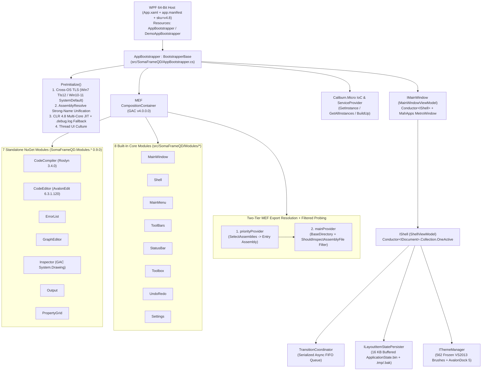
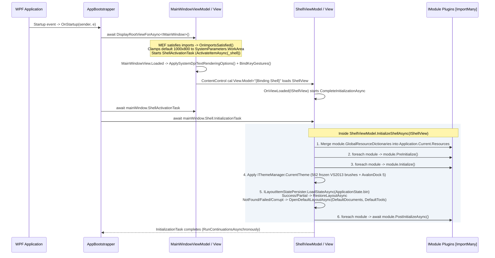

# 01 — Architecture & Bootstrapper Overview (`.NET Framework 4.8` `x64`)

> **Documentation Status:** **Authoritative Post-Conversion Reference (`2026-11-23`)** — Verified against frozen `SomaFrameQD` `0.9.0` (and `SomaFrameQD.Demo` `0.1.0` alpha) sources after Stage 1 Retargeting and Stage 2 Optimization.  
> **Scope:** [`src/SomaFrameQD`](../src/SomaFrameQD/) (`SomaFrameQDWpf` NuGet package) — Core workbench architecture, native `.NET 4.8` GAC MEF + Caliburn.Micro `5.0.258` bootstrapper, CLR 4.8 runtime/manifest configuration, Multi-Core Background JIT, filtered `BaseDirectory` probing, strong-name `AssemblyResolve` unification, deterministic async startup, and `IModule` plugin lifecycle.  
> **Target Runtime & OS Continuum:** `<TargetFramework>net48</TargetFramework>` — **Windows 7 SP1 `x64` → Windows 8.1 `x64` → Windows 10 `x64` → Windows 11 `x64`** (`x64` `PE32+` host executables + `AnyCPU` `x64`-clean NuGet libraries).

---

## 1. Purpose & Core Technology Stack

**SomaFrameQD** is a modular WPF IDE/workbench shell framework modeled conceptually on the Visual Studio Shell and engineered specifically for broad, zero-friction compatibility on **`.NET Framework 4.8` (`64-bit x64`)**. Host applications and plugins compose tabbed documents, dockable tool panes, declarative menus, toolbars, keyboard shortcuts, settings pages, themes, and services via **MEF (`System.ComponentModel.Composition` in the `.NET 4.8` GAC)** inside a **Caliburn.Micro `5.0.258`** MVVM shell hosted in a **MahApps.Metro `2.4.11`** window and laid out by **Dirkster.AvalonDock `5.0.1`**.

### Core Project & Package Identity ([`src/SomaFrameQD/SomaFrameQD.csproj`](../src/SomaFrameQD/SomaFrameQD.csproj) & [`src/Directory.Build.props`](../src/Directory.Build.props))

| Property | Post-Conversion Value (`0.9.0`) | Notes |
| :--- | :--- | :--- |
| **Project SDK** | `Microsoft.NET.Sdk.WindowsDesktop` | `<UseWPF>true</UseWPF>`, `<LangVersion>12.0</LangVersion>`, `<Deterministic>true</Deterministic>` |
| **Target Framework** | `net48` (single-target) | Compiles `AnyCPU` `x64`-clean `SomaFrameQD.dll` (`Exe`/`WinExe` hosts compile as `x64` `PE32+`, `Prefer32Bit=false`) |
| **Assembly / Root Namespace** | `SomaFrameQD` | Pack URI authority: `pack://application:,,,/SomaFrameQD;component/...` |
| **NuGet Package ID** | `SomaFrameQDWpf` | Distinct from assembly name; symbols emitted as `BSJB` Portable PDBs (`.snupkg`) |
| **Version Authority** | `0.9.0` ([`version.json`](../version.json)) | Stamped by `Nerdbank.GitVersioning` `3.5.109` (`SomaFrameQD.Demo` versions separately at `0.1.0` alpha) |
| **App Config ([`app.config`](../src/SomaFrameQD/app.config))** | `sku=".NETFramework,Version=v4.8"` | Exits `.NET 4.6.1` quirk mode; declares `userSettings` (`AutoHideMainMenu`, `ThemeName="LightTheme"`, `LanguageCode`) |

### Direct Dependencies of `SomaFrameQD.csproj`

| Dependency | Version / Source | Architectural Role |
| :--- | :--- | :--- |
| `System.ComponentModel.Composition` | `.NET Framework 4.8` GAC (`v4.0.0.0`) | Native pre-NGen'd 64-bit GAC MEF engine (`<Reference>` in [`src/Directory.Build.props`](../src/Directory.Build.props); replaces OOB `6.0.0` NuGet shim) |
| `PresentationFramework.Aero` | `.NET Framework 4.8` GAC (`v4.0.0.0`) | Native WPF Aero control chrome (`<Reference>` in `SomaFrameQD.csproj`) |
| `Caliburn.Micro` | `5.0.258` (NuGet) | Async MVVM screen/conductor lifecycle (`BootstrapperBase`, `Screen`, `Conductor<T>`, `IoC`, `IWindowManager`, `IEventAggregator`, `IResult` coroutines) |
| `Dirkster.AvalonDock.Serializer.Xml` | `5.0.1` (NuGet) | Docking engine (`DockingManager`), `AvalonDock.Core`, `XmlLayoutSerializer`, and transitive `System.Text.Json` `10.0.12` |
| `Dirkster.AvalonDock.Themes.VS2013` | `5.0.1` (NuGet) | Code-generated VS2013 Light/Blue/Dark docking `DictionaryTheme` resources |
| `MahApps.Metro` | `2.4.11` (NuGet) | Borderless `MetroWindow` chrome (`MainWindowView`), `ControlzEx` `4.4.0`, and `Microsoft.Xaml.Behaviors.Wpf` `1.1.135` |
| `DotNetProjects.Extended.Wpf.Toolkit` | `5.0.129` (NuGet) | Extended WPF controls (`ColorCanvas`, `ColorPicker`, numeric/collection editors) |

### Assembly-Level XAML, Theme & Test Visibility Metadata ([`src/SomaFrameQD/Properties/AssemblyInfo.cs`](../src/SomaFrameQD/Properties/AssemblyInfo.cs))

```csharp
[assembly: ThemeInfo(ResourceDictionaryLocation.None, ResourceDictionaryLocation.SourceAssembly)]

[assembly: XmlnsDefinition("http://schemas.timjones.io/SomaFrameQD", "SomaFrameQD")]
[assembly: XmlnsDefinition("http://schemas.timjones.io/SomaFrameQD", "SomaFrameQD.Framework.Controls")]
[assembly: XmlnsDefinition("http://schemas.timjones.io/SomaFrameQD", "SomaFrameQD.Framework.Markup")]

[assembly: InternalsVisibleTo("SomaFrameQD.Tests")]
```

> [!WARNING]
> **Legacy `README.md` Pitfall (`timjones.tw` vs. `timjones.io`):**  
> Legacy snippets in [`README.md`](../README.md) show `http://schemas.timjones.tw/SomaFrameQD`. Compiled assemblies and [`SomaFrameQD.Demo/App.xaml`](../src/SomaFrameQD.Demo/App.xaml) use **`http://schemas.timjones.io/SomaFrameQD`**. Always use `.io` in XAML.

---

## 2. High-Level Component Architecture



---

## 3. CLR 4.8 Host Configuration & `AppBootstrapper` Startup Pipeline

### 3.1 CLR 4.8 SKU & Embedded Win32 Application Manifest
Host executables mirror [`SomaFrameQD.Demo/app.config`](../src/SomaFrameQD.Demo/app.config) and [`SomaFrameQD.Demo/app.manifest`](../src/SomaFrameQD.Demo/app.manifest):
1. **`sku=".NETFramework,Version=v4.8"` (`app.config`):** Disables `.NET 4.6.1` compatibility quirks across CLR 4.8 and WPF 4.8—unlocking star-Grid allocation fixes, `AutomationPeer`/`BitmapImage` memory-retention fixes, SHA-256 crypto defaults, and modern `ServicePointManager` `SystemDefault` TLS delegation.
2. **Embedded `app.manifest` (`<ApplicationManifest>app.manifest</ApplicationManifest>`):**
   * **UAC:** `<requestedExecutionLevel level="asInvoker" uiAccess="false" />`.
   * **Unshimmed OS Version Detection (`<supportedOS>`):** Declares Windows 7 SP1 (`{35138b9a-5d96-4fbd-8e2d-a2440225f93a}`), Windows 8 (`{4a2f28e3-53b9-4441-ba9c-d69d4a4a6e38}`), Windows 8.1 (`{1f676c76-80e1-4239-95bb-83d0f6d0da78}`), and Windows 10 / Windows 11 (`{8e0f7a12-bfb3-4fe8-b9a5-48fd50a15a9a}`) so `Environment.OSVersion` reports true kernel versions.
   * **System-DPI Awareness (`Q2 = 2A`):** Declares both `<dpiAware xmlns=".../2005/WindowsSettings">true</dpiAware>` and `<dpiAwareness xmlns=".../2016/WindowsSettings">system</dpiAwareness>`, preventing child Win32 `HwndHost` airspace tearing across mixed-DPI monitors.
   * **Win32 Common Controls v6:** Enables `Microsoft.Windows.Common-Controls` `6.0.0.0` visual styles on native Win32 file/message dialogs across Win7 SP1 → Win11.

### 3.2 `PreInitialize()` Execution Order (`AppBootstrapper.cs` lines 118–132)
`AppBootstrapper` executes `PreInitialize()` inside its constructor **before** `BootstrapperBase.Initialize()` (note that legacy `.NET 5+` `PublishSingleFile` detection/bypass members were cleanly removed in Stage 2 `Q3 = 3B`):

1. **Cross-OS TLS Security Defaults (`ConfigureCrossOsNetworkDefaults` / `ResolveCrossOsSecurityProtocol`):**
   * On **Windows 7 SP1 / Server 2008 R2 (`NT 6.1`, `Major == 6 && Minor == 1`)**, if `ServicePointManager.SecurityProtocol == SecurityProtocolType.SystemDefault` (`0`), upgrades automatically to `SecurityProtocolType.Tls12` (while respecting any explicit non-default protocol set earlier by the host).
   * On **Windows 8.1, Windows 10, and Windows 11**, preserves `SecurityProtocolType.SystemDefault` (`0`) untouched so the OS Schannel stack negotiates **TLS 1.2 and TLS 1.3** natively without hardcoding an obsolete ceiling.
2. **Dynamic Strong-Name `AssemblyResolve` Unification (`RegisterAssemblyResolveHandler` / `TryUnifyStrongNamedAssembly`):**
   * Registers an idempotent `AppDomain.CurrentDomain.AssemblyResolve` handler (`Interlocked.CompareExchange`) guarded against recursion via `[ThreadStatic] HashSet<string> _resolvingAssemblyPaths`.
   * When a dynamically discovered MEF plugin requests an older strong-named assembly version (for example, Roslyn `3.4.0` requesting `System.Runtime.CompilerServices.Unsafe, Version=4.0.4.1` while AvalonDock `5.0.1` / `System.Text.Json` `10.0.12` loaded `Version=6.0.0.0`), `TryUnifyStrongNamedAssembly` unifies to the highest loaded or `BaseDirectory` assembly matching `Name` + `PublicKeyToken` with `Version >= requestedVersion`—complementing compile-time `.exe.config` binding redirects.
3. **CLR 4.8 Multi-Core Background JIT (`ConfigureMultiCoreJit`, `Q5 = 5A`):**
   * When `EnableMultiCoreJit` is `true` (default), creates `JitProfileDirectory` (`%LocalAppData%\<EntryAssemblyName>\JitProfiles`) and calls `ProfileOptimization.SetProfileRoot(profileDirectory)` + `ProfileOptimization.StartProfile(JitProfileFileName)` (`"Startup.net48.jitprofile"` by default; overridden to `"SomaFrameQD.Demo.Startup.net48.jitprofile"` in [`DemoAppBootstrapper.cs`](../src/SomaFrameQD.Demo/DemoAppBootstrapper.cs)).
   * **Resilient Fallback & `.debug.log` Diagnostics:** If profile creation fails (locked-down kiosk profile or read-only volume), startup degrades cleanly to standard 64-bit RyuJIT and appends a timestamped UTF-8 diagnostic record (`OSVersion`, `Is64BitProcess`, `AttemptedProfileDirectory`, full `Exception`) to `JitFallbackDebugLogFilePath` (`%LocalAppData%\<EntryAssemblyName>\Logs\SomaFrameQD.JitFallback.debug.log`, falling back to `%TEMP%\<EntryAssemblyName>.JitFallback.debug.log`).
4. **UI Culture Pre-Initialization:**
   * Reads `SomaFrameQD.Properties.Settings.Default.LanguageCode` and sets `Thread.CurrentThread.CurrentUICulture` and `CurrentCulture` before any XAML views or menus are instantiated.

### 3.3 Overridable `AppBootstrapper` Customization Hooks

| Virtual / Protected Member | Default Behavior | Host Override Use Case |
| :--- | :--- | :--- |
| `EnableMultiCoreJit` | `true` | Set `false` in unit test harnesses or diagnostic launches. |
| `JitProfileFileName` | `"Startup.net48.jitprofile"` | Per-executable profile naming (e.g., `DemoAppBootstrapper`). |
| `JitProfileDirectory` | `%LocalAppData%\<EntryAssemblyName>\JitProfiles` | Redirect JIT profiles to a portable or enterprise app-data path. |
| `JitFallbackDebugLogFilePath` | `%LocalAppData%\<EntryAssemblyName>\Logs\SomaFrameQD.JitFallback.debug.log` | Redirect Multi-Core JIT fallback diagnostics. |
| `PopulateAssemblySource()` | Probes `AppDomain.CurrentDomain.BaseDirectory` | Add secondary plugin directories (e.g., `./Plugins`) via `PopulateAssemblySourceUsingDirectoryCatalog(dir)`. |
| `ShouldInspectAssemblyFile(string)` | Skips known BCL/vendor prefixes & `.resources.dll` | Exclude large custom native/third-party DLLs from startup MEF probing. |
| `SelectAssemblies()` | `new[] { Assembly.GetEntryAssembly() }` | Register additional host assemblies into the high-priority `priorityProvider` tier. |
| `BindServices(CompositionBatch)` | Binds `IWindowManager`, `IEventAggregator`, `Container`, `this` | Inject host-specific singleton services prior to MEF composition. |
| `HandleFatalStartupException(Exception)` | Shows `MessageBox` and calls `Shutdown(-1)` | Route fatal startup faults to custom crash telemetry. |

---

## 4. Filtered `BaseDirectory` Probing & Two-Tier MEF Composition

### 4.1 Filtered Assembly Probing (`PopulateAssemblySourceUsingDirectoryCatalog`, `Q4 = 4A`)
Instead of scanning the mutable process working directory (`".\\"`), `PopulateAssemblySource()` probes `AppDomain.CurrentDomain.BaseDirectory` so file-association launches and Desktop shortcuts with altered working directories never miss MEF plugins:

1. **Vendor & BCL Prefix Filter (`ShouldInspectAssemblyFile`):** Accepts `.dll`/`.exe` files while skipping `*.resources.dll` satellite assemblies and known non-MEF prefixes (`System.`, `Microsoft.`, `netstandard.`, `mscorlib.`, `Caliburn.Micro`, `AvalonDock`, `MahApps.Metro`, `ControlzEx`, `ICSharpCode.AvalonEdit`, `DotNetProjects.Wpf.Extended.Toolkit`, `HelixToolkit`), while allowing all `SomaFrameQD*` and third-party plugin assemblies.
2. **Loaded-Assembly Reuse & Native Binary Safety:** Pre-indexes `AppDomain.CurrentDomain.GetAssemblies()` by normalized `Location` (`loadedByPath`) to avoid redundant disk metadata reads, calls `AssemblyName.GetAssemblyName(fullPath)` inside a `catch (BadImageFormatException)` guard so unmanaged C/C++ DLLs in `bin\` never fault startup, and wraps `new AssemblyCatalog(candidateAssembly)` in a `using` block—adding the assembly to `Caliburn.Micro.AssemblySource.Instance` only if `assemblyCatalog.Parts.Any()` is `true`.

### 4.2 Priority Catalog Override Mechanism (`Configure()`)
SomaFrameQD enforces **client-first MEF export resolution** (`AppBootstrapper.cs`, lines 260–291):
1. **`priorityProvider`:** Wraps `SelectAssemblies()` (the entry assembly by default).
2. **`mainProvider`:** Wraps all remaining MEF assemblies discovered in `AssemblySource.Instance` (`SomaFrameQD`, `SomaFrameQD.Modules.*`, plugins).
3. **Container Precedence:**
   ```csharp
   Container = new CompositionContainer(priorityProvider, mainProvider);
   priorityProvider.SourceProvider = Container;
   mainProvider.SourceProvider = Container;
   ```
   Single-instance lookups via `GetInstance(Type, string)` (`exports.First().Value`) always resolve the entry application's override ahead of built-in framework exports (for example, `SomaFrameQD.Demo`'s custom `[Export(typeof(IShell))] ShellViewModel` overriding core `ShellViewModel`). Missing contracts throw loudly (`new Exception("Could not locate any instances of contract ...")`)—never swallow cardinality errors with silent `null` fallbacks.

### 4.3 Root MEF Singletons & `IServiceProvider` Bridge
* `BindServices(CompositionBatch)` + `Configure()` export five root singletons: `IWindowManager` (`WindowManager`), `IEventAggregator` (`EventAggregator`), `CompositionContainer` (`Container`), `AppBootstrapper` (`this`), and `AggregateCatalog` (`mainCatalog`).
* [`ServiceProvider`](../src/SomaFrameQD/Framework/Services/ServiceProvider.cs) (`[Export(typeof(IServiceProvider))]`) bridges standard `.NET` `IServiceProvider.GetService(Type)` calls to `IoC.GetInstance(serviceType, null)`.

---

## 5. Deterministic Async Startup & `IModule` Lifecycle

### 5.1 Three-Stage Async Startup (`OnStartup`)
`AppBootstrapper.OnStartup` (`lines 445–460`) awaits three view-synchronized milestones in strict order and routes any exception to `HandleFatalStartupException`:



### 5.2 `IModule` & `ModuleBase` Contract ([`IModule.cs`](../src/SomaFrameQD/Framework/IModule.cs), [`ModuleBase.cs`](../src/SomaFrameQD/Framework/ModuleBase.cs))

| Member | Type | Execution Timing & Responsibility |
| :--- | :--- | :--- |
| `GlobalResourceDictionaries` | `IEnumerable<ResourceDictionary>` | Merged into `Application.Current.Resources.MergedDictionaries` first during `InitializeShellAsync`, prior to `PreInitialize()` or theme selection. |
| `PreInitialize()` | `void` | Runs across all `[ImportMany] IModule` exports before any module's `Initialize()`. |
| `Initialize()` | `void` | Synchronous setup hook prior to layout state restoration. Because `DefaultDocuments` and `DefaultTools` are skipped when `ApplicationState.bin` restores cleanly, avoid opening layout-managed documents unconditionally here unless intentional. |
| `DefaultDocuments` | `IEnumerable<IDocument>` | Opened via `OpenDocumentAsync` **only** when persisted layout state is `NotFound`, `Failed`, or `Corrupt`. |
| `DefaultTools` | `IEnumerable<Type>` | `ITool` contract `Type`s resolved via `IoC.GetInstance(type, null)` and shown via `ShowToolAsync` **only** when opening the default layout. |
| `PostInitializeAsync()` | `Task` | Awaited sequentially **after** theme application, layout restoration (or default layout creation), and `IAsyncLayoutItemStateRestorer` content loading complete. |

`ModuleBase` automatically `[Import]`s `MainWindow` (`IMainWindow`), `Shell` (`IShell`), `MainMenu` (`Shell.MainMenu`), and `ToolBars` (`Shell.ToolBars`) for convenience.

---

## 6. Legacy `README.md` vs. Compiled `0.9.0` Contract Summary

| Topic | Stale `README.md` Snippet | Authoritative `0.9.0` Codebase Contract |
| :--- | :--- | :--- |
| **Core NuGet ID vs. Namespace** | Mixes package/assembly naming | NuGet Package ID is **`SomaFrameQDWpf`**; assembly, root namespace, and pack URI authority are **`SomaFrameQD`** |
| **XAML XML Namespace** | `http://schemas.timjones.tw/SomaFrameQD` | **`http://schemas.timjones.io/SomaFrameQD`** (`Properties/AssemblyInfo.cs`) |
| **`IShell` Document & Tool APIs** | Sync `OpenDocument`, `CloseDocument`, `ShowTool` | **Async `Task` methods:** `OpenDocumentAsync`, `CloseDocumentAsync`, `ShowToolAsync`, `CloseToolAsync`, `InitializationTask` (see [02 — Core Framework Primitives](./02_Core_Framework_Primitives_and_Coroutines.md)) |
| **Caliburn.Micro Lifecycle** | Caliburn 2/3/4 sync `OnInitialize`, `EventHandler` | **Caliburn.Micro `5.0.258` async lifecycle:** `OnInitializedAsync`, `OnActivateAsync`/`OnActivatedAsync`, `OnDeactivateAsync`, `CanCloseAsync`, `AsyncEventHandler<ActivationEventArgs>` ([`doc/caliburn-5-migration.md`](../doc/caliburn-5-migration.md)) |
| **Built-In Core Modules** | Lists 7 built-in modules | **8 built-in modules** under `src/SomaFrameQD/Modules/`: `MainWindow`, `Shell`, `MainMenu`, `StatusBar`, `ToolBars`, `Toolbox`, `UndoRedo`, and **`Settings`** (`04_Shell_Docking_Persistence_and_BuiltIn_Modules.md`) |
