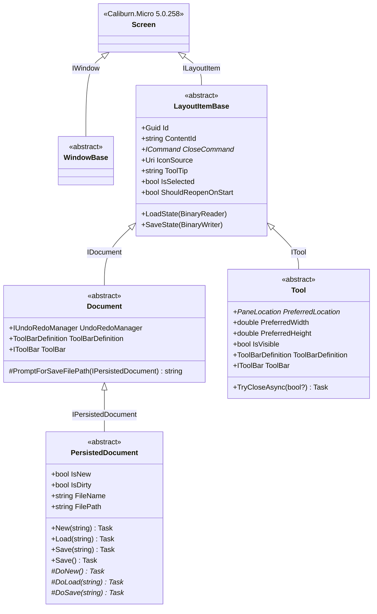

# 02 — Core Framework Primitives, Editor Pipeline & Coroutines (`.NET Framework 4.8` `x64`)

> **Documentation Status:** **Authoritative Post-Conversion Reference (`2026-11-23`)** — Verified against frozen `SomaFrameQD` `0.9.0` sources after Stage 1 Retargeting and Stage 2 Optimization.  
> **Scope:** [`src/SomaFrameQD/Framework/*`](../src/SomaFrameQD/Framework/) and [`EditorOpeningService.cs`](../src/SomaFrameQD/Modules/Shell/Services/EditorOpeningService.cs) — Screen/docking class hierarchy (`WindowBase`, `Document`, `PersistedDocument`, `Tool`), view-ready editor opening pipeline, Caliburn.Micro `5.0.258` `IResult` coroutines (`Show.*`), `AsyncCommand`/`RelayCommand`, XAML localization, frozen pack-URI resource loading, weak settings listeners, and 64-bit-hardened WPF behaviors (`WindowOptionsBehavior`).  
> **Companion Guides:** [01 — Architecture & Bootstrapper Overview](./01_Architecture_and_Bootstrapper_Overview.md) | [03 — Commands, Menus, ToolBars & KeyGestures](./03_Commands_Menus_ToolBars_and_KeyGestures.md)

---

## 1. Screen & Docking Layout Item Hierarchy

All SomaFrameQD windows, documents, and dockable tool panes inherit from **Caliburn.Micro `5.0.258`**'s `Screen` base class (`IScreen` = `IHaveDisplayName`, `IActivate`, `IDeactivate`, `IGuardClose`, `INotifyPropertyChangedEx`, `IViewAware`, `IChild`) and use exclusively asynchronous lifecycle hooks (`OnInitializedAsync`, `OnActivateAsync`/`OnActivatedAsync`, `OnDeactivateAsync(bool close, CancellationToken)`, `CanCloseAsync`).

### 1.1 `IWindow` & `WindowBase` ([`IWindow.cs`](../src/SomaFrameQD/Framework/IWindow.cs), [`WindowBase.cs`](../src/SomaFrameQD/Framework/WindowBase.cs))
* Base contract (`IActivate, IDeactivate, INotifyPropertyChangedEx`) and abstract `Screen` subclass for standalone modal dialogs (`Show.Dialog<TWindow>()`, such as `SettingsViewModel`) and modeless popup windows (`Show.Window<TWindow>()`).
* Modal dialog exports such as `SettingsViewModel` must declare `[PartCreationPolicy(CreationPolicy.NonShared)]` so repeated dialog invocations receive fresh instances.

### 1.2 `ILayoutItem` & `LayoutItemBase` ([`ILayoutItem.cs`](../src/SomaFrameQD/Framework/ILayoutItem.cs), [`LayoutItemBase.cs`](../src/SomaFrameQD/Framework/LayoutItemBase.cs))
Shared base for every item hosted inside AvalonDock 5 (`IDocument` and `ITool`):
* **`Id` & `ContentId`:** Allocates a fresh `Guid.NewGuid()` per instance (`ContentId => Id.ToString()`), enabling `LayoutItemStatePersister` and AvalonDock's `XmlLayoutSerializer` to correlate XML layout nodes back to per-item binary state records.
* **`ShouldReopenOnStart`:** Virtual boolean (`false` on `LayoutItemBase`, overridden to `true` on `Tool` and `CodeEditorViewModel`). Only items returning `true` are written into `ApplicationState.bin` on shutdown.
* **`LoadState(BinaryReader)` / `SaveState(BinaryWriter)`:** Synchronous, stream-scoped binary state hooks. Implementations must never start unawaited background work that outlives the `BinaryReader` stream.
* **`IAsyncLayoutItemStateRestorer` ([`IAsyncLayoutItemStateRestorer.cs`](../src/SomaFrameQD/Framework/IAsyncLayoutItemStateRestorer.cs)):** Optional secondary interface (`Task RestoreStateAsync()`). `LayoutItemStatePersister` closes the `ApplicationState.bin` file stream first and then awaits `RestoreStateAsync()` on all implementing items **before** presenting documents, activating visible tools, or completing `IShell.InitializationTask`.

### 1.3 `IDocument` & `Document` ([`IDocument.cs`](../src/SomaFrameQD/Framework/IDocument.cs), [`Document.cs`](../src/SomaFrameQD/Framework/Document.cs))
Base class for center-pane tabbed/docked editor documents conducted by `ShellViewModel : Conductor<IDocument>.Collection.OneActive`:
* **Per-Document `UndoRedoManager` Disposal Invariant:** Lazily creates `IUndoRedoManager` via virtual `CreateUndoRedoManager() => new UndoRedoManager()`. Inside `OnDeactivateAsync(bool close, CancellationToken)`, `_undoRedoManager?.Dispose()` executes **strictly when `close == true`**—preserving undo history across tab switches and vetoed/faulted closes while releasing object graphs immediately upon actual document close.
* **Built-In Contextual Command Handlers:** Implements explicit handlers routed automatically by `CommandRouter` whenever the document is active (or is `IShell.ActiveItem` while focus resides inside a tool pane):
  * `ICommandHandler<UndoCommandDefinition>` (`Enabled = UndoRedoManager.CanUndo`, executes `Undo(1)`)
  * `ICommandHandler<RedoCommandDefinition>` (`Enabled = UndoRedoManager.CanRedo`, executes `Redo(1)`)
  * `ICommandHandler<SaveFileCommandDefinition>` (`Enabled = this is IPersistedDocument`; routes `IsNew` files to `DoSaveAs`, existing files to `Save(FilePath)`)
  * `ICommandHandler<SaveFileAsCommandDefinition>` (`Enabled = this is IPersistedDocument`; prompts via `PromptForSaveFilePath`)
* **Save File Dialog Filtering:** `PromptForSaveFilePath(IPersistedDocument)` queries `IoC.GetAll<IEditorProvider>().SelectMany(x => x.FileTypes)` matching `Path.GetExtension(persistedDocument.FileName)` to build `SaveFileDialog.Filter` (`"<TypeName>|*<ext>|All Files|*.*"`), returning `null` on cancel.
* **Per-Document ToolBar & `CloseCommand`:** Setting `protected ToolBarDefinition` lazily builds a pane-local `ToolBarModel` via `IToolBarBuilder` on first `ToolBar` read; `CloseCommand` wraps `new AsyncCommand(() => TryCloseAsync(null))`.

### 1.4 `IPersistedDocument` & `PersistedDocument` ([`IPersistedDocument.cs`](../src/SomaFrameQD/Framework/IPersistedDocument.cs), [`PersistedDocument.cs`](../src/SomaFrameQD/Framework/PersistedDocument.cs))
Template-method subclass of `Document` for file-backed editors:
* **State Tracking:** `IsNew`, `IsDirty`, `FileName`, `FilePath`. Updating `IsDirty` refreshes `DisplayName` (`IsDirty ? FileName + "*" : FileName`); updating `FilePath` refreshes `ToolTip = FilePath`.
* **Async File Operations:**
  * `New(string fileName)` → sets `IsNew = true`, `IsDirty = false`, awaits `DoNew()`.
  * `Load(string filePath)` → sets `FilePath`, `FileName`, `IsNew = false`, `IsDirty = false`, awaits `DoLoad(filePath)`.
  * `Save(string filePath)` → sets `FilePath`, `FileName`, awaits `DoSave(filePath)`, then clears `IsDirty = false` and `IsNew = false`.
* **Dirty Close-Guard Outcomes (`CanCloseAsync`):** When `IsDirty == true`, invokes virtual `PromptToSaveChanges()` (`MessageBoxButton.YesNoCancel`):
  * **`Cancel`:** Returns `false` (close vetoed; document remains active and dirty).
  * **`No` (Discard):** Returns `true` immediately **without** clearing `IsDirty` first.
  * **`Yes` (Save):** Awaits `Save()`. If `IsNew == true` and the user cancels the `SaveFileDialog`, `IsNew` stays `true`, so `return !IsNew` evaluates to `false` and **vetoes the close**.

### 1.5 `ITool` & `Tool` ([`ITool.cs`](../src/SomaFrameQD/Framework/ITool.cs), [`Tool.cs`](../src/SomaFrameQD/Framework/Tool.cs), [`PaneLocation.cs`](../src/SomaFrameQD/Framework/Services/PaneLocation.cs))
Base class for dockable utility panes (`ErrorList`, `Output`, `Inspector`, `PropertyGrid`, `Toolbox`, `History`):
* **Placement & Defaults:** Abstract `PaneLocation PreferredLocation` (`Left`, `Right`, `Bottom`), virtual `PreferredWidth => 200`, `PreferredHeight => 200`, `IsVisible` (`true` initially), `ShouldReopenOnStart => true`.
* **Shell-Owned Close Routing (Non-Negotiable Invariant):** Tools in `ShellViewModel.Tools` are **not** parented by a Caliburn conductor. `Tool.TryCloseAsync(bool? dialogResult = null)` overrides `Screen.TryCloseAsync` and delegates to `IoC.Get<IShell>().CloseToolAsync(this)`, which evaluates `CanCloseAsync` once, deactivates with `close: true`, sets `IsVisible = false` and `IsSelected = false`, and **leaves the tool in `Shell.Tools`** so `ShowToolAsync` can reopen it cleanly.

---

## 2. View-Ready Editor Opening Pipeline (`IEditorProvider` & `EditorOpeningService`)

### 2.1 `IEditorProvider` & `NonShared` Lifetime ([`IEditorProvider.cs`](../src/SomaFrameQD/Framework/Services/IEditorProvider.cs), [`EditorFileType.cs`](../src/SomaFrameQD/Framework/Services/EditorFileType.cs))
Modules register file editors by exporting `[Export(typeof(IEditorProvider))]`:
* `IEnumerable<EditorFileType> FileTypes` (`Name`, `FileExtension`, `IconSource`), `bool CanCreateNew`, `bool Handles(string path)`, `IDocument Create()`, `Task New(IDocument, string)`, and `Task Open(IDocument, string)`.
* **MEF Lifetime Rule:** Because MEF defaults exports to `CreationPolicy.Shared` (singleton), every multi-instance `IDocument` resolved inside `Create()` (such as `CodeEditorViewModel` or `GraphViewModel`) **must** be decorated with `[PartCreationPolicy(CreationPolicy.NonShared)]`.

### 2.2 `EditorOpeningService` ([`EditorOpeningService.cs`](../src/SomaFrameQD/Modules/Shell/Services/EditorOpeningService.cs))
`EditorOpeningService` (`[Export(typeof(IEditorOpeningService))]`) guarantees **view-ready, truthful asynchronous completion** for both `OpenFileAsync` and `NewFileAsync`:
1. **Open-File Deduplication (`OpenFileAsync`):** Normalizes `Path.GetFullPath(path)` and checks `_shell.Documents.OfType<IPersistedDocument>()` (`StringComparison.OrdinalIgnoreCase`). If already open, runs `configure?.Invoke(existingDocument)`, awaits `_shell.OpenDocumentAsync(existingDocument)` to focus it, and returns the existing document.
2. **Provider Lookup:** Resolves `_editorProviders.FirstOrDefault(x => x.Handles(path))` or returns a faulted task with `NotSupportedException`.
3. **Pre-Subscribed View Readiness (`PresentAndInitializeAsync`):** Because WPF editors such as `CodeEditorViewModel` access view controls inside `DoNew()` / `DoLoad()`, `EditorOpeningService`:
   * Attaches a disposable `EditorViewReadiness` observer (`IViewAware.ViewAttached` + `FrameworkElement.Loaded`) **before** invoking `_shell.OpenDocumentAsync(document)` so synchronous view loads cannot race ahead of event registration;
   * Starts `presentationTask = _shell.OpenDocumentAsync(document)` and awaits `AwaitViewReadinessAsync(readiness.Task, presentationTask)` (propagating any early presentation fault immediately);
   * Calls `editorProvider.Open(document, path)` or `editorProvider.New(document, name)`; and
   * Awaits `Task.WhenAll(presentationTask, initializationTask)` before completing.

---

## 3. Caliburn.Micro 5 Coroutine Results ([`Framework/Results/*`](../src/SomaFrameQD/Framework/Results/))

SomaFrameQD provides the static `Show` factory ([`Show.cs`](../src/SomaFrameQD/Framework/Results/Show.cs)) and thread-safe [`OpenResultBase<TTarget>`](../src/SomaFrameQD/Framework/Results/OpenResultBase.cs) implementing Caliburn's `IResult`:

### 3.1 `OpenResultBase<TTarget>` State-Machine Guarantees
* **At-Most-Once Terminal Completion:** Each `Execute(CoroutineExecutionContext)` creates a `ResultExecution` capturing `SynchronizationContext.Current` and guards `TryComplete` with `Interlocked.Exchange(ref _isCompleted, 1)` so racing task completions and `Deactivated` events never fire `Completed` twice.
* **Re-Execution Cancellation:** Calling `BeginExecution()` on an in-flight result atomically supersedes the prior `ResultExecution` with `WasCancelled = true`.
* **Captured Context Marshaling:** Background continuations post `ResultCompletionEventArgs` back onto the captured `SynchronizationContext`.
* **`OnConfigure` & `OnShutDown` Error Routing:** Exceptions in `OnConfigure` complete the result immediately with `Error = exception`. Exceptions in `OnShutDown` become `ResultCompletionEventArgs.Error` while the result is awaiting close/dialog return; for an already-completed `OpenDocumentResult`, they fault the later close lifecycle task.

### 3.2 Built-In `IResult` Types & Completion Matrix

| Result Class | `Show.*` Factory Overloads | When `Completed` Fires | Cancellation & Fault Semantics |
| :--- | :--- | :--- | :--- |
| `OpenDocumentResult` | `Show.Document(doc)` `Show.Document(path)` `Show.Document<T>()` | **Immediately after shell presentation & provider initialization finish.** | Null editor cancels (`WasCancelled = true`). Retains a one-shot `WasClosed` handler solely to invoke `OnShutDown`. |
| `ShowToolResult<TTool>` | `Show.Tool<TTool>()` `Show.Tool(tool)` | **When the shown tool closes** (`Deactivated` with `WasClosed == true`). | Faulted or canceled `ShowToolAsync` completes immediately instead of waiting for close. |
| `ShowWindowResult<TWindow>` | `Show.Window<TWindow>()` `Show.Window(window)` | **When the modeless window closes** (`Deactivated` with `WasClosed == true`). | Uses `[Import] IWindowManager.ShowWindowAsync(window)`. Faulted/canceled show completes immediately. |
| `ShowDialogResult<TWindow>` | `Show.Dialog<TWindow>()` `Show.Dialog(window)` | **When `WindowManager.ShowDialogAsync(window)` returns.** | `false` or `null` dialog return sets `WasCancelled = true`; `true` sets `WasCancelled = false`; faulted task sets `Error`. |
| `ShowCommonDialogResult` | `Show.CommonDialog(dialog)` | **Synchronously after Win32 `CommonDialog.ShowDialog()` returns.** | Sets `WasCancelled = !result`. |
| `LambdaResult` | `new LambdaResult(ctx => ...)` | **Synchronously after `_lambda(context)` returns.** | Emits empty `ResultCompletionEventArgs` on normal return. |

---

## 4. Command Wrappers, Localization, Services & 64-Bit WPF Behaviors

### 4.1 `AsyncCommand` & `RelayCommand` ([`AsyncCommand.cs`](../src/SomaFrameQD/Framework/AsyncCommand.cs), [`RelayCommand.cs`](../src/SomaFrameQD/Framework/RelayCommand.cs))
* **`AsyncCommand` (`IAsyncCommand : ICommand`):** Wraps `Func<Task>` + optional `Func<bool>`, blocks concurrent re-entrancy via `!_isExecuting`, resets `_isExecuting = false` in `finally`, and raises `CanExecuteChanged` on completion.
* **`RelayCommand` (`ICommand`):** Synchronous `Action<object>` / `Predicate<object>` command hooked to `CommandManager.RequerySuggested`.

### 4.2 XAML Localization, Frozen Pack Resources & Weak Settings Listeners
* **`TranslateExtension` ([`TranslateExtension.cs`](../src/SomaFrameQD/Framework/Markup/TranslateExtension.cs)):** Subclasses `System.Windows.Markup.StaticExtension` (`http://schemas.timjones.io/SomaFrameQD`) so XAML views bind localized `.resx` keys via `{SomaFrameQD:Translate local:Resources.SomeKey}` across all 7 supported locales (`en`, `de`, `fr`, `ko`, `ru`, `zh-Hans`, `zh-TW`).
* **`ResourceManager` ([`ResourceManager.cs`](../src/SomaFrameQD/Framework/Services/ResourceManager.cs)):** `[Export(typeof(IResourceManager))]` service loading WPF pack streams (`Application.GetResourceStream`) and returning **frozen** (`bmp.Freeze()`) `BitmapImage` instances.
* **`SettingsPropertyChangedEventManager<T>` ([`SettingsPropertyChangedEventManager.cs`](../src/SomaFrameQD/Framework/Services/SettingsPropertyChangedEventManager.cs)):** Generic `IWeakEventListener` wrapper around `PropertyChangedEventManager` using compiled member expressions so transient views/view-models observe `ApplicationSettingsBase` singletons without strong-reference leaks.
* **`TaskUtility.Completed` ([`TaskUtility.cs`](../src/SomaFrameQD/Framework/Threading/TaskUtility.cs)):** Pre-completed `Task` helper retained for source compatibility across modules and plugins.

### 4.3 Hardened 64-Bit `WindowOptionsBehavior` & Visual Helpers
* **`WindowOptionsBehavior` ([`WindowOptionsBehavior.cs`](../src/SomaFrameQD/Framework/Behaviors/WindowOptionsBehavior.cs)):**
  * **Why an HWND Wrapper Is Needed:** WPF's `Window.ResizeMode` offers only coarse presets (`NoResize`, `CanMinimize`, `CanResize`) and exposes no managed API to hide the title-bar icon (`WS_EX_DLGMODALFRAME` + `WM_SETICON`) or toggle `WS_MINIMIZEBOX` / `WS_MAXIMIZEBOX` independently on resizable modal dialogs such as `SettingsView`.
  * **Post-Stage-2 `x64` Hardening:**
    1. **Pre-HWND Deferral:** When `ShowIcon`, `ShowMinimizeBox`, or `ShowMaximizeBox` is set in XAML before `Window.SourceInitialized`, `new WindowInteropHelper(AssociatedObject).Handle` is `IntPtr.Zero`; `UpdateWindowStyle()` returns cleanly and applies the styles once `SourceInitialized` fires (detaching `SourceInitialized` in `OnDetaching()`).
    2. **64-Bit `GetWindowLongPtr` / `SetWindowLongPtr`:** Reads and writes `GWL_STYLE` and `GWL_EXSTYLE` as 64-bit `long` / `IntPtr` bitmasks via `NativeMethods.GetWindowLongPtr` and `NativeMethods.SetWindowLongPtr`, followed by `SetWindowPos(..., SWP_NOMOVE | SWP_NOSIZE | SWP_NOZORDER | SWP_FRAMECHANGED)` and `SendMessage(handle, WM_SETICON, IntPtr.Zero, IntPtr.Zero)` when `ShowIcon == false` (verified on `[net48|x64]` by `Win32X64InteropTests.WindowOptionsBehavior_BeforeAndAfterSourceInitialized_UpdatesStylesCleanlyOnX64`).
* **`BindableTreeViewSelectedItemBehavior` ([`BindableTreeViewSelectedItemBehavior.cs`](../src/SomaFrameQD/Framework/Behaviors/BindableTreeViewSelectedItemBehavior.cs)):** Adds a two-way bindable `SelectedItem` `DependencyProperty` to WPF `TreeView` (used by `SettingsView.xaml`), expanding ancestor `TreeViewItem` containers to bring virtualized nodes into view.
* **`KeyboardFocusBehavior` ([`KeyboardFocusBehavior.cs`](../src/SomaFrameQD/Framework/Behaviors/KeyboardFocusBehavior.cs)), `ItemsControlUtility` ([`ItemsControlUtility.cs`](../src/SomaFrameQD/Framework/Utils/ItemsControlUtility.cs)), & `VisualTreeUtility` ([`VisualTreeUtility.cs`](../src/SomaFrameQD/Framework/VisualTreeUtility.cs)):** Initial keyboard focus helper, automatic menu/toolbar `Separator` visibility collapsing, and `VisualTreeHelper.GetParent` ancestor lookup.
