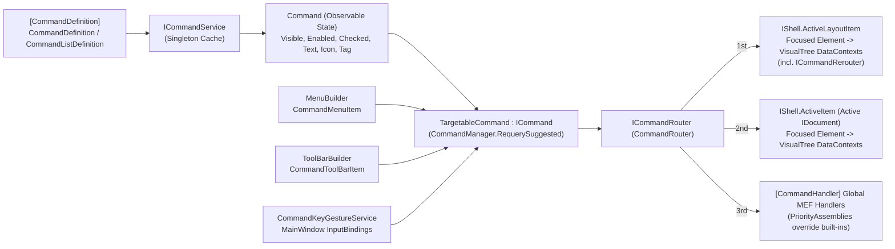

# 03 — Commands, Menus, ToolBars & KeyGestures (`.NET Framework 4.8` `x64`)

> **Documentation Status:** **Authoritative Post-Conversion Reference (`2026-11-23`)** — Verified against frozen `SomaFrameQD` `0.9.0` sources after Stage 1 Retargeting and Stage 2 Optimization.  
> **Scope:** [`src/SomaFrameQD/Framework/Commands/*`](../src/SomaFrameQD/Framework/Commands/), [`Framework/Menus/*`](../src/SomaFrameQD/Framework/Menus/), [`Framework/ToolBars/*`](../src/SomaFrameQD/Framework/ToolBars/), [`Framework/Services/InputManager.cs`](../src/SomaFrameQD/Framework/Services/InputManager.cs), [`Modules/MainMenu/MenuBuilder.cs`](../src/SomaFrameQD/Modules/MainMenu/MenuBuilder.cs), and [`Modules/ToolBars/ToolBarBuilder.cs`](../src/SomaFrameQD/Modules/ToolBars/ToolBarBuilder.cs).  
> **Companion Guides:** [01 — Architecture & Bootstrapper Overview](./01_Architecture_and_Bootstrapper_Overview.md) | [02 — Core Framework Primitives, Editor Pipeline & Coroutines](./02_Core_Framework_Primitives_and_Coroutines.md)

---

## 1. Architectural Overview: Decoupled Command & UI Composition

Unlike standard WPF `RoutedUICommand` (which couples command routing strictly to keyboard-focus visual ancestry and exposes only boolean `CanExecute` gating), SomaFrameQD separates UI actions into four orthogonal layers composed via `.NET Framework 4.8`'s native GAC MEF engine (`System.ComponentModel.Composition`):

1. **Command Definitions (`[CommandDefinition]`):** Static metadata (`Name`, `Text`, `ToolTip`, `IconSource`, `IsList`) identifying an abstract user action once.
2. **Observable Command State (`Command` & `TargetableCommand`):** Runtime UI properties (`Visible`, `Enabled`, `Checked`, `Text`, `ToolTip`, `IconSource`, `Tag`) bridged to `ICommand` via WPF's `CommandManager.RequerySuggested`.
3. **Command Handlers (`[CommandHandler]` & Contextual Handlers):** Global singleton MEF services **or** active document/tool/`DataContext` handlers (including `ICommandRerouter`) resolved dynamically by `CommandRouter`.
4. **Declarative Surface Bindings (`[Export]` Menus, ToolBars & Shortcuts):** Modules attach commands to menus, toolbars, and keyboard gestures—or declaratively **exclude** built-in items—without modifying central shell code.

---

## 2. Command Definitions & Runtime State ([`Framework/Commands/*`](../src/SomaFrameQD/Framework/Commands/))

### 2.1 `CommandDefinitionBase`, `CommandDefinition` & `CommandListDefinition`
All command definitions export themselves to MEF via `[CommandDefinition]` (`CommandDefinitionAttribute : ExportAttribute(typeof(CommandDefinitionBase))`):

| Class | `IsList` | Purpose & Required Overrides |
| :--- | :---: | :--- |
| [`CommandDefinitionBase`](../src/SomaFrameQD/Framework/Commands/CommandDefinitionBase.cs) | *(abstract)* | Abstract root declaring `Name`, `Text`, `ToolTip`, `IconSource`, and `IsList`. |
| [`CommandDefinition`](../src/SomaFrameQD/Framework/Commands/CommandDefinition.cs) | `false` | Standard single action (`File.OpenFile`, `Edit.Undo`, `View.ErrorList`, etc. — 27 built-in/module/demo single commands). Subclasses override `Name`, `Text`, `ToolTip`, and optionally `IconSource`. |
| [`CommandListDefinition`](../src/SomaFrameQD/Framework/Commands/CommandListDefinition.cs) | `true` | Dynamic menu list placeholder (`File.NewFile`, `Window.SwitchToDocument`). Seals `Text => "[NotUsed]"`, `ToolTip => "[NotUsed]"`, `IconSource => null`; subclasses override `Name` only. |

### 2.2 `Command`, `ICommandService` & `TargetableCommand`
* **[`Command`](../src/SomaFrameQD/Framework/Commands/Command.cs) (`PropertyChangedBase`):** Mutable runtime model initialized from a `CommandDefinitionBase` (`Visible = true`, `Enabled = true`, `Checked = false`, `Text`, `ToolTip`, `IconSource`, plus an `object Tag` payload used by dynamic list items).
* **[`CommandService`](../src/SomaFrameQD/Framework/Commands/CommandService.cs) (`[Export(typeof(ICommandService))]`):** Imports `[ImportMany] CommandDefinitionBase[]` and caches 1-to-1 singletons for `GetCommandDefinition(Type)`, `GetCommand(CommandDefinitionBase)`, and `GetTargetableCommand(Command)`.
* **[`TargetableCommand`](../src/SomaFrameQD/Framework/Commands/TargetableCommand.cs) (`ICommand`):**
  * Wires `CanExecuteChanged` directly to `CommandManager.RequerySuggested`.
  * `CanExecute(object parameter)`: Queries `_commandRouter.GetCommandHandler(_command.CommandDefinition)`. Returns `false` when no handler is in scope; otherwise calls `commandHandler.Update(_command)` (allowing dynamic mutation of `Enabled`, `Visible`, `Checked`, `Text`, `ToolTip`, and `IconSource`) and returns `_command.Enabled`.
  * `Execute(object parameter)` (`async void`): Resolves the active `CommandHandlerWrapper` from `_commandRouter` and awaits `commandHandler.Run(_command)`.

---

## 3. Command Handlers & Three-Stage Routing ([`CommandRouter.cs`](../src/SomaFrameQD/Framework/Commands/CommandRouter.cs))

### 3.1 Handler & Rerouter Contracts
* **Single Command Handler ([`ICommandHandler<TCommandDefinition>` / `CommandHandlerBase<T>`](../src/SomaFrameQD/Framework/Commands/ICommandHandler.cs)):**
  * `void Update(Command command)` — updates observable command state (virtual no-op on `CommandHandlerBase<T>`).
  * `Task Run(Command command)` — executes asynchronous command work.
* **Dynamic List Handler (`ICommandListHandler<TCommandListDefinition>`):**
  * `void Populate(Command command, List<Command> commands)` — generates transient `Command` entries (storing item context in `command.Tag`).
  * `Task Run(Command command)` — handles invocation of a populated list item.
* **Global MEF Registration:** Decorate a service class with `[CommandHandler]` (`ExportAttribute(typeof(ICommandHandler))`). One class may implement multiple `ICommandHandler<T>` and/or `ICommandListHandler<T>` interfaces.
* **Contextual Delegation ([`ICommandRerouter`](../src/SomaFrameQD/Framework/Commands/ICommandRerouter.cs)):** Any `DataContext` in the visual tree may implement `object GetHandler(CommandDefinitionBase commandDefinition)` to forward specific commands to another object—for example, `PropertyGridViewModel` forwarding `UndoCommandDefinition` and `RedoCommandDefinition` to `IShell.ActiveItem` (verified on `[net48|x64]` in `StandaloneAndDemoOptimizationTests.PropertyGridViewModel_CommandRerouter_ForwardsUndoRedoToActiveDocumentOnX64`).

### 3.2 `CommandRouter.GetCommandHandler` Resolution Order
Whenever WPF evaluates `CanExecute`, invokes `Execute`, or opens a menu, `CommandRouter` resolves a reflection-cached `CommandHandlerWrapper` in three stages:

1. **Stage 1 — Active Layout Item (`IShell.ActiveLayoutItem`: Focused Tool or Document):**
   * Resolves the item's view via `ViewLocator.LocateForModel(...)` and confirms `Window.GetWindow(activeItemView) != null`.
   * Starts at `FocusManager.GetFocusedElement(activeItemView) ?? activeItemView` and walks **up** `VisualTreeHelper.GetParent(...)`.
   * At each distinct `FrameworkElement.DataContext`:
     * Checks `ICommandRerouter.GetHandler(commandDefinition)` first (throwing `InvalidOperationException` if a rerouter returns an object that does not implement `ICommandHandler<T>` / `ICommandListHandler<T>` for that definition).
     * Next checks whether `DataContext` itself implements the matching handler interface.
2. **Stage 2 — Active Document Fallback (`IShell.ActiveItem`):**
   * If `IShell.ActiveItem` (the active center-pane `IDocument`) is non-null and differs from `ActiveLayoutItem` (for instance, when keyboard focus is inside `Inspector`, `Toolbox`, or `ErrorList`), repeats the visual-tree walk on `ActiveItem` so document-level `Save`, `Save As`, `Undo`, and `Redo` remain active while working in docked tools.
3. **Stage 3 — Global MEF `[CommandHandler]` Exports (`_globalCommandHandlerWrappers`):**
   * Falls back to global `[CommandHandler]` exports.
   * **Priority Assembly Override Rule (`SortCommandHandlers`):** Handlers from non-priority assemblies are registered first, and handlers residing in `AppBootstrapper.PriorityAssemblies` (entry assembly) are registered **last**, overwriting built-in global handlers for the same `CommandDefinition` type without forking `SomaFrameQD`.

---

## 4. Declarative Menu System ([`Framework/Menus/*`](../src/SomaFrameQD/Framework/Menus/), [`Modules/MainMenu/*`](../src/SomaFrameQD/Modules/MainMenu/))

### 4.1 Four-Level Static `[Export]` Hierarchy
1. **`MenuBarDefinition`:** Top-level bar token (`SomaFrameQD.Modules.MainMenu.MenuDefinitions.MainMenuBar`).
2. **`MenuDefinition(MenuBarDefinition menuBar, int sortOrder, string text)`:** Top-level menus (`File` [`0`], `Edit` [`1`], `View` [`2`], `Tools` [`10`], `Window` [`20`], `Help` [`30`], plus Demo's debugger-only `DEBUG` [`int.MaxValue`]).
3. **`MenuItemGroupDefinition(MenuDefinitionBase parent, int sortOrder)`:** Logical section within a menu or submenu; `MenuBuilder` automatically inserts `MenuItemSeparator`s between consecutive non-empty groups and `ItemsControlUtility.UpdateSeparatorsVisibility` collapses orphaned separators dynamically.
4. **`MenuItemDefinition` Subclasses:**
   * `CommandMenuItemDefinition<TCommandDefinition>(group, sortOrder)` — binds a `CommandDefinition` or `CommandListDefinition` and attaches its primary `KeyGesture`.
   * `TextMenuItemDefinition(group, sortOrder, text, iconSource = null)` — container header for cascading submenus (such as `File -> New`).

### 4.2 Static Exclusions, `DynamicExclusionPredicate` & Submenu List Expansion
* **Static MEF Exclusions:** Export `ExcludeMenuDefinition`, `ExcludeMenuItemGroupDefinition`, or `ExcludeMenuItemDefinition` targeting any built-in static definition.
* **Runtime Exclusion Predicates:** Attach `.SetDynamicExclusionPredicate(Predicate<...>)` to suppress menus, groups, or items dynamically during `MenuBuilder.BuildMenuBar`. Empty top-level menus (such as `Help` when unpopulated) are omitted automatically.
* **Dynamic `CommandListDefinition` Expansion (`MenuBehavior`):** On `MenuItem.SubmenuOpened`, `MenuBehavior.UpdateCommandUiItems="True"` refreshes each child `ICommandUiItem`; for `IsList == true`, `CommandMenuItem.Update` hides the placeholder item, clears prior generated siblings, calls `commandHandler.Populate(_command, listCommands)`, and inserts fresh `CommandMenuItem` entries (`IsListItem = true`).

---

## 5. Declarative ToolBar System ([`Framework/ToolBars/*`](../src/SomaFrameQD/Framework/ToolBars/), [`Modules/ToolBars/*`](../src/SomaFrameQD/Modules/ToolBars/))

### 5.1 Global Tray vs. Pane-Local ToolBars
1. **`ToolBarDefinition(int sortOrder, string name)`:**
   * **Exported (`[Export]`):** Appears in the top-level main window `ToolBarTray` (`StandardToolBar` [`0`], `CodeEditorToolBar` [`1`]).
   * **Un-exported (`internal`/`private static`):** Assigned to `Document.ToolBarDefinition` or `Tool.ToolBarDefinition` to render a pane-local `ToolPaneToolBar` inside a specific document or tool window (such as `ErrorListToolBar`).
2. **`ToolBarItemGroupDefinition(ToolBarDefinition toolBar, int sortOrder)`:** Inserts `ToolBarItemSeparator`s between non-empty groups.
3. **`CommandToolBarItemDefinition<TCommandDefinition>(group, sortOrder, display = ToolBarItemDisplay.IconOnly)`:** Supports `IconOnly` or `IconAndText`.

### 5.2 Exclusions & Mnemonic Formatting
* Export `ExcludeToolBarDefinition`, `ExcludeToolBarItemGroupDefinition`, or `ExcludeToolBarItemDefinition` to remove unwanted built-in toolbars, groups, or buttons.
* `CommandToolBarItem` strips access-key underscores (`_Open` → `Open`, `__` → `_`) via `TrimMnemonics(string)` and appends primary shortcut gestures to tooltips (e.g., `"Open (Ctrl+O)"`).

---

## 6. Keyboard Shortcuts & Input Services

### 6.1 Declarative Command Shortcuts (`CommandKeyboardShortcut` & `CommandKeyGestureService`)
* Register shortcuts via `[Export] public static CommandKeyboardShortcut Shortcut = new CommandKeyboardShortcut<TCommandDefinition>(new KeyGesture(Key.O, ModifierKeys.Control), sortOrder = 5);`.
* Suppress built-in shortcuts via `[Export] public static ExcludeCommandKeyboardShortcut Exclude = new ExcludeCommandKeyboardShortcut(TargetShortcut);`.
* [`CommandKeyGestureService`](../src/SomaFrameQD/Framework/Commands/CommandKeyGestureService.cs) (`[Export(typeof(ICommandKeyGestureService))]`) filters excluded entries, sorts by `SortOrder`, binds `InputBinding`s (backed by `TargetableCommand`) onto `MainWindowView` during `MainWindowViewModel.OnViewLoaded`, and returns `GetPrimaryKeyGesture(CommandDefinitionBase)` for menu and toolbar display.

### 6.2 Imperative View/Action Shortcuts (`IInputManager` & `InputBindingTrigger`)
* [`InputManager`](../src/SomaFrameQD/Framework/Services/InputManager.cs) (`[Export(typeof(IInputManager))]`) and [`InputBindingTrigger`](../src/SomaFrameQD/Framework/Services/InputBindingTrigger.cs) (`TriggerBase<FrameworkElement>, ICommand`) attach `Microsoft.Xaml.Behaviors` key-gesture triggers invoking `"Execute"` via Caliburn's `ActionMessage.InvokeAction` (`SetShortcut(view, gesture, handler)` / `SetShortcut(gesture, handler)`).
* Control-scoped shortcuts outside `CommandKeyGestureService` include `Ctrl+F` (`OwnedSearchPanel` in `CodeEditor`), `Delete` (node/connection deletion in Demo `GraphView.xaml`), and `Escape` (`ScreenColorPicker` cancel in `Inspector`).
