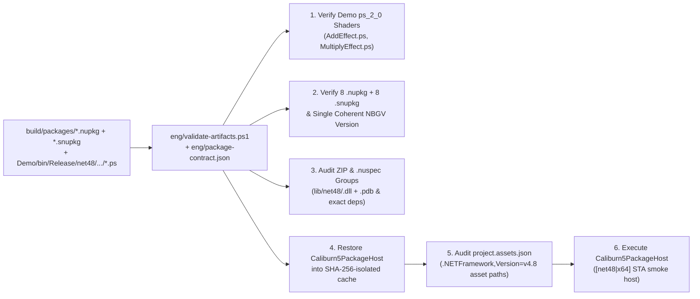

# 09 — Build, Versioning, Packaging & CI Pipeline (After `.NET Framework 4.8` `x64` Conversion)

> **Documentation Status:** **Authoritative Post-Conversion Reference (`2026-11-23`)** — Verified against frozen `SomaFrameQD` `0.9.0` / `SomaFrameQD.Demo` `0.1.0` build, packaging, and CI files after Stage 1 Retargeting and Stage 2 Optimization.  
> **Scope:** [`global.json`](../global.json), [`version.json`](../version.json), [`src/SomaFrameQD.Demo/version.json`](../src/SomaFrameQD.Demo/version.json), [`src/Directory.Build.props`](../src/Directory.Build.props), [`src/NuGet.config`](../src/NuGet.config), [`src/SomaFrameQD.sln`](../src/SomaFrameQD.sln), [`src/.vscode/launch.json`](../src/.vscode/launch.json), [`SomaFrameQD.code-workspace`](../SomaFrameQD.code-workspace), [`eng/package-contract.json`](../eng/package-contract.json), [`eng/validate-artifacts.ps1`](../eng/validate-artifacts.ps1), [`eng/compatibility/Caliburn5PackageHost/*`](../eng/compatibility/Caliburn5PackageHost/), [`.github/workflows/ci.yml`](../.github/workflows/ci.yml), [`changelogs/`](../changelogs/), and [`releasenotes/`](../releasenotes/).  
> **Companion Guides:** [00 — Master Index](./00_INDEX.md) | [01 — Architecture & Bootstrapper](./01_Architecture_and_Bootstrapper_Overview.md) | [06 — Standalone Modules](./06_Standalone_Modules_Reference.md) | [07 — Demo Application](./07_Demo_Application_and_Extension_Patterns.md) | [08 — Test Suite & Harness](./08_Test_Suite_and_Characterization_Harness.md)

---

## 1. Toolchain, Deterministic MSBuild & IDE Configuration

### 1.1 `.NET SDK 8.0.400` LTS & `MSTest.Sdk 4.1.0` Pin ([`global.json`](../global.json))

| Key | Active Value | Effect |
| :--- | :--- | :--- |
| `sdk.version` | `8.0.400` (`rollForward: "latestPatch"`, `allowPrerelease: false`) | Pins the Long-Term Support `.NET 8.0.400` SDK across developer workstations and GitHub Actions CI while compiling cleanly against `.NET Framework 4.8` reference assemblies (`Microsoft.NETFramework.ReferenceAssemblies`). |
| `msbuild-sdks["MSTest.Sdk"]` | `4.1.0` | Centralizes the `MSTest.Sdk` version imported by [`src/SomaFrameQD.Tests/SomaFrameQD.Tests.csproj`](../src/SomaFrameQD.Tests/SomaFrameQD.Tests.csproj). |

### 1.2 Hermetic NuGet Feed Isolation ([`src/NuGet.config`](../src/NuGet.config))
[`src/NuGet.config`](../src/NuGet.config) executes `<clear />` before registering only `https://api.nuget.org/v3/index.json` (`protocolVersion="3"`), preventing machine-wide or corporate NuGet caches from injecting undeclared transitive dependencies during `dotnet restore`.

### 1.3 Shared `net48` & `x64` Build Properties ([`src/Directory.Build.props`](../src/Directory.Build.props))
Imported automatically by all 10 projects under `src/`:
* **Language & Reproducibility:** `<LangVersion>12.0</LangVersion>` and `<Deterministic>true</Deterministic>`, with `Authors = Dmitriy Novikov, Tim Jones, and contributors`, `Copyright = Copyright (c) Dmitriy Novikov, Tim Jones, and contributors`, `RepositoryUrl = https://github.com/NTLDR2/SomaFrameQD`, and `PackageLicenseExpression = Apache-2.0`.
* **Portable Symbols (`Q6 = 6A`):** `<DebugType>portable</DebugType>`, `<IncludeSymbols>true</IncludeSymbols>`, and `<SymbolPackageFormat>snupkg</SymbolPackageFormat>`—emitting cross-tool `BSJB` Portable PDBs supported natively by Visual Studio, WinDbg, PerfView, and `.NET Framework 4.8` stack traces alongside NuGet.org `.snupkg` symbol packages.
* **64-Bit (`x64` `PE32+`) Executable Policy (`Q1 = 1A`):** Whenever `'$(OutputType)' == 'Exe' or '$(OutputType)' == 'WinExe'`, enforces `<PlatformTarget>x64</PlatformTarget>`, `<Prefer32Bit>false</Prefer32Bit>`, `<AutoGenerateBindingRedirects>true</AutoGenerateBindingRedirects>`, and `<GenerateBindingRedirectsOutputType>true</GenerateBindingRedirectsOutputType>`. Class libraries (`OutputType = Library`) remain `AnyCPU` (`x64`-clean) for maximum NuGet consumer flexibility.
* **Native `.NET 4.8` GAC MEF & Git-Height Versioning:** Injects `<Reference Include="System.ComponentModel.Composition" />` (eliminating out-of-band MEF NuGet shims across all projects) and `<PackageReference Include="Nerdbank.GitVersioning" Version="3.5.109" PrivateAssets="all" />`.
* **IDE Launch Configs ([`src/.vscode/launch.json`](../src/.vscode/launch.json), [`SomaFrameQD.code-workspace`](../SomaFrameQD.code-workspace)):** Configured with `"type": "clr"` targeting `${workspaceFolder}/SomaFrameQD.Demo/bin/Debug/net48/SomaFrameQD.Demo.exe` plus `.NET Framework Attach`.

---

## 2. Solution Topology & 11-Project Matrix

The repository contains **11 `.csproj` files**: **10 inside [`src/SomaFrameQD.sln`](../src/SomaFrameQD.sln)** (`Debug|Any CPU`, `Debug|x64`, `Release|Any CPU`, `Release|x64`) and **1 standalone NuGet consumer verification host** ([`Caliburn5PackageHost.csproj`](../eng/compatibility/Caliburn5PackageHost/Caliburn5PackageHost.csproj)):

| Project Path | In `.sln`? | TFM & Platform | Output / Packable | NuGet Package ID | Version Source |
| :--- | :---: | :---: | :--- | :--- | :--- |
| [`src/SomaFrameQD/SomaFrameQD.csproj`](../src/SomaFrameQD/SomaFrameQD.csproj) | Yes | `net48` (`AnyCPU`) | `Library` (`Packable`) | **`SomaFrameQDWpf`** *(assembly: `SomaFrameQD`)* | Root [`version.json`](../version.json) (`0.9.0`) |
| [`src/SomaFrameQD.Modules.CodeCompiler/...csproj`](../src/SomaFrameQD.Modules.CodeCompiler/SomaFrameQD.Modules.CodeCompiler.csproj) | Yes | `net48` (`AnyCPU`) | `Library` (`Packable`) | `SomaFrameQD.Modules.CodeCompiler` | Root `version.json` (`0.9.0`) |
| [`src/SomaFrameQD.Modules.CodeEditor/...csproj`](../src/SomaFrameQD.Modules.CodeEditor/SomaFrameQD.Modules.CodeEditor.csproj) | Yes | `net48` (`AnyCPU`) | `Library` (`Packable`) | `SomaFrameQD.Modules.CodeEditor` | Root `version.json` (`0.9.0`) |
| [`src/SomaFrameQD.Modules.ErrorList/...csproj`](../src/SomaFrameQD.Modules.ErrorList/SomaFrameQD.Modules.ErrorList.csproj) | Yes | `net48` (`AnyCPU`) | `Library` (`Packable`) | `SomaFrameQD.Modules.ErrorList` | Root `version.json` (`0.9.0`) |
| [`src/SomaFrameQD.Modules.GraphEditor/...csproj`](../src/SomaFrameQD.Modules.GraphEditor/SomaFrameQD.Modules.GraphEditor.csproj) | Yes | `net48` (`AnyCPU`) | `Library` (`Packable`) | `SomaFrameQD.Modules.GraphEditor` | Root `version.json` (`0.9.0`) |
| [`src/SomaFrameQD.Modules.Inspector/...csproj`](../src/SomaFrameQD.Modules.Inspector/SomaFrameQD.Modules.Inspector.csproj) | Yes | `net48` (`AnyCPU`) | `Library` (`Packable`) | `SomaFrameQD.Modules.Inspector` | Root `version.json` (`0.9.0`) |
| [`src/SomaFrameQD.Modules.Output/...csproj`](../src/SomaFrameQD.Modules.Output/SomaFrameQD.Modules.Output.csproj) | Yes | `net48` (`AnyCPU`) | `Library` (`Packable`) | `SomaFrameQD.Modules.Output` | Root `version.json` (`0.9.0`) |
| [`src/SomaFrameQD.Modules.PropertyGrid/...csproj`](../src/SomaFrameQD.Modules.PropertyGrid/SomaFrameQD.Modules.PropertyGrid.csproj) | Yes | `net48` (`AnyCPU`) | `Library` (`Packable`) | `SomaFrameQD.Modules.PropertyGrid` | Root `version.json` (`0.9.0`) |
| [`src/SomaFrameQD.Demo/SomaFrameQD.Demo.csproj`](../src/SomaFrameQD.Demo/SomaFrameQD.Demo.csproj) | Yes (`Demos`) | `net48` (**`x64`**) | `WinExe` (`IsPackable=false`) | *(not packed)* | [`Demo/version.json`](../src/SomaFrameQD.Demo/version.json) (`0.1.0`) |
| [`src/SomaFrameQD.Tests/SomaFrameQD.Tests.csproj`](../src/SomaFrameQD.Tests/SomaFrameQD.Tests.csproj) | Yes | `net48` (**`x64`**) | `Exe` (`IsPackable=false`) | *(not packed)* | Root `version.json` (`0.9.0`) |
| [`eng/compatibility/Caliburn5PackageHost/...csproj`](../eng/compatibility/Caliburn5PackageHost/Caliburn5PackageHost.csproj) | **No** | `net48` (**`x64`**) | `Exe` (`IsPackable=false`) | *(not packed)* | `$(SomaFrameQDPackageVersion)` / `0.0.0-local` |

> [!IMPORTANT]
> **NuGet Package ID vs. CLR Namespace (`SomaFrameQDWpf` vs. `SomaFrameQD`):**  
> Core's `.csproj` sets `<PackageId>SomaFrameQDWpf</PackageId>` while preserving `<AssemblyName>SomaFrameQD</AssemblyName>` and `<RootNamespace>SomaFrameQD</RootNamespace>`. Downstream `.nuspec` dependencies reference **`SomaFrameQDWpf`**, whereas C# `using` directives and WPF pack URIs (`pack://application:,,,/SomaFrameQD;component/...`) use **`SomaFrameQD`**.

---

## 3. Split `Nerdbank.GitVersioning` (`0.9.0` Framework vs. `0.1.0` Alpha Demo)

No `.csproj` or `AssemblyInfo.cs` file hardcodes `<Version>` or `[assembly: AssemblyVersion]`. `Nerdbank.GitVersioning` (`3.5.109`) computes deterministic versions from Git commit height across two independent scopes:
1. **Root [`version.json`](../version.json) (`0.9.0` — 8 Published NuGet Libraries + Tests):** Stamps the `0.9.0` family version across `SomaFrameQDWpf` and all 7 `SomaFrameQD.Modules.*` packages (`publicReleaseRefSpec`: `master` and `v*` tags; `pathFilters: [".", ":!src/SomaFrameQD.Demo"]` so Demo-only edits never bump NuGet package build height).
2. **[`src/SomaFrameQD.Demo/version.json`](../src/SomaFrameQD.Demo/version.json) (`0.1.0` — Demo Application):** Versions `SomaFrameQD.Demo.exe` independently at `0.1.0` to signal alpha showcase status.

---

## 4. Lockstep Packaging Contract & Artifact Gate (`eng/package-contract.json` & `eng/validate-artifacts.ps1`)

[`eng/validate-artifacts.ps1`](../eng/validate-artifacts.ps1) (`493` lines, compatible with both **Windows PowerShell 5.1** locally and **PowerShell 7 (`pwsh`)** in CI) validates build and pack outputs against [`eng/package-contract.json`](../eng/package-contract.json) (`115` lines):

### Exact Checks Enforced on Every Release Build
1. **Compiled Demo Pixel Shaders:** Asserts `AddEffect.ps` and `MultiplyEffect.ps` exist and are non-empty under `src\SomaFrameQD.Demo\bin\Release\net48\Modules\FilterDesigner\ShaderEffects\`.
2. **Complete 8-Package Family & Coherent Version:** Asserts `build\packages` contains **exactly** the 8 declared `.nupkg` and 8 `.snupkg` archives sharing one identical NBGV version.
3. **Archive & `.nuspec` Inspection:** Opens every `.nupkg` and `.snupkg` ZIP archive to verify `lib/net48/<Assembly>.dll`, `lib/net48/<Assembly>.pdb` (inside `.snupkg`), `.nuspec` `<group targetFramework=".NETFramework4.8">`, coherent internal package versions, and exact external dependency sets (`0` external NuGet dependencies on `ErrorList`, `GraphEditor`, `Inspector`, `Output`, and `PropertyGrid`).
4. **Content-Hashed `Caliburn5PackageHost` Restore & Lockfile Audit:** Computes a SHA-256 `packageFamilyHash` over all 8 `.nupkg` files, restores [`Caliburn5PackageHost.csproj`](../eng/compatibility/Caliburn5PackageHost/Caliburn5PackageHost.csproj) into an isolated `obj\package-validation\<hash>` folder, and parses `project.assets.json` to assert `.NETFramework,Version=v4.8` resolved package versions and exact compile/runtime DLL asset paths (`Dirkster.AvalonDock` `lib/net48/AvalonDock.dll`, `AvalonEdit` `lib/net462/ICSharpCode.AvalonEdit.dll`, `DotNetProjects.Extended.Wpf.Toolkit` `lib/net40/DotNetProjects.Wpf.Extended.Toolkit.dll`, `System.Text.Json` `10.0.12` `lib/net462/System.Text.Json.dll`).
5. **Live `[net48|x64]` Consumer Smoke Run:** Executes `Caliburn5PackageHost` (`Program.cs`) on an STA thread, verifying runtime assembly versions (`AvalonDock` `5.0.1.0`, `AvalonEdit` `6.3.1.120`, `Extended.Wpf.Toolkit` `5.0.129.0`), Caliburn 5 async screen activation, `DockingManager`, `CodeEditorViewModel`, and VS2013 theme dictionary loading from packed NuGet archives.

> [!WARNING]
> **Lockstep Packaging Rule:**  
> Any NuGet dependency or target change in packable `src/` projects **must** update [`eng/package-contract.json`](../eng/package-contract.json) and [`Caliburn5PackageHost.csproj`](../eng/compatibility/Caliburn5PackageHost/Caliburn5PackageHost.csproj) in lockstep or `eng/validate-artifacts.ps1` will fail the build.

---

## 5. GitHub Actions CI, OIDC Publishing & Release Housekeeping

### 5.1 Hardened CI & OIDC Publish Pipeline ([`.github/workflows/ci.yml`](../.github/workflows/ci.yml))
1. **`build` Job (`windows-2025`, 30-min timeout, `permissions: contents: read`):**
   * Pins every GitHub Action to an immutable 40-character commit SHA (`actions/checkout` `v7.0.1` with `fetch-depth: 0` & `persist-credentials: false`, `actions/setup-dotnet` `v6.0.0` reading `global.json`, `actions/upload-artifact` `v7.0.1`).
   * Runs `dotnet restore` (`--configfile src\NuGet.config`) → `dotnet build` (`Release`) → `dotnet test` (`[net48|x64]`, `174` executions) → `dotnet pack` (`build\packages`) → `./eng/validate-artifacts.ps1` → uploads `nuget-packages` (`*.nupkg` + `*.snupkg`, `retention-days: 14`).
2. **`publish` Job (`windows-2025`, 15-min timeout, `permissions: id-token: write`):**
   * Restricted to `github.repository == 'NTLDR2/SomaFrameQD' && github.event_name == 'push' && (github.ref == 'refs/heads/master' || startsWith(github.ref, 'refs/tags/v'))`.
   * Never checks out code or rebuilds: downloads the exact validated `nuget-packages` artifact (`actions/download-artifact` `v8.0.1`), exchanges a short-lived GitHub OIDC token via `NuGet/login@v1`, and pushes `build\packages\*.nupkg` to NuGet.org.

### 5.2 Centralized Release Housekeeping (`YYYYMMDD_` Convention) & Provenance
* **[`changelogs/`](../changelogs/) vs. [`releasenotes/`](../releasenotes/):** Granular developer/maintainer technical changelogs live in `changelogs/YYYYMMDD_CHANGELOG.md` ([`20261123_CHANGELOG.md`](../changelogs/20261123_CHANGELOG.md)), while user- and adopter-facing release announcements and upgrade notes live in `releasenotes/YYYYMMDD_RELEASE_NOTES_v*.md` ([`20261123_RELEASE_NOTES_v0.9.0.md`](../releasenotes/20261123_RELEASE_NOTES_v0.9.0.md)). Root [`CHANGELOG.md`](../CHANGELOG.md) is preserved solely as a pre-fork historical archive (`0.2.0`–`0.6.0`, 2013–2015).
* **Provenance ([`VNIR.md`](../VNIR.md)) & Git Working-Tree Note:** Until the `Gemini` → `SomaFrameQD` rename is committed in Git, always enumerate files from disk (`src/SomaFrameQD*`) rather than relying on `git ls-files --cached` alone.
