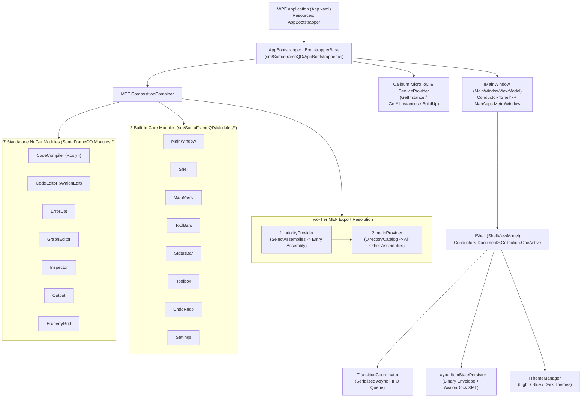
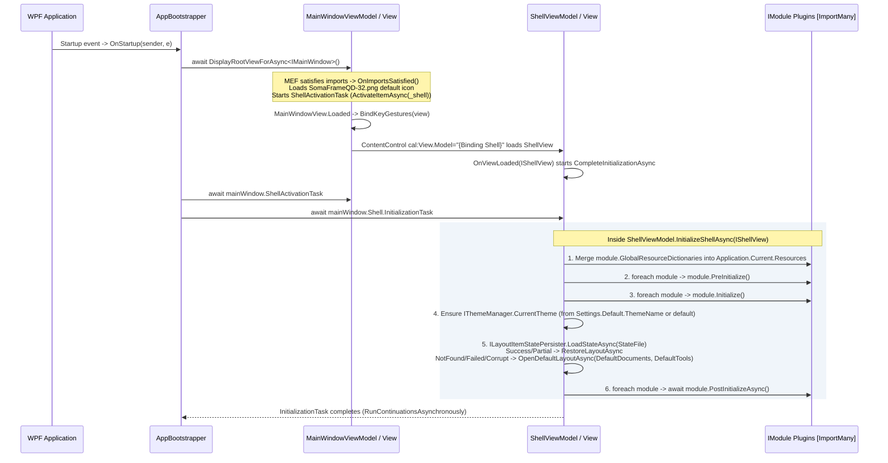

# 01 — Architecture & Bootstrapper Overview (Before `.NET 4.8` Retargeting)

> **Baseline Snapshot:** Pre-`.NET Framework 4.8`-only retargeting and optimization (`2026-11-22`).  
> **Scope:** `src/SomaFrameQD` (`SomaFrameQDWpf` NuGet package) — Core architecture, MEF + Caliburn.Micro 5 bootstrapper, IoC composition, deterministic async startup pipeline, and `IModule` plugin lifecycle.  
> **Target Frameworks in Snapshot:** `<TargetFrameworks>net48;net10.0-windows</TargetFrameworks>`

---

## 1. Purpose & Core Technology Stack

**SomaFrameQD** is a modular WPF IDE/workbench shell framework modeled conceptually on the Visual Studio Shell. Applications are assembled from loosely coupled **MEF (`System.ComponentModel.Composition`)** modules that contribute documents, dockable tool panes, declarative menus, toolbars, keyboard shortcuts, settings pages, themes, and services into a single **Caliburn.Micro 5** MVVM shell hosted inside a **MahApps.Metro** window and laid out by **AvalonDock 5**.

### Core Project & Package Identity (`src/SomaFrameQD/SomaFrameQD.csproj`)

| Property | Pre-Conversion Baseline Value | Notes |
| :--- | :--- | :--- |
| **Project SDK** | `Microsoft.NET.Sdk.WindowsDesktop` | `<UseWPF>true</UseWPF>` |
| **Target Frameworks** | `net48;net10.0-windows` | Dual-targeted prior to Stage 1 `net48` retargeting |
| **Assembly / Root Namespace** | `SomaFrameQD` | Outputs `SomaFrameQD.dll` |
| **NuGet Package ID** | `SomaFrameQDWpf` | Distinct from assembly name to avoid NuGet naming collision |
| **Version Authority** | `0.9.0` (via root `version.json`) | Stamped at build time by `Nerdbank.GitVersioning` `3.5.109` |
| **App Config (`app.config`)** | `sku=".NETFramework,Version=v4.6.1"` | Declares `userSettings` (`AutoHideMainMenu`, `ThemeName`, `LanguageCode`) |

### Direct Dependencies of `SomaFrameQD.csproj`

| Dependency | Version / Scope | Architectural Role |
| :--- | :--- | :--- |
| `Caliburn.Micro` | `5.0.258` | MVVM screen/conductor lifecycle (`BootstrapperBase`, `Screen`, `Conductor<T>`, `IoC`, `IWindowManager`, `IEventAggregator`, `IResult` coroutines) |
| `Dirkster.AvalonDock.Serializer.Xml` | `5.0.1` | Docking engine (`DockingManager`), `AvalonDock.Core`, and `XmlLayoutSerializer` |
| `Dirkster.AvalonDock.Themes.VS2013` | `5.0.1` | VS2013 Light/Blue/Dark docking theme dictionaries |
| `MahApps.Metro` | `2.4.11` | Borderless `MetroWindow` chrome (`MainWindowView`) and base control resources |
| `DotNetProjects.Extended.Wpf.Toolkit` | `5.0.129` | Extended WPF controls (color canvas, numeric/toolkit primitives) |
| `System.ComponentModel.Composition` | `6.0.0` (NuGet) | MEF v1 attribute-driven dependency injection (`[Export]`, `[Import]`, `[ImportMany]`, `CompositionContainer`) |
| `PresentationFramework.Aero` | `net48` only | Conditional GAC reference (`Condition="$(TargetFramework) == 'net48'"`) for Aero control chrome |

### XAML Namespace & Theme Metadata (`src/SomaFrameQD/Properties/AssemblyInfo.cs`)

`AssemblyInfo.cs` maps three CLR namespaces onto a single XAML XML namespace URI and registers `Themes/Generic.xaml` in the source assembly:

```csharp
[assembly: ThemeInfo(ResourceDictionaryLocation.None, ResourceDictionaryLocation.SourceAssembly)]

[assembly: XmlnsDefinition("http://schemas.timjones.io/SomaFrameQD", "SomaFrameQD")]
[assembly: XmlnsDefinition("http://schemas.timjones.io/SomaFrameQD", "SomaFrameQD.Framework.Controls")]
[assembly: XmlnsDefinition("http://schemas.timjones.io/SomaFrameQD", "SomaFrameQD.Framework.Markup")]
```

> [!WARNING]
> **Documentation Drift Alert (`README.md` vs. Compiled Code):**  
> `README.md` (lines 21 and 30) shows `xmlns:SomaFrameQD="http://schemas.timjones.tw/SomaFrameQD"` (`.tw`). **That URI is stale.** Compiled assemblies and `SomaFrameQD.Demo/App.xaml` use **`http://schemas.timjones.io/SomaFrameQD`** (`.io`). Always use `.io` in XAML.

---

## 2. High-Level Component Architecture



---

## 3. `AppBootstrapper` & Two-Tier MEF Composition

`AppBootstrapper` (`src/SomaFrameQD/AppBootstrapper.cs`) inherits from `Caliburn.Micro.BootstrapperBase` and serves as the entry point when declared in an application's `App.xaml` resource dictionary (or subclassed, as in `SomaFrameQD.Demo.DemoAppBootstrapper`).

### 3.1 Culture Pre-Initialization (`PreInitialize`)

In `AppBootstrapper()`, `PreInitialize()` executes **before** `BootstrapperBase.Initialize()`:
- Reads `SomaFrameQD.Properties.Settings.Default.LanguageCode`.
- If non-whitespace, resolves `CultureInfo.GetCultureInfo(code)` and assigns both `Thread.CurrentThread.CurrentUICulture` and `Thread.CurrentThread.CurrentCulture` so localized `.resx` lookups apply before any WPF views or menus are constructed.

### 3.2 `.NET Core 3.1` / `.NET 5+` Single-File Deployment Guard

In the pre-`net48`-retargeting codebase, `AppBootstrapper.Configure()` begins with single-file deployment detection:
1. `CheckIfSomaFrameQDAppearsPublishedToSingleFile()` checks `Assembly.GetAssembly(typeof(AppBootstrapper)).Location == string.Empty` (the `.NET 5+` bundled-assembly indicator).
2. If `true` and `IsPublishSingleFileHandled` is `false` (its default):
   - Shows a `MessageBox` (when `!Debugger.IsAttached`) and throws `InvalidOperationException` instructing the host app to override `IsPublishSingleFileHandled => true` and supply `PublishSingleFileBypassAssemblies`.
3. If `IsPublishSingleFileHandled` is `true`, `AssemblySource.Instance.AddRange(PublishSingleFileBypassAssemblies)` pre-seeds Caliburn's `AssemblySource.Instance` with assemblies that `DirectoryCatalog` cannot discover on disk.

### 3.3 Assembly Discovery (`PopulateAssemblySource`)

`PopulateAssemblySource()` scans disk directories using temporary MEF `DirectoryCatalog` instances:
- Always scans `currentWorkingDir` (`Path.GetDirectoryName(Path.GetFullPath(@"./"))`).
- Also scans `baseDirectory` (`Path.GetDirectoryName(Path.GetFullPath(AppContext.BaseDirectory))`) whenever `currentWorkingDir != baseDirectory` (originally added for `.NET Core 3.1` `PublishSingleFile` temp-folder extraction).
- `PopulateAssemblySourceUsingDirectoryCatalog(string path)` enumerates `directoryCatalog.Parts`, resolves each part's owning `Assembly` via `ReflectionModelServices.GetPartType(part).Value.Assembly`, and adds distinct assemblies into `Caliburn.Micro.AssemblySource.Instance` (which Caliburn also uses for View/ViewModel convention resolution).

### 3.4 Priority Catalog Override Mechanism

A defining architectural invariant of SomaFrameQD is **client-first MEF export resolution** (`AppBootstrapper.cs`, lines 91–114):

1. **Priority Assemblies (`priorityProvider`):** `SelectAssemblies()` returns `new[] { Assembly.GetEntryAssembly() }` by default (client subclasses may override `SelectAssemblies()` to add more priority assemblies). These are wrapped in `priorityCatalog` → `priorityProvider = new CatalogExportProvider(priorityCatalog)`.
2. **Main Assemblies (`mainProvider`):** Every other assembly in `AssemblySource.Instance` (core `SomaFrameQD`, `SomaFrameQD.Modules.*`, plugins) is wrapped in `mainCatalog` → `mainProvider = new CatalogExportProvider(mainCatalog)`.
3. **Container Ordering:**
   ```csharp
   Container = new CompositionContainer(priorityProvider, mainProvider);
   priorityProvider.SourceProvider = Container;
   mainProvider.SourceProvider = Container;
   ```
   Because `priorityProvider` precedes `mainProvider`, calling `Container.GetExports<object>(contract).First().Value` in `GetInstance(Type, string)` **always returns the entry application's export first** if the application exports a replacement for a single-instance contract (for example, `SomaFrameQD.Demo`'s custom `[Export(typeof(IShell))] ShellViewModel` overriding `SomaFrameQD`'s built-in `ShellViewModel`).

### 3.5 Core Singleton Bindings & IoC Bridges

`BindServices(CompositionBatch)` registers five root singletons directly in the MEF `CompositionContainer`:
- `IWindowManager` → `new WindowManager()`
- `IEventAggregator` → `new EventAggregator()`
- `CompositionContainer` → `Container`
- `AppBootstrapper` → `this`
- `AggregateCatalog` → `mainCatalog` (added in `Configure()`)

Caliburn's static `IoC` facade delegates directly to `AppBootstrapper`:
- `GetInstance(Type serviceType, string key)`: Resolves contract name via `AttributedModelServices.GetContractName(serviceType)` when `key` is null/empty; returns `exports.First().Value` or **throws `Exception("Could not locate any instances of contract ...")`** (missing required dependencies fail loudly rather than silently falling back).
- `GetAllInstances(Type serviceType)`: Calls `Container.GetExportedValues<object>(contract)`.
- `BuildUp(object instance)`: Calls `Container.SatisfyImportsOnce(instance)`.
- `ServiceProvider` (`src/SomaFrameQD/Framework/Services/ServiceProvider.cs`): Exports `[Export(typeof(IServiceProvider))]` and forwards `GetService(Type)` to `IoC.GetInstance(serviceType, null)`.

---

## 4. Deterministic Async Startup & Readiness Sequence

Startup in SomaFrameQD is fully asynchronous and view-synchronized. `AppBootstrapper.OnStartup` (`lines 197–212`) awaits three sequential milestones and routes any fault to `HandleFatalStartupException(Exception)` (which displays a modal error `MessageBox` and calls `Application.Current?.Shutdown(-1)`):



### Key Startup Readiness Contracts
- **`IMainWindow.ShellActivationTask`** (`src/SomaFrameQD/Framework/Services/IMainWindow.cs`, `MainWindowViewModel.cs` lines 87–95): Scheduled on the UI dispatcher inside `IPartImportsSatisfiedNotification.OnImportsSatisfied()` via `Execute.OnUIThreadAsync(() => ActivateItemAsync(_shell, CancellationToken.None))`. Completes once the `ShellViewModel` conductor is active.
- **`IShell.InitializationTask`** (`src/SomaFrameQD/Framework/Services/IShell.cs`, `ShellViewModel.cs` lines 49–50, 90, 119–194): Backed by a `TaskCompletionSource<object>(TaskCreationOptions.RunContinuationsAsynchronously)`. Triggered exactly once on the first `ShellViewModel.OnViewLoaded(object view)` call. Propagates cancellation (`TrySetCanceled`) or exceptions (`TrySetException`) directly to `AppBootstrapper.OnStartup`.

---

## 5. `IModule` & `ModuleBase` Plugin Contract

Every feature vertical in SomaFrameQD (both built-in modules and external plugins) integrates by exporting `[Export(typeof(IModule))]` and inheriting from `ModuleBase`.

### Interface & Base Class (`Framework/IModule.cs`, `Framework/ModuleBase.cs`)

| Member | Type | Execution Timing & Responsibility |
| :--- | :--- | :--- |
| `GlobalResourceDictionaries` | `IEnumerable<ResourceDictionary>` | Merged into `Application.Current.Resources.MergedDictionaries` **first** during `InitializeShellAsync`, before `PreInitialize()` or theme application. |
| `PreInitialize()` | `void` | Runs across **all** modules before any module's `Initialize()`. Used to register early state, event subscriptions, or service configuration before cross-module initialization. |
| `Initialize()` | `void` | Main synchronous setup hook. Runs before layout state restoration. Note: if `ApplicationState.bin` exists and restores cleanly, `DefaultDocuments` and `DefaultTools` are **skipped**, so do not open layout-dependent documents unconditionally inside `Initialize()` unless intentional. |
| `DefaultDocuments` | `IEnumerable<IDocument>` | Yielded `IDocument` instances opened via `OpenDocumentAsync` **only** when persisted state is `NotFound`, `Failed`, or `Corrupt`. |
| `DefaultTools` | `IEnumerable<Type>` | Yielded `ITool` contract `Type`s (e.g., `typeof(IInspectorTool)`) resolved via `IoC.GetInstance(type, null)` and shown via `ShowToolAsync` **only** when opening the default layout. |
| `PostInitializeAsync()` | `Task` | Awaited sequentially **after** theme loading, layout restoration (or default layout presentation), and asynchronous layout item content restoration have finished. Safe place for post-layout async work. |

`ModuleBase` (`src/SomaFrameQD/Framework/ModuleBase.cs`) automatically imports and exposes four `protected` properties to subclasses:
- `MainWindow` (`IMainWindow`)
- `Shell` (`IShell`)
- `MainMenu` (`IMenu` — delegates to `Shell.MainMenu`)
- `ToolBars` (`IToolBars` — delegates to `Shell.ToolBars`)

---

## 6. Known Discrepancies Between Legacy `README.md` and Source Code

AI coding agents and developers inspecting the pre-`net48` repository must rely on compiled source contracts rather than legacy examples in `README.md`:

| Topic | Legacy `README.md` Claim | Actual Codebase Reality (`SomaFrameQD` `0.9.0`) |
| :--- | :--- | :--- |
| **XAML XML Namespace** | `http://schemas.timjones.tw/SomaFrameQD` | **`http://schemas.timjones.io/SomaFrameQD`** (`Properties/AssemblyInfo.cs`) |
| **`IShell` Document & Tool APIs** | Synchronous `OpenDocument`, `CloseDocument`, `ShowTool` | **Asynchronous `Task`-returning methods:** `OpenDocumentAsync`, `CloseDocumentAsync`, `ShowToolAsync`, `CloseToolAsync`, plus `InitializationTask` (`Framework/Services/IShell.cs`) |
| **Caliburn.Micro Lifecycle** | Caliburn 2/3/4 sync `OnInitialize`, `EventHandler<ActivationEventArgs>` | **Caliburn.Micro `5.0.258` async lifecycle:** `OnInitializedAsync`, `OnActivateAsync`, `OnDeactivateAsync`, `CanCloseAsync`, and `AsyncEventHandler<ActivationEventArgs>` (`doc/caliburn-5-migration.md`) |
| **Built-In Core Modules Count** | Lists 7 built-in modules | **8 built-in module folders** exist under `src/SomaFrameQD/Modules/`: `MainWindow`, `Shell`, `MainMenu`, `StatusBar`, `ToolBars`, `Toolbox`, `UndoRedo`, and **`Settings`** |
| **Sample Project Paths** | Links to `src/SomaFrameQD.Demo.FilterDesigner` | Consolidated inside `src/SomaFrameQD.Demo/Modules/FilterDesigner` |
