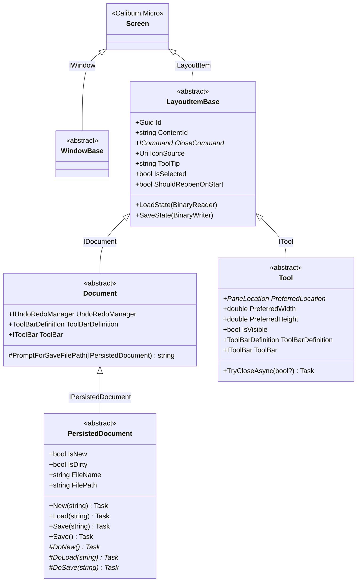

# 02 — Core Framework Primitives, Editor Pipeline & Coroutines (Before `.NET 4.8` Retargeting)

> **Baseline Snapshot:** Pre-`.NET Framework 4.8`-only retargeting and optimization (`2026-11-22`).  
> **Scope:** `src/SomaFrameQD/Framework/*` (and `Modules/Shell/Services/EditorOpeningService.cs`) — Screen/layout item class hierarchy (`WindowBase`, `Document`, `PersistedDocument`, `Tool`), editor opening pipeline, Caliburn.Micro 5 `IResult` coroutines, `AsyncCommand`/`RelayCommand`, localization markup, resource/weak-event services, and WPF behaviors.

---

## 1. Screen & Docking Layout Item Hierarchy

All SomaFrameQD windows, documents, and dockable tool panes build upon **Caliburn.Micro 5**'s `Screen` class (`IScreen` = `IHaveDisplayName`, `IActivate`, `IDeactivate`, `IGuardClose`, `INotifyPropertyChangedEx`, `IViewAware`, `IChild`).

### 1.1 `IWindow` & `WindowBase` (`Framework/IWindow.cs`, `WindowBase.cs`)
- Base contract (`IActivate, IDeactivate, INotifyPropertyChangedEx`) and abstract `Screen` subclass for standalone modal dialogs (`Show.Dialog<TWindow>()`, e.g., `SettingsViewModel`) and modeless popup windows (`Show.Window<TWindow>()`).

### 1.2 `ILayoutItem` & `LayoutItemBase` (`Framework/ILayoutItem.cs`, `LayoutItemBase.cs`)
Shared base for every item hosted inside AvalonDock (`IDocument` and `ITool`):
- **`Id` & `ContentId`:** Generates a fresh `Guid.NewGuid()` per instance (`ContentId => Id.ToString()`), used by AvalonDock layout serialization to match XML layout nodes back to binary state records.
- **`ShouldReopenOnStart`:** Virtual boolean (`false` on `LayoutItemBase`, overridden to `true` on `Tool`). Only items returning `true` are serialized into `ApplicationState.bin` on shutdown unless overridden by a document subclass.
- **`LoadState(BinaryReader)` / `SaveState(BinaryWriter)`:** Synchronous stream-scoped hooks for custom per-item binary state persistence. Must never outlive the `BinaryReader` or start unawaited background work on the stream.
- **`IAsyncLayoutItemStateRestorer` (`Framework/IAsyncLayoutItemStateRestorer.cs`):** Optional secondary interface (`Task RestoreStateAsync()`). When implemented by an `ILayoutItem`, `LayoutItemStatePersister` awaits `RestoreStateAsync()` **after** synchronous binary/XML parsing completes and **before** the shell activates restored items or completes `IShell.InitializationTask`.

### 1.3 `IDocument` & `Document` (`Framework/IDocument.cs`, `Document.cs`)
Base class for center-pane tabbed/docked editor documents (conducted by `ShellViewModel : Conductor<IDocument>.Collection.OneActive`):
- **Per-Document Undo/Redo Lifecycle:** Lazily creates an `IUndoRedoManager` via virtual `CreateUndoRedoManager() => new UndoRedoManager()`. In `OnDeactivateAsync(bool close, CancellationToken)`, `_undoRedoManager?.Dispose()` executes **only when `close == true`**, preserving undo stacks across tab switches and vetoed closes while releasing object graphs once closed.
- **Contextual Command Handlers:** Implements explicit interface handlers routed automatically when the document is active:
  - `ICommandHandler<UndoCommandDefinition>` (`Enabled = UndoRedoManager.CanUndo`, `Undo(1)`)
  - `ICommandHandler<RedoCommandDefinition>` (`Enabled = UndoRedoManager.CanRedo`, `Redo(1)`)
  - `ICommandHandler<SaveFileCommandDefinition>` (`Enabled = this is IPersistedDocument`; routes new files to `DoSaveAs`, existing files to `Save(FilePath)`)
  - `ICommandHandler<SaveFileAsCommandDefinition>` (`Enabled = this is IPersistedDocument`; prompts via `PromptForSaveFilePath`)
- **Save File Dialog Filtering:** `PromptForSaveFilePath(IPersistedDocument)` inspects `IoC.GetAll<IEditorProvider>().SelectMany(x => x.FileTypes)` matching `Path.GetExtension(persistedDocument.FileName)` to build the `SaveFileDialog.Filter` (`"<TypeName>|*<ext>|All Files|*.*"`). Returns `null` if canceled.
- **Per-Document ToolBar:** Setting `protected ToolBarDefinition` lazily constructs a `ToolBarModel` via `IoC.Get<IToolBarBuilder>().BuildToolBar(...)` on first `ToolBar` access.
- **`CloseCommand`:** Bound to tab close buttons; wraps `new AsyncCommand(() => TryCloseAsync(null))`.

### 1.4 `IPersistedDocument` & `PersistedDocument` (`Framework/IPersistedDocument.cs`, `PersistedDocument.cs`)
Template-method subclass of `Document` for file-backed editors:
- **State Properties:** `IsNew`, `IsDirty`, `FileName`, `FilePath`. Changing `IsDirty` updates `DisplayName` (`IsDirty ? FileName + "*" : FileName`); changing `FilePath` updates `ToolTip = FilePath`.
- **Lifecycle Operations:**
  - `New(string fileName)` → sets `IsNew = true`, `IsDirty = false`, awaits `DoNew()`.
  - `Load(string filePath)` → sets `FilePath`, `FileName`, `IsNew = false`, `IsDirty = false`, awaits `DoLoad(filePath)`.
  - `Save(string filePath)` → sets `FilePath`, `FileName`, awaits `DoSave(filePath)`, then clears `IsDirty = false` and `IsNew = false`.
- **Dirty Close Guard (`CanCloseAsync`):** When `IsDirty == true`, calls virtual `PromptToSaveChanges()` (`MessageBoxButton.YesNoCancel`):
  - **`Cancel`:** Returns `false` (vetoes close; document stays active and dirty).
  - **`No` (Discard):** Returns `true` immediately **without** clearing `IsDirty` first.
  - **`Yes` (Save):** Awaits `Save()`. If the document was untitled (`IsNew == true`) and the user cancels the `SaveFileDialog`, `IsNew` remains `true`, so `return !IsNew` evaluates to `false` and **vetoes the close**.

### 1.5 `ITool` & `Tool` (`Framework/ITool.cs`, `Tool.cs`, `Services/PaneLocation.cs`)
Base class for dockable utility panes (`ErrorList`, `Output`, `Inspector`, `PropertyGrid`, `Toolbox`, `History`):
- **Placement & Sizing:** Abstract `PaneLocation PreferredLocation` (`Left`, `Right`, `Bottom`), virtual `PreferredWidth => 200`, `PreferredHeight => 200`, `IsVisible` (`true` by default), `ShouldReopenOnStart => true`.
- **Per-Pane ToolBar:** Assigning `protected ToolBarDefinition` immediately builds and assigns `ToolBar` via `IToolBarBuilder` (clearing `ToolBar = null` when set to `null`).
- **Shell-Owned Close Routing (Critical Invariant):** Unlike `IDocument` items, `ITool` instances are registered in `ShellViewModel.Tools` rather than parented by a Caliburn conductor. Consequently, `Tool.TryCloseAsync(bool? dialogResult = null)` overrides `Screen.TryCloseAsync` and delegates to `IoC.Get<IShell>().CloseToolAsync(this)`, which evaluates `CanCloseAsync` once, deactivates the tool with `close: true`, sets `IsVisible = false` and `IsSelected = false`, and **keeps the tool registered** in `Shell.Tools` so it can be reopened later.

---

## 2. Truthful Editor Opening Pipeline (`IEditorProvider` & `IEditorOpeningService`)

### 2.1 `IEditorProvider` & `EditorFileType` (`Framework/Services/IEditorProvider.cs`, `EditorFileType.cs`)
Modules register file editors by exporting `[Export(typeof(IEditorProvider))]`:
- `IEnumerable<EditorFileType> FileTypes`: Metadata (`Name`, `FileExtension` e.g. `".cs"`, `IconSource`) used by `File -> New` menus and file dialogs.
- `bool CanCreateNew`: Controls whether the provider participates in `File -> New` command lists.
- `bool Handles(string path)`: Predicate determining whether this provider opens `path`.
- `IDocument Create()`: Instantiates a fresh document ViewModel. **Note:** If resolved from MEF via `IoC.Get<TDocument>()`, the document ViewModel **must** be marked `[PartCreationPolicy(CreationPolicy.NonShared)]` so multiple open files do not share one singleton instance.
- `Task New(IDocument document, string name)` / `Task Open(IDocument document, string path)`: Initializes editor content.

### 2.2 `EditorOpeningService` (`Modules/Shell/Services/EditorOpeningService.cs`)
`EditorOpeningService` (`[Export(typeof(IEditorOpeningService))]`) enforces **view-ready, truthful asynchronous completion** across both `OpenFileAsync` and `NewFileAsync`:

1. **Deduplication of Open Files (`OpenFileAsync`):** Normalizes `Path.GetFullPath(path)` and searches `_shell.Documents.OfType<IPersistedDocument>()` using `StringComparison.OrdinalIgnoreCase`. If already open, invokes `configure?.Invoke(existingDocument)`, awaits `_shell.OpenDocumentAsync(existingDocument)` to activate it, and returns the existing instance.
2. **Provider Selection:** Finds `_editorProviders.FirstOrDefault(x => x.Handles(path))` or throws `NotSupportedException`.
3. **View-Readiness Synchronization (`PresentAndInitializeAsync`):** Many WPF editors (such as AvalonEdit-based `CodeEditorViewModel` or `Demo`'s `EditorViewModel`) populate view controls directly inside `DoNew()` / `DoLoad()`, which requires `OnViewLoaded` to have fired first. `EditorOpeningService` guarantees this ordering:
   - Attaches a disposable `EditorViewReadiness` observer (`IViewAware.ViewAttached` + `FrameworkElement.Loaded`) **before** calling `_shell.OpenDocumentAsync(document)` so synchronous view loads cannot race ahead of subscription.
   - Starts `presentationTask = _shell.OpenDocumentAsync(document)`.
   - Awaits `AwaitViewReadinessAsync(readiness.Task, presentationTask)` — ensuring the `FrameworkElement` view is attached and `IsLoaded == true` (while immediately propagating any early fault from `presentationTask`).
   - Invokes `editorProvider.Open(document, path)` or `editorProvider.New(document, name)`.
   - Awaits `Task.WhenAll(presentationTask, initializationTask)` before returning the ready `IDocument`.

---

## 3. Caliburn.Micro 5 Coroutine Results (`Framework/Results/*`)

SomaFrameQD provides a fluent coroutine factory (`Show`) and a thread-safe base class (`OpenResultBase<TTarget>`) implementing Caliburn's `IResult` interface.

### 3.1 `OpenResultBase<TTarget>` Guarantees (`Framework/Results/OpenResultBase.cs`)
- **Single Terminal Outcome per Execution:** Each `Execute(CoroutineExecutionContext)` call creates a `ResultExecution` capturing `SynchronizationContext.Current`. `ResultExecution.TryComplete` uses `Interlocked.Exchange(ref _isCompleted, 1)` so competing task completions and `Deactivated` close events can never raise `Completed` twice.
- **Re-Execution Safety:** Calling `BeginExecution()` on an already-running result atomically replaces `_currentExecution` and completes the superseded execution with `WasCancelled = true`.
- **SynchronizationContext Marshaling:** If `TryComplete` fires from a background continuation (`ConfigureAwait(false)`), `RaiseCompleted` posts `ResultCompletionEventArgs` back onto the captured `SynchronizationContext`.
- **Configuration & Shutdown Hooks (`IOpenResult<TChild>`):**
  - `OnConfigure`: Runs synchronously before presentation; exceptions complete the result immediately with `Error = exception`.
  - `OnShutDown`: Runs when the target closes or dialog returns; exceptions during an active wait become `ResultCompletionEventArgs.Error` (and for an already-completed `OpenDocumentResult`, fault the document's `Deactivated` close task via `Task.FromException`).

### 3.2 Built-In `IResult` Types & Lifetime Semantics

| Result Class | `Show.*` Factory Overloads | When `Completed` Fires | Cancellation & Error Behavior |
| :--- | :--- | :--- | :--- |
| `OpenDocumentResult` | `Show.Document(doc)` `Show.Document(path)` `Show.Document<T>()` | **Immediately after presentation & provider initialization finish** (`completeOnSuccess: true`). | Null resolved editor cancels (`WasCancelled = true`). Detaches close listener on open failure; otherwise retains a one-shot `WasClosed` listener solely to invoke `OnShutDown`. |
| `ShowToolResult<TTool>` | `Show.Tool<TTool>()` `Show.Tool(tool)` | **When the shown tool is closed** (`Deactivated` with `WasClosed == true`). | If `_shell.ShowToolAsync(tool)` faults or cancels, completes immediately instead of waiting for close. |
| `ShowWindowResult<TWindow>` | `Show.Window<TWindow>()` `Show.Window(window)` | **When the modeless window is closed** (`Deactivated` with `WasClosed == true`). | Uses `[Import] IWindowManager.ShowWindowAsync(window)`. Faulted/canceled show completes immediately. |
| `ShowDialogResult<TWindow>` | `Show.Dialog<TWindow>()` `Show.Dialog(window)` | **When `WindowManager.ShowDialogAsync(window)` returns.** | `false` or `null` dialog return sets `WasCancelled = true`; `true` sets `WasCancelled = false`. Invokes `OnShutDown(window)` on return. |
| `ShowCommonDialogResult` | `Show.CommonDialog(dialog)` | **Synchronously after `CommonDialog.ShowDialog()` returns.** | Sets `WasCancelled = !result`. Note: invokes `Completed` directly (expects Caliburn coroutine runner subscriber). |
| `LambdaResult` | `new LambdaResult(ctx => ...)` | **Synchronously after `_lambda(context)` returns.** | Unhandled exceptions propagate to caller; normal return emits empty `ResultCompletionEventArgs`. |

---

## 4. Command Wrappers, Markup, Services & UI Helpers

### 4.1 `AsyncCommand` & `RelayCommand` (`Framework/AsyncCommand.cs`, `RelayCommand.cs`)
- **`AsyncCommand` (`IAsyncCommand : ICommand`):** Wraps `Func<Task>` + optional `Func<bool>`. Prevents concurrent re-entrancy via `!_isExecuting` inside `CanExecute()`, resets `_isExecuting = false` in `finally`, and calls `RaiseCanExecuteChanged()` on completion. Used by `Document.CloseCommand` and `Tool.CloseCommand`.
- **`RelayCommand` (`ICommand`):** Synchronous `Action<object>` / `Predicate<object>` command wired to WPF's `CommandManager.RequerySuggested`.

### 4.2 XAML Localization (`Framework/Markup/TranslateExtension.cs`)
- `TranslateExtension` inherits directly from `System.Windows.Markup.StaticExtension` (`[assembly: XmlnsDefinition("http://schemas.timjones.io/SomaFrameQD", "SomaFrameQD.Framework.Markup")]`), allowing XAML views to write `{SomaFrameQD:Translate local:Resources.SomeKey}` for static `.resx` bindings.

### 4.3 Pack Resource Loading & Weak Settings Listeners (`Framework/Services/*`)
- **`IResourceManager` / `ResourceManager` (`ResourceManager.cs`):** `[Export(typeof(IResourceManager))]` helper that resolves WPF pack streams via `Application.GetResourceStream("<assembly>;component/<relativeUri>")` (with plain relative-URI fallback) and decodes **frozen** (`bmp.Freeze()`) `BitmapImage` instances.
- **`SettingsPropertyChangedEventManager<TApplicationSettings>`:** Generic `IWeakEventListener` wrapper around `PropertyChangedEventManager.AddListener` using compiled `Expression<Func<TApplicationSettings, TProperty>>` selectors so transient views/view-models can observe long-lived settings objects without strong-reference memory leaks.
- **`ExtensionMethods` (`ExtensionMethods.cs`):** Expression member-name extraction (`GetPropertyName`) and `GetExecutingAssemblyName()`.
- **`TaskUtility` (`Framework/Threading/TaskUtility.cs`):** Exposes `public static readonly Task Completed = Task.FromResult(true);` (legacy pre-`Task.CompletedTask` helper still referenced by modules and samples).

### 4.4 Attached WPF Behaviors & Visual Utilities (`Framework/Behaviors/*`, `Utils/*`, `VisualTreeUtility.cs`)
- **`WindowOptionsBehavior` (`Behavior<Window>`):** Attached properties `ShowIcon`, `ShowMinimizeBox`, `ShowMaximizeBox` (all defaulting to `true`). On `SourceInitialized` or property change, mutates Win32 `GWL_STYLE` (`WS_MINIMIZEBOX`, `WS_MAXIMIZEBOX`) and `GWL_EXSTYLE` (`WS_EX_DLGMODALFRAME` + `WM_SETICON` when `ShowIcon == false`) via `Framework.Win32.NativeMethods`. *(Note: re-enabling `ShowIcon = true` after hiding is currently an unimplemented `// TODO` branch.)*
- **`BindableTreeViewSelectedItemBehavior` (`Behavior<TreeView>`):** Adds two-way bindable `SelectedItem` `DependencyProperty` to WPF `TreeView` (used by `SettingsView.xaml`), recursively expanding parent `TreeViewItem` containers and calling `ApplyTemplate()` / `BringIntoView()` to locate virtualized items.
- **`KeyboardFocusBehavior` (`Behavior<FrameworkElement>`):** Calls `Keyboard.Focus(AssociatedObject)` immediately if loaded, or on `Loaded`.
- **`ItemsControlUtility.UpdateSeparatorsVisibility(ItemsControl)`:** Walks generated item containers and collapses leading, trailing, or consecutive `Separator` controls when surrounding menu/toolbar items are hidden.
- **`VisualTreeUtility.FindParent<T>(DependencyObject)`:** Recursive `VisualTreeHelper.GetParent` ancestor lookup.
