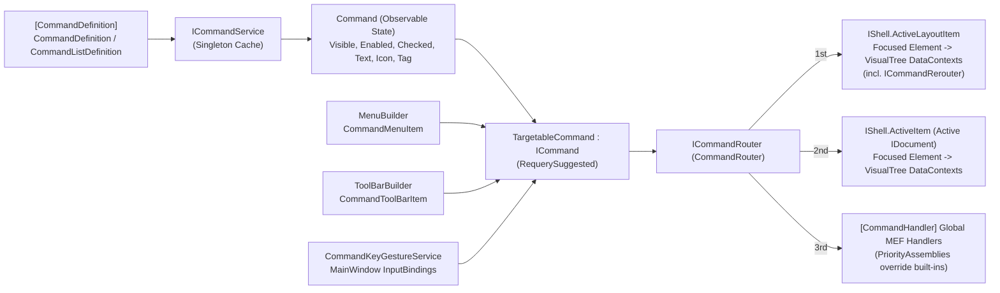

# 03 — Commands, Menus, ToolBars & KeyGestures (Before `.NET 4.8` Retargeting)

> **Baseline Snapshot:** Pre-`.NET Framework 4.8`-only retargeting and optimization (`2026-11-22`).  
> **Scope:** `src/SomaFrameQD/Framework/Commands/*`, `Framework/Menus/*`, `Framework/ToolBars/*`, `Framework/Services/InputManager.cs`, `Modules/MainMenu/MenuBuilder.cs`, and `Modules/ToolBars/ToolBarBuilder.cs`.

---

## 1. Architectural Overview: Decoupled Command & UI Composition

Unlike standard WPF `RoutedUICommand` (which couples command routing strictly to the active keyboard-focus visual ancestry and provides only `CanExecute` boolean gating), SomaFrameQD separates UI actions into four orthogonal, MEF-composable layers:

1. **Command Definitions (`[CommandDefinition]`):** Static metadata (`Name`, `Text`, `ToolTip`, `IconSource`, `IsList`) identifying an abstract user action once.
2. **Command Runtime State (`Command` & `TargetableCommand`):** Observable UI state (`Visible`, `Enabled`, `Checked`, `Text`, `ToolTip`, `IconSource`, `Tag`) bridged to `ICommand` via `CommandManager.RequerySuggested`.
3. **Command Handlers (`[CommandHandler]` & Contextual Handlers):** Global singleton MEF services **or** active document/tool/DataContext handlers discovered dynamically by `CommandRouter`.
4. **Declarative Surface Bindings (`[Export]` Menus, ToolBars & Shortcuts):** Modules attach commands to menus, toolbars, and keyboard shortcuts—or declaratively **exclude** built-in items—without touching central UI code.

---

## 2. Command Definitions & Runtime State (`Framework/Commands/*`)

### 2.1 `CommandDefinitionBase`, `CommandDefinition` & `CommandListDefinition`

All command definitions export themselves to MEF via `[CommandDefinition]` (`CommandDefinitionAttribute : ExportAttribute(typeof(CommandDefinitionBase))`):

| Class | `IsList` | Purpose & Required Overrides |
| :--- | :---: | :--- |
| `CommandDefinitionBase` | *(abstract)* | Abstract root declaring `Name`, `Text`, `ToolTip`, `IconSource`, and `IsList`. |
| `CommandDefinition` | `false` | Standard single action (`File.OpenFile`, `Edit.Undo`, etc.). Subclasses override `Name`, `Text`, `ToolTip`, and optionally `IconSource` (defaults to `null`). |
| `CommandListDefinition` | `true` | Dynamic placeholder list (`File.NewFile`, `Window.SwitchToDocument`). Seals `Text => "[NotUsed]"`, `ToolTip => "[NotUsed]"`, `IconSource => null`; subclasses only override `Name`. |

### 2.2 `Command`, `ICommandService` & `TargetableCommand`

- **`Command` (`PropertyChangedBase`):** Mutable runtime state created from a `CommandDefinitionBase` (initializing `Text`, `ToolTip`, and `IconSource` from the definition, with `Visible = true`, `Enabled = true`, `Checked = false`, and an arbitrary `object Tag` payload used heavily by dynamic list items).
- **`ICommandService` / `CommandService` (`[Export(typeof(ICommandService))]`):** Imports `[ImportMany] CommandDefinitionBase[]` and maintains 1-to-1 singleton dictionaries mapping:
  - `Type` → `CommandDefinitionBase` (`GetCommandDefinition(Type)`)
  - `CommandDefinitionBase` → `Command` (`GetCommand(CommandDefinitionBase)`)
  - `Command` → `TargetableCommand` (`GetTargetableCommand(Command)`)
- **`TargetableCommand` (`ICommand`):**
  - Hooks `CanExecuteChanged` to WPF's `CommandManager.RequerySuggested`.
  - On `CanExecute(parameter)`: resolves `_commandRouter.GetCommandHandler(_command.CommandDefinition)`. Returns `false` if no handler is active; otherwise invokes `commandHandler.Update(_command)` (allowing the handler to mutate `Enabled`, `Visible`, `Checked`, `Text`, `ToolTip`, or `IconSource` dynamically!) and returns `_command.Enabled`.
  - On `Execute(parameter)` (`async void`): resolves the current handler via `_commandRouter` and `await commandHandler.Run(_command)`.

---

## 3. Command Handlers & Three-Stage Routing (`CommandRouter`)

### 3.1 Handler Contracts (`ICommandHandler.cs`, `ICommandRerouter.cs`)

- **Single Command Handler (`ICommandHandler<TCommandDefinition>` / `CommandHandlerBase<T>`):**
  - `void Update(Command command)` — updates `Enabled`, `Checked`, `Visible`, `Text`, etc. (no-op virtual default on `CommandHandlerBase<T>`).
  - `Task Run(Command command)` — executes the asynchronous command logic.
- **Dynamic List Handler (`ICommandListHandler<TCommandListDefinition>`):**
  - `void Populate(Command command, List<Command> commands)` — populates transient `Command` instances (typically storing target metadata in `command.Tag`).
  - `Task Run(Command command)` — invoked when the user clicks one of the generated `Command` items.
- **Global Registration:** Decorate a class with `[CommandHandler]` (`CommandHandlerAttribute : ExportAttribute(typeof(ICommandHandler))`). A single class may implement multiple `ICommandHandler<T>` and/or `ICommandListHandler<T>` interfaces.
- **Custom Delegation (`ICommandRerouter`):** Any `DataContext` in the visual tree can implement `object GetHandler(CommandDefinitionBase commandDefinition)` to dynamically forward specific commands to an inner controller object.

### 3.2 `CommandRouter.GetCommandHandler` Resolution Order (`CommandRouter.cs`)

Whenever WPF queries `CanExecute`, invokes `Execute`, or opens a submenu, `CommandRouter` resolves the winning `CommandHandlerWrapper` (a reflection-cached invoker for `Update`, `Populate`, and `Run`) in strict priority order:

1. **Active Layout Item (`IShell.ActiveLayoutItem` — Focused Tool or Document):**
   - Locates the item's view via `ViewLocator.LocateForModel(...)` and verifies `Window.GetWindow(activeItemView) != null`.
   - Starts at `FocusManager.GetFocusedElement(activeItemView) ?? activeItemView` and walks **up** `VisualTreeHelper.GetParent(...)`.
   - For each distinct `FrameworkElement.DataContext`:
     - First checks `ICommandRerouter.GetHandler(commandDefinition)` (throws `InvalidOperationException` if a rerouter returns an object that does not actually implement the handler interface for that command).
     - Next checks whether the `DataContext` itself implements `ICommandHandler<T>` or `ICommandListHandler<T>`.
2. **Active Document Fallback (`IShell.ActiveItem`):**
   - If `IShell.ActiveItem` (the active center-pane `IDocument`) is non-null and different from `ActiveLayoutItem` (for example, when keyboard focus is inside the `Inspector` or `Toolbox` pane while an editor document remains open), `CommandRouter` repeats the visual-tree walk on `ActiveItem`. This ensures document-level `Save`, `Save As`, `Undo`, and `Redo` remain enabled even while interacting with a docked tool window.
3. **Global MEF Command Handlers (`_globalCommandHandlerWrappers`):**
   - Falls back to `[CommandHandler]` MEF exports.
   - **Priority Override Rule (`SortCommandHandlers`, lines 51–61):** During construction, handlers from non-priority assemblies are inserted into `_globalCommandHandlerWrappers` first, and handlers residing in `AppBootstrapper.PriorityAssemblies` are inserted **last**—overwriting built-in global handlers for the same `CommandDefinition` type.

---

## 4. Declarative Menu System (`Framework/Menus/*`, `Modules/MainMenu/*`)

### 4.1 Menu Hierarchy & Static `[Export]` Pattern

Menus are defined as static `[Export]` fields organized in a four-level hierarchy:

1. **`MenuBarDefinition`:** Top-level bar token (`SomaFrameQD.Modules.MainMenu.MenuDefinitions.MainMenuBar`).
2. **`MenuDefinition(MenuBarDefinition menuBar, int sortOrder, string text)`:** Top-level menus (`File` [`0`], `Edit` [`1`], `View` [`2`], `Tools` [`10`], `Window` [`20`], `Help` [`30`]).
3. **`MenuItemGroupDefinition(MenuDefinitionBase parent, int sortOrder)`:** Logical section inside a `MenuDefinition` or cascading `MenuItemDefinition`. `MenuBuilder` automatically inserts a `MenuItemSeparator` between consecutive non-empty groups.
4. **`MenuItemDefinition` subclasses:**
   - `CommandMenuItemDefinition<TCommandDefinition>(group, sortOrder)` — binds a `CommandDefinition` or `CommandListDefinition` and looks up its primary `KeyGesture`.
   - `TextMenuItemDefinition(group, sortOrder, text, iconSource = null)` — pure container header for cascading submenus (e.g., `File -> New` parenting `FileNewCascadeGroup`).

### 4.2 Static Exclusions vs. `DynamicExclusionPredicate`

Menus, groups, and items support two exclusion mechanisms evaluated inside `MenuBuilder.BuildMenuBar`:
- **Declarative MEF Exclusions:** Export an `ExcludeMenuDefinition`, `ExcludeMenuItemGroupDefinition`, or `ExcludeMenuItemDefinition` referencing the target static definition instance.
- **Fluent Runtime Predicates:** Call `.SetDynamicExclusionPredicate(Predicate<...>)` on a `MenuDefinition`, `MenuItemGroupDefinition`, or `MenuItemDefinition`. Returning `true` suppresses the element when `BuildMenuBar` constructs the `MenuModel`. Top-level menus with zero remaining children are automatically omitted.

### 4.3 Dynamic Submenu Command Lists (`MenuBehavior` & `CommandMenuItem`)

When a submenu opens (`MenuItem.SubmenuOpened`), the attached property `MenuBehavior.UpdateCommandUiItems="True"` (`Modules/MainMenu/Behaviors/MenuBehavior.cs`) iterates `menuItem.Items.OfType<ICommandUiItem>()` and calls `item.Update(commandHandler)`:
- For a `CommandListDefinition` (`IsList == true`), `CommandMenuItem.Update` hides the placeholder item itself (`_command.Visible = false`), removes previously generated sibling items, invokes `commandHandler.Populate(_command, listCommands)`, and inserts fresh `CommandMenuItem` entries (`IsListItem = true`) directly into `_parent.Children`.

---

## 5. Declarative ToolBar System (`Framework/ToolBars/*`, `Modules/ToolBars/*`)

### 5.1 ToolBar Hierarchy & Scopes

Toolbars mirror the menu pattern using three levels:
1. **`ToolBarDefinition(int sortOrder, string name)`:** Exported via `[Export]` for main-window toolbars (e.g., `ToolBarDefinitions.StandardToolBar`), **or** kept un-exported (internal/private static) and assigned to `Document.ToolBarDefinition` or `Tool.ToolBarDefinition` to render a local `ToolPaneToolBar` inside a specific document or tool pane!
2. **`ToolBarItemGroupDefinition(ToolBarDefinition toolBar, int sortOrder)`:** Groups items and inserts `ToolBarItemSeparator` between non-empty groups.
3. **`CommandToolBarItemDefinition<TCommandDefinition>(group, sortOrder, display = ToolBarItemDisplay.IconOnly)`:** Supports `ToolBarItemDisplay.IconOnly` or `ToolBarItemDisplay.IconAndText`.

### 5.2 Exclusions & Mnemonic Trimming
- **Declarative Exclusions:** Export `ExcludeToolBarDefinition`, `ExcludeToolBarItemGroupDefinition`, or `ExcludeToolBarItemDefinition` to strip unwanted built-in toolbars, groups, or buttons. *(Unlike menus, toolbar definitions do not define `DynamicExclusionPredicate`, and `CommandToolBarItem.Update` is currently a `// TODO` stub so `CommandListDefinition` items do not expand on toolbars.)*
- **Text & ToolTip Formatting (`CommandToolBarItem.cs`):**
  - `Text` strips menu access-key underscores (`_Open` → `Open`, `__` → `_`) via `TrimMnemonics(string)`.
  - `ToolTip` automatically combines `_command.ToolTip` with the localized shortcut display string, e.g., `"Open (Ctrl+O)"`.

---

## 6. Keyboard Shortcuts & Input Services

SomaFrameQD contains **two** distinct shortcut mechanisms:

### 6.1 Primary Command Shortcuts (`CommandKeyboardShortcut` & `CommandKeyGestureService`)
- Declare shortcuts by exporting `[Export] public static CommandKeyboardShortcut Shortcut = new CommandKeyboardShortcut<TCommandDefinition>(new KeyGesture(Key.O, ModifierKeys.Control), sortOrder = 5);`.
- Suppress any built-in shortcut by exporting `[Export] public static ExcludeCommandKeyboardShortcut Exclude = new ExcludeCommandKeyboardShortcut(TargetShortcut);`.
- `CommandKeyGestureService` (`[Export(typeof(ICommandKeyGestureService))]`) filters excluded shortcuts, orders remaining entries by `SortOrder`, and:
  1. Binds `InputBinding`s (backed by `TargetableCommand`) onto `MainWindowView` inside `MainWindowViewModel.OnViewLoaded`.
  2. Supplies `GetPrimaryKeyGesture(CommandDefinitionBase)` (first matching shortcut in `SortOrder`) for display on menu items and toolbar tooltips.

### 6.2 View/Action Shortcuts (`IInputManager` & `InputBindingTrigger`)
- `InputManager` (`[Export(typeof(IInputManager))]` in `Framework/Services/InputManager.cs`) and `InputBindingTrigger` (`TriggerBase<FrameworkElement>, ICommand`) provide an imperative Caliburn `ActionMessage` shortcut bridge (`SetShortcut(view, gesture, handler)` / `SetShortcut(gesture, handler)`), attaching a `Microsoft.Xaml.Behaviors` trigger that invokes `"Execute"` on `handler` via `ActionMessage.InvokeAction`.
