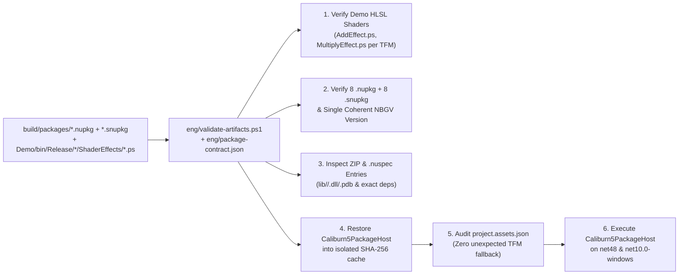

# 09 — Build, Versioning, Packaging & CI Pipeline (Before `.NET 4.8` Retargeting)

> **Baseline Snapshot:** Pre-`.NET Framework 4.8`-only retargeting and optimization (`2026-11-22`).  
> **Scope:** `global.json`, `version.json`, `src/SomaFrameQD.Demo/version.json`, `src/Directory.Build.props`, `src/NuGet.config`, `src/SomaFrameQD.sln`, `eng/package-contract.json`, `eng/validate-artifacts.ps1`, `eng/compatibility/*`, `.github/workflows/ci.yml`, `src/.vscode/launch.json`, and `VNIR.md`.

---

## 1. Toolchain & Deterministic Build Configuration

### 1.1 `.NET SDK` & Test Runner Pin (`global.json`)
`global.json` is the single authority for SDK and test-platform versions across local developer machines and GitHub Actions CI:

| Key | Baseline Value | Effect |
| :--- | :--- | :--- |
| `sdk.version` | `10.0.400` | Pins `.NET 10.0.400` SDK (`rollForward: "latestPatch"`, `allowPrerelease: false`), capable of compiling both `net48` and `net10.0-windows` targets. |
| `msbuild-sdks["MSTest.Sdk"]` | `4.1.0` | Centralizes the `MSTest.Sdk` version imported by `src/SomaFrameQD.Tests/SomaFrameQD.Tests.csproj`. |
| `test.runner` | `Microsoft.Testing.Platform` | Switches `dotnet test` from legacy VSTest to `Microsoft.Testing.Platform` (requiring `--project` CLI syntax). |

### 1.2 NuGet Feed Isolation (`src/NuGet.config`)
`src/NuGet.config` executes `<clear />` before registering a single source (`https://api.nuget.org/v3/index.json`, `protocolVersion="3"`), guaranteeing that machine-local or corporate NuGet feeds cannot inject unlisted transitive packages during `dotnet restore`.

### 1.3 Shared MSBuild Properties (`src/Directory.Build.props`)
Imported automatically by every project beneath `src/`:
- **Package Metadata:** `Authors = Tim Jones`, `RepositoryUrl = https://github.com/tgjones/SomaFrameQD.git`, `PackageProjectUrl = https://github.com/tgjones/SomaFrameQD`, `PackageLicenseExpression = Apache-2.0`, `Copyright = Copyright ©2020 Tim Jones`.
- **Symbol Packages:** `IncludeSymbols = true` and `SymbolPackageFormat = snupkg` so `dotnet pack` emits portable `.snupkg` symbol archives alongside every `.nupkg`.
- **Git-Height Versioning:** Injects `<PackageReference Include="Nerdbank.GitVersioning" Version="3.5.109" PrivateAssets="all" />` into all `src/` projects.

---

## 2. Solution Topology & Project Matrix (`src/SomaFrameQD.sln` + `eng/compatibility/*`)

The repository contains **12 `.csproj` files**: **11 inside `src/SomaFrameQD.sln`** and **1 intentionally standalone package-consumer host** (`Caliburn5PackageHost.csproj`):

| Project Path | In `.sln`? | Pre-Conversion TFMs | Output / Packable | NuGet Package ID | Version Source |
| :--- | :---: | :--- | :--- | :--- | :--- |
| `src/SomaFrameQD/SomaFrameQD.csproj` | Yes | `net48;net10.0-windows` | `Library` (`Packable`) | **`SomaFrameQDWpf`** *(assembly: `SomaFrameQD`)* | Root `version.json` (`0.9.0`) |
| `src/SomaFrameQD.Modules.CodeCompiler/...csproj` | Yes | `net48;net10.0-windows` | `Library` (`Packable`) | `SomaFrameQD.Modules.CodeCompiler` | Root `version.json` (`0.9.0`) |
| `src/SomaFrameQD.Modules.CodeEditor/...csproj` | Yes | `net48;net10.0-windows` | `Library` (`Packable`) | `SomaFrameQD.Modules.CodeEditor` | Root `version.json` (`0.9.0`) |
| `src/SomaFrameQD.Modules.ErrorList/...csproj` | Yes | `net48;net10.0-windows` | `Library` (`Packable`) | `SomaFrameQD.Modules.ErrorList` | Root `version.json` (`0.9.0`) |
| `src/SomaFrameQD.Modules.GraphEditor/...csproj` | Yes | `net48;net10.0-windows` | `Library` (`Packable`) | `SomaFrameQD.Modules.GraphEditor` | Root `version.json` (`0.9.0`) |
| `src/SomaFrameQD.Modules.Inspector/...csproj` | Yes | `net48;net10.0-windows` | `Library` (`Packable`) | `SomaFrameQD.Modules.Inspector` | Root `version.json` (`0.9.0`) |
| `src/SomaFrameQD.Modules.Output/...csproj` | Yes | `net48;net10.0-windows` | `Library` (`Packable`) | `SomaFrameQD.Modules.Output` | Root `version.json` (`0.9.0`) |
| `src/SomaFrameQD.Modules.PropertyGrid/...csproj` | Yes | `net48;net10.0-windows` | `Library` (`Packable`) | `SomaFrameQD.Modules.PropertyGrid` | Root `version.json` (`0.9.0`) |
| `src/SomaFrameQD.Demo/SomaFrameQD.Demo.csproj` | Yes (`Demos`) | `net48;net10.0-windows` | `WinExe` (`IsPackable=false`) | *(not packed)* | `Demo/version.json` (`0.1.0`) |
| `src/SomaFrameQD.Tests/SomaFrameQD.Tests.csproj` | Yes | `net48;net10.0-windows` | `Exe` (`IsPackable=false`) | *(not packed)* | Root `version.json` (`0.9.0`) |
| `eng/compatibility/MahApps.Net10DragHost/...csproj` | Yes (`Compatibility`) | `net10.0-windows` | `WinExe` (`IsPackable=false`) | *(not packed)* | *(outside `src/`)* |
| `eng/compatibility/Caliburn5PackageHost/...csproj` | **No** | `net48;net10.0-windows` | `Exe` (`IsPackable=false`) | *(not packed)* | `0.0.0-local` / CLI prop |

> [!IMPORTANT]
> **Why `SomaFrameQDWpf` Differs From `SomaFrameQD.dll`:**  
> `src/SomaFrameQD/SomaFrameQD.csproj` sets `<PackageId>SomaFrameQDWpf</PackageId>` (inherited from upstream `GeminiWpf` where `Gemini` was already taken on NuGet.org), while keeping `<AssemblyName>SomaFrameQD</AssemblyName>` and `<RootNamespace>SomaFrameQD</RootNamespace>`. Every downstream `.nuspec` internal dependency references **`SomaFrameQDWpf`**, whereas C# `using` directives and pack URIs (`pack://application:,,,/SomaFrameQD;component/...`) use **`SomaFrameQD`**.

---

## 3. Split `Nerdbank.GitVersioning` (`version.json`) Architecture

No `.csproj` or `Properties/AssemblyInfo.cs` file in the repository hardcodes `<Version>`, `[assembly: AssemblyVersion]`, or `[assembly: AssemblyFileVersion]`. Instead, `Nerdbank.GitVersioning` (`3.5.109`) computes version numbers from Git commit height across two independent `version.json` scopes:

1. **Root `version.json` (`0.9.0` — Packable Library Family):**
   - Stamps `0.9.0` (SemVer 2.0) across `SomaFrameQDWpf` and all 7 `SomaFrameQD.Modules.*` packages.
   - `publicReleaseRefSpec`: `^refs/heads/master$` and `^refs/tags/v\d+\.\d+` (requires `fetch-depth: 0` in CI so full git history is present).
   - `pathFilters`: `[ ".", ":!src/SomaFrameQD.Demo" ]` — commits touching **only** `src/SomaFrameQD.Demo` do **not** increment the git-height build number of the published NuGet packages.
2. **`src/SomaFrameQD.Demo/version.json` (`0.1.0` — Demo Application):**
   - Stamps `0.1.0` independently for `SomaFrameQD.Demo.exe`.

---

## 4. Declarative Package & Artifact Verification (`eng/package-contract.json` & `eng/validate-artifacts.ps1`)

`eng/validate-artifacts.ps1` (`461` lines of PowerShell) enforces `eng/package-contract.json` (`137` lines) as a zero-drift release gate after `dotnet build` and `dotnet pack`.

### Exact Checks Performed by `validate-artifacts.ps1`
1. **Compiled Demo Pixel Shaders:** Confirms `AddEffect.ps` and `MultiplyEffect.ps` exist and are non-empty under `src/SomaFrameQD.Demo/bin/Release/<build-tfm>/Modules/FilterDesigner/ShaderEffects/` for every framework in `package-contract.json` (`net48` and `net10.0-windows`).
2. **Exact Package Set & Version Coherence:** Confirms `build/packages` contains **only** the 8 expected `.nupkg` and 8 matching `.snupkg` archives and that all 8 share one identical NBGV package version.
3. **Archive & `.nuspec` Structural Inspection:** Opens every `.nupkg` and `.snupkg` as a ZIP archive and verifies:
   - Exact `lib/net48/<Assembly>.dll` + `.pdb` and `lib/net10.0-windows7.0/<Assembly>.dll` + `.pdb` entries (and matching portable PDBs inside `.snupkg`).
   - Exact `.nuspec` `<group targetFramework="...">` entries (`.NETFramework4.8` and `net10.0-windows7.0`) and exact internal + external dependency versions—including `SomaFrameQD.Modules.Inspector`'s framework-conditional dependency (`System.Drawing.Common` `6.0.0` on `.NETFramework4.8`, empty `{}` on `net10.0-windows7.0`).
4. **Isolated `Caliburn5PackageHost` Restore & Lockfile Audit:**
   - Computes a SHA-256 `packageFamilyHash` across all 8 `.nupkg` files and creates an isolated NuGet `globalPackagesFolder` under `eng/compatibility/Caliburn5PackageHost/obj/package-validation/<hash>`.
   - Restores `Caliburn5PackageHost.csproj` against `build/packages` + `src/NuGet.config`.
   - Parses `project.assets.json` to assert exact `resolvedDependencies` versions (including transitive `System.Text.Json` `10.0.12` on `net48`) and exact `resolvedAssets` DLL paths per framework (e.g., `Dirkster.AvalonDock` resolving `lib/net48/AvalonDock.dll` on `net48` and `lib/net10.0-windows7.0/AvalonDock.dll` on `net10.0-windows`, `AvalonEdit` resolving `lib/net462/...` vs `lib/net8.0-windows7.0/...`, `DotNetProjects.Extended.Wpf.Toolkit` resolving `lib/net40/...` vs `lib/net8.0-windows7.0/...`).
5. **Live Consumer Smoke Execution:** Runs `Caliburn5PackageHost` under both `net48` and `net10.0-windows`.

> [!WARNING]
> **Lockstep Contract Rule for Future Retargeting (`TODO.md` Stage 1, Phase 1.4):**  
> Any change to `<TargetFrameworks>` or `<PackageReference>` versions in packable `src/` projects **will fail `./eng/validate-artifacts.ps1`** unless `eng/package-contract.json` and `eng/compatibility/Caliburn5PackageHost/Caliburn5PackageHost.csproj` are updated in lockstep!

---

## 5. Compatibility Verification Hosts (`eng/compatibility/*`)

### 5.1 `Caliburn5PackageHost` (`eng/compatibility/Caliburn5PackageHost/*`)
Kept **outside `src/SomaFrameQD.sln`** because it references `<PackageReference Include="SomaFrameQDWpf" />` and `<PackageReference Include="SomaFrameQD.Modules.CodeEditor" />` instead of `<ProjectReference>`. On STA startup (`Program.cs`, `178` lines), it asserts:
- Loaded assembly versions: `AvalonDock` `5.0.1.0`, `ICSharpCode.AvalonEdit` `6.3.1.120`, and `DotNetProjects.Wpf.Extended.Toolkit` `5.0.129.0`.
- Caliburn.Micro 5 `Screen` async `Activated` lifecycle completion.
- Instantiation of `AvalonDock.DockingManager`, `CodeEditorViewModel`, `Extended.Wpf.Toolkit` controls, and `SomaFrameQD` built-in VS2013 theme resource loading from consumed NuGet packages.

### 5.2 `MahApps.Net10DragHost` (`eng/compatibility/MahApps.Net10DragHost/*`)
Included in `src/SomaFrameQD.sln` under the `Compatibility` solution folder (`TargetFramework = net10.0-windows`). Documents and verifies the fix for MahApps.Metro issue `#4554` (where `MahApps.Metro` `2.4.9` crashed on `.NET 10` borderless `MetroWindow` title-bar drag due to private `Window.CriticalHandle` reflection removal, resolved by upgrading `MahApps.Metro` to `2.4.11`). Supports `--smoke` headless verification. *(Scheduled for retirement or archival when `net10.0-windows` is removed in Stage 1 of `TODO.md`.)*

---

## 6. GitHub Actions CI & OIDC Publishing (`.github/workflows/ci.yml`)

`.github/workflows/ci.yml` defines a hardened two-job pipeline running on `windows-2025`:

1. **`build` Job (`Build and validate packages`, 30-min timeout):**
   - **Supply-Chain Hardening:** Top-level `permissions: contents: read`; all GitHub Actions pinned to reviewed 40-char commit SHAs (`actions/checkout`, `actions/setup-dotnet`, `actions/upload-artifact`, `actions/download-artifact`); `persist-credentials: false`; `fetch-depth: 0` for NBGV.
   - **Sequential Gates:**
     1. `dotnet restore src\SomaFrameQD.sln --configfile src\NuGet.config`
     2. `dotnet build src\SomaFrameQD.sln --configuration Release --no-restore`
     3. `dotnet test --project src\SomaFrameQD.Tests\SomaFrameQD.Tests.csproj --configuration Release --framework net48 --no-build --no-restore`
     4. `dotnet test --project src\SomaFrameQD.Tests\SomaFrameQD.Tests.csproj --configuration Release --framework net10.0-windows --no-build --no-restore`
     5. `dotnet pack src\SomaFrameQD.sln --configuration Release --no-build --no-restore --output build\packages`
     6. `./eng/validate-artifacts.ps1`
     7. Uploads `build/packages/*.nupkg` and `*.snupkg` as the `nuget-packages` workflow artifact (`retention-days: 14`).
2. **`publish` Job (`Publish approved upstream release`, 15-min timeout):**
   - Guarded by `github.repository == 'tgjones/SomaFrameQD' && github.event_name == 'push' && (github.ref == 'refs/heads/master' || startsWith(github.ref, 'refs/tags/v'))`.
   - **Never checks out source code or rebuilds:** Downloads the exact `nuget-packages` artifact validated by `build`, acquires a short-lived NuGet API key via GitHub OIDC (`permissions: id-token: write` + `NuGet/login@v1`), and pushes `build\packages\*.nupkg` to `https://api.nuget.org/v3/index.json`.

---

## 7. Legacy Artifacts, Provenance (`VNIR.md`) & Git Working-Tree State

- **Codebase Provenance (`VNIR.md`):** Roughly two-thirds of the non-test source files preserve their original 2012–2021 WPF/MEF architecture (derived from Tim Jones's *Gemini* IDE shell), while the Sept–Oct 2026 modernization pass upgraded Caliburn.Micro to `5.0.258`, migrated AvalonDock to `5.0.1`, added transactional layout persistence (`LayoutItemStatePersister`) and `TransitionCoordinator`, built the 146-test characterization suite, and introduced `eng/validate-artifacts.ps1`.
- **Stale Pre-Conversion Tooling Files on Disk:**
  - `src/.vscode/launch.json` still points to `SomaFrameQD.Demo/bin/Debug/netcoreapp3.1/SomaFrameQD.Demo.dll`.
  - `src/SomaFrameQD.Demo/Properties/PublishProfiles/` still holds `FolderProfileNet5.pubxml` (`net5.0-windows`) and `FolderProfileNetCore31.pubxml` (`netcoreapp3.1`).
- **Uncommitted `Gemini` → `SomaFrameQD` Git Working-Tree State:**
  - In the current pre-retargeting working tree, the rename from `Gemini` to `SomaFrameQD` is uncommitted: `git status` shows deleted `src/Gemini*` and `doc/gemini-*` paths alongside untracked `src/SomaFrameQD*` directories. Always enumerate files using filesystem tools (not `git ls-files --cached`) until the working tree is committed.
